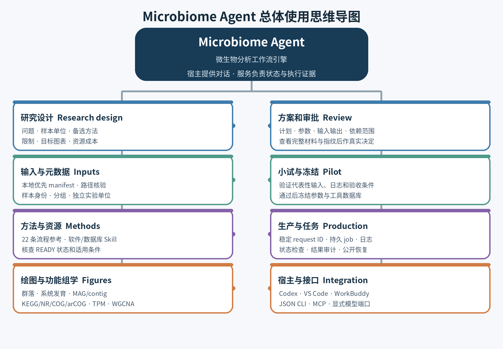

# Microbiome Agent

**微生物生物信息工作流引擎与宿主工具服务 / Host-callable microbial bioinformatics workflow engine**

中文 | [English](#english)



Microbiome 把自然语言研究问题衔接到可审阅、可追踪的微生物生物信息流程。Codex、VS Code 或 WorkBuddy 提供对话模型；Microbiome 提供 JSON/MCP 工具、方法目录、本地资源检查、项目状态、持久任务、预检、冻结与生产记录。

## 功能范围

- 22 条 curated workflow references：扩增子、shotgun、细菌/古菌/真菌 MAG 与 contig、单菌基因组、RNA 与宏转录组、病毒、系统发育、功能注释、宿主去除、移动元件/耐药及基础序列统计。
- 可检查本地输入 manifest、样本身份、软件/数据库登记和冻结计划；支持持久任务与 JSON CLI / MCP 接入。
- 小型本地 FASTA/FASTQ 统计可直接运行；科研分析须经过输入解析、方法与依赖审阅、项目预检和相应验收。
- 可视化技能覆盖群落、系统发育、MAG、contig 基因图、gene TPM 与 KEGG/NR/COG/arCOG 功能展示，并含 R/Python 工具配方。
- WGCNA 指南覆盖矩阵契约、预检、网络构建、eigengene、性状关联和稳定性检查；小样本下需保持探索性解释。

## 快速开始

在 Linux 或 WSL2 上，将发行包安装到一个新的受管目录：

```bash
bash install.sh --prefix /work/microbiome-runtime
/work/microbiome-runtime/bin/microbiome doctor
/work/microbiome-runtime/bin/microbiome export --host codex --output /work/new-codex-adapter
```

安装创建隔离 Python 环境并核验入口。它不会自动安装全部科学软件或下载数据库。把导出的宿主 Skill/MCP 配置检查后合并到宿主配置。也支持 `--host vscode` 和 `--host workbuddy`。

## 推荐工作顺序

1. 明确问题、独立生物学单位、比较设计、目标图表和限制。
2. 初始化项目并解析本地输入 manifest。
3. 查询相关 workflow reference 和本机软件/数据库状态。
4. 比较方法与备选方案，提交可审阅计划和依赖范围。
5. 查看完整决策材料及指纹，在对应项目模式下真实审批。
6. 运行有代表性的预检，查看实际日志、输出身份和资源消耗。
7. 接受预检后冻结方案，明确启动生产并保存真实 job/run ID。
8. 审查结果与图像；失败时使用公开恢复接口和原 run ID。

## JSON/MCP 调用示例

```bash
microbiome-service init \
  --project /work/study --raw-data /data/reads \
  --database /data/microbiome-db --output /work/results

microbiome-service call input.resolve --json \
  '{"project":"/work/study","declaration":"/data/reads/samples.tsv"}'

microbiome-service call catalog.search --json \
  '{"query":"bacterial MAG phylogeny"}'

microbiome-service call project.inspect --json \
  '{"project":"/work/study"}'

microbiome mcp --transport http --port 8765
```

HTTP MCP 绑定 `127.0.0.1`，地址为 `http://127.0.0.1:8765/mcp`。MCP 工具服务不是模型服务或公网调度器。已有 OpenAI-compatible 模型服务只能通过用户明确提供的 URL 连接。

## 图表与功能组学

安装后可将仓库内 `source/docs/agent-guide/skills/microbiome-visualization/` 复制到宿主支持的 Skill 目录。技能说明涵盖图种、输入模式、解释限制、R/base 与 ggplot2/phyloseq/vegan/ape 的参考路线，以及 iTOL、FigTree、Cytoscape、IGV、Python 大树等工作方式。具体软件包仍须在目标环境检查。

功能图保留 gene family 与 contig locus 的区别，保存数据库版本、命中映射、TPM/计数单位、完整/分数分配政策，并区分基因丰度、pathway/module 成员完整度与代谢活动。WGCNA 是统计网络分析；必须检查独立样本数、输入矩阵和性状映射。技能文本不表示 WGCNA 包已安装或真实网络已经计算。

## 数据与生产边界

- 发布包不带真实 FASTQ、用户数据库、运行目录、账号凭据或机器私有配置。
- 本地输入优先；缺失文件是路径/输入问题，不会默认为 SRA 下载请求。
- 已验证为 `READY` 的环境与数据库应复用。生产阶段按冻结计划重放，不安装或改科学参数。
- `CURATED_REFERENCE` 是方法参考，不是可执行状态。包内 catalog/manifest 提供实际发行快照和哈希。
- 预检/合成测试/真实生产分别标记；文件生成或退出码不能单独替代科学验收和图像检查。

## 文档与许可

- [中文与 English 使用手册](Microbiome_Agent_使用手册_中英双语.docx)
- [总体思维导图源码](source/docs/agent-guide/mindmap.mmd)
- [Visualization skill](source/docs/agent-guide/skills/microbiome-visualization/SKILL.md)
- [流程目录](source/docs/workflow_catalog.md)
- [安装与发行包验证](source/docs/packaging.md)
- [许可说明](source/LICENSE)

代码以 Apache-2.0 许可提供；第三方软件和生物数据库遵循各自许可。来源和当前验证边界见 `source/docs/`、`catalog/` 与 `manifest.json`。

## English

Microbiome is a microbial bioinformatics workflow engine exposed to existing agent hosts. The host provides the conversational model. Microbiome provides versioned JSON/MCP operations, a curated workflow catalog, local input and resource inspection, persistent jobs, pretest evidence, frozen plans, and execution records.

### Capabilities

- 22 curated workflow references span amplicons, shotgun profiles, bacterial/archaeal/fungal MAGs and contigs, isolate genomes, RNA-seq and metatranscriptomes, viruses, phylogeny, functional annotation, host depletion, mobile elements/AMR, and sequence statistics.
- Local input manifests, software/database readiness, requirements, plans, decisions, dependencies, durable jobs, and status are accessible through the versioned JSON service and MCP.
- A bounded local FASTA/FASTQ statistics utility can run without a model or scientific project. Full analyses still need project-specific input resolution, design review, dependency planning, pretest, and acceptance.
- The visualization skill documents community ecology, phylogeny, MAG/contig/gene TPM, KEGG/NR/COG/arCOG, and WGCNA figure routes, with R/Python examples and interpretation checks.

### Quick start

```bash
bash install.sh --prefix /work/microbiome-runtime
/work/microbiome-runtime/bin/microbiome doctor
/work/microbiome-runtime/bin/microbiome export --host codex --output /work/new-codex-adapter
```

Install the adapter into an existing host after reviewing the generated settings. VS Code and WorkBuddy are also supported. The installer provisions the Microbiome Python runtime; it does not install every scientific executable or download reference databases.

### Recommended lifecycle

Define the scientific question and independent unit; resolve local inputs; inspect the relevant workflow and resources; compare methods and alternatives; review the complete plan and dependency scope; run and inspect a representative pretest; freeze the accepted workflow; explicitly start production; audit outputs and rendered figures. Use stable request IDs and the documented recovery interfaces for durable jobs.

### Data and interpretation boundaries

The source and release bundle exclude real sample FASTQ files, private databases, local state, model credentials, and user-specific configuration. `CURATED_REFERENCE` means a reviewed method guide, not an installed executable route. DNA-derived TPM is relative gene abundance, not RNA expression or metabolic flux. WGCNA requires adequate independent samples; it is not a causal mechanism by itself. Production replays the frozen, approved contract and does not install or silently change scientific parameters.

See the [full bilingual handbook](Microbiome_Agent_使用手册_中英双语.docx), [visualization skill](source/docs/agent-guide/skills/microbiome-visualization/SKILL.md), [workflow catalog](source/docs/workflow_catalog.md), and release `manifest.json` for the detailed guide and exact packaged inventory.

