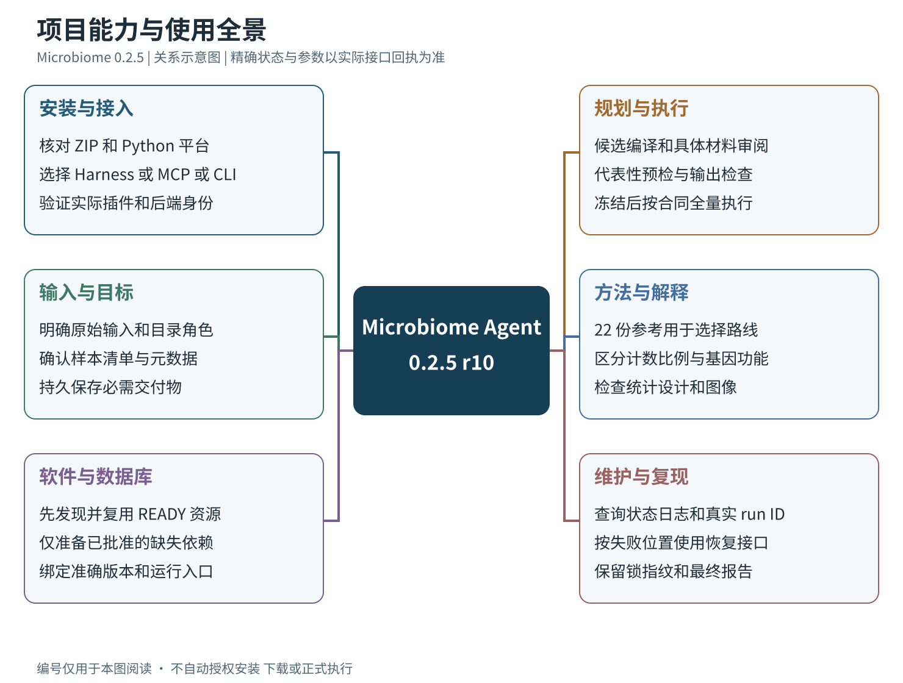

# Microbiome Agent

公开的微生物生物信息工作流引擎与宿主工具服务。当前发行版本 **0.2.5（r10）**，发布于 2026-10-19。

## 完整使用说明书（2026-10-19 更新）

**119 页、约 5 万汉字、8 张流程与思维导图**。涵盖 22 类工作流、107 个软件与 33 个数据库条目，逐项说明用途、输入输出、选择依据与解释边界。

**[在线阅读完整说明书](manual/Microbiome%20Agent%200.2.5%20完整说明书.md)** · **[分章导航](manual/README.md)** · **[Word 下载](https://github.com/ylifc/microbiome-agent/releases/download/v0.2.5/microbiome-manual-0.2.5.docx)** · **[手册资料 ZIP](https://github.com/ylifc/microbiome-agent/releases/download/v0.2.5/microbiome-manual-0.2.5.zip)**

| 阅读主题 | 具体内容 |
| --- | --- |
| [架构与全流程](manual/chapters/01_overview.md) | 组件职责、事实来源、输入、资源、规划、执行和结果验收流程图 |
| [安装与宿主适配](manual/chapters/02_install_adapt.md) | Linux 环境、离线/源码安装、DeepSeek Harness、Codex、VS Code、WorkBuddy、升级、回退与卸载 |
| [操作与恢复](manual/chapters/03_usage_operations.md) | 用户消息模板、输入声明、审阅、依赖准备、预检、冻结、生产、后台任务、预算修复、清理和导出 |
| [软件与分析方法](manual/chapters/04_methods_resources.md) | 输入质量、群落分析、环境基因组、功能注释、RNA、统计、系统发育和可视化；[完整软件数据库附录](manual/reference/catalog-appendix.md) |
| [维护与开发](manual/chapters/05_developer_reference.md) | 接口合同、源码模块、测试、构建打包、身份校验、文件格式与术语 |



[查看完整生命周期图](manual/diagrams/03_lifecycle.svg) · [查看全部图与 Mermaid 编辑源文件](manual/diagrams/)

手册 ZIP 解压后打开 `index.html` 可离线阅读并筛选目录；同时提供 Word、Markdown、SVG、PNG 和 Mermaid 源文件。**完整安装 ZIP 也已包含同一版手册**，位于 `microbiome-0.2.5/manual/`。引擎版本仍为 0.2.5 r10，原始 bundle 与验收证据未改动。手册中旧 ZIP 摘要已标为历史基线，当前下载包使用下方现行校验文件。

## 下载与源码

- [最新版完整安装包 microbiome-latest.zip](https://github.com/ylifc/microbiome-agent/releases/latest/download/microbiome-latest.zip)
- [ZIP SHA-256 校验文件](https://github.com/ylifc/microbiome-agent/releases/latest/download/microbiome-latest.zip.sha256)
- [完整源码快照：microbiome-0.2.5-source.tar.gz](microbiome-0.2.5-source.tar.gz)（888 个文件，含测试、文档、配置模板和安装脚本）
- [0.2.5 修改说明](RELEASE_NOTES_0.2.5.md) · [Harness 安装指南](DeepSeek_Harness_Microbiome_Guide.md) · [第三方许可证补充](THIRD_PARTY_NOTICES.md)
- [本次工程验收报告](VALIDATION_REPORT_0.2.5.md) · [发布文件清单](release-manifest.json)

此仓库采用源码快照和 Release 附件发布。完整引擎源码在上述源码压缩包及完整 ZIP 的 `microbiome-0.2.5/bundle/source/` 内；GitHub 自动生成的 Source code 归档是本仓库的发布资料快照。根目录保留的 0.1.0 包、旧手册、旧 manifest/verification 是历史资料；当前安装与校验以本页、0.2.5 指南和 `release-manifest.json` 为准。

完整 ZIP 为 **96,896,800 字节**，SHA-256：

```text
cb16e1b953cf491057f8d062a8496283698839bc16c0c21ecc69f39010f7d229
```

## 功能与本次修复

Microbiome 为现有宿主提供工作流、维护、资源登记、状态查询、持久后台任务和审阅检查点。宿主提供模型；引擎负责输入合同、资源入口、预检、冻结锁、确定性执行和可核查记录。包含 22 份工作流参考、142 份 Skill，以及 workflow / visualization 宿主接入材料。

0.2.5 修复了规划上下文容量、候选检查点、输入确认事务、有限恢复、资源入口一致性、工具参数合同、命令与验收结果区分、会话导出以及安装身份一致性。原生审阅正文由已校验合同生成，模型原文另存审计材料。

本地输入优先；已验证 READY 软件和数据库复用。生产执行冻结合同，不重新规划、不修改科学参数。代码源自 Biomni，保留 Apache-2.0 许可和原始归属；第三方依赖遵循各自许可。

## 安装

完整 ZIP 的离线 Python wheels 面向 **Linux x86_64 / CPython 3.13**，需要已有兼容 Python。科学工具、R 及参考数据库按批准的任务依赖另行管理。

```bash
sha256sum -c microbiome-latest.zip.sha256
unzip microbiome-latest.zip
cd microbiome-0.2.5/bundle
# DeepSeek Harness 原生集成
python3.13 scripts/install_harness.py --bundle . --offline
# 或独立 CLI 安装
MICROBIOME_INSTALL_PYTHON=python3.13 bash install.sh --prefix "$HOME/.local/share/microbiome-runtime"
```

升级、回退和宿主配置以新版 [安装与适配章节](manual/chapters/02_install_adapt.md) 为准。此次更新补入完整手册；已验收代码、插件、依赖 wheels 和原始测试记录未改变。

## 验证与已知边界

- 131 项相关 Python 回归通过，包含 `tests/test_frozen_pipeline.py`；25 项审阅/恢复专项通过（测试集合有重叠）。
- 60 项 Node 宿主测试通过，无跳过。
- 本机 DeepSeek Harness 0.1.0-rc.12 的真实模型任务以人工数值 TSV 完成规划、批准、预检、冻结、生产和导出；独立审计 49 项通过。
- 验证不是全部真实生物分析流程的科学验收，未覆盖真实参考下载/索引构建、复杂科学流程或 Electron UI。验收中一次分页参数缺失经补齐恢复；摘要的诊断状态和大整数显示问题仍记录在报告中。

ZIP 包含精选工程验收日志和人工测试会话，可能出现本地路径、用户名和测试标识；不包含账号密钥、完整宿主配置或真实样本数据。

## English

Microbiome is an Apache-2.0 bioinformatics workflow engine for existing agent hosts. Version 0.2.5 r10 provides complete source, matching Harness integration, offline Python dependencies, workflow/visualization guidance, tests and curated engineering validation evidence. Download the complete ZIP from Releases or the separate 888-file source snapshot above. The bundled wheels target Linux x86_64 / Python 3.13.

The native Harness synthetic TSV task reached COMPLETED and passed 49 independent audit checks. This verifies software execution for that task; it does not certify every scientific workflow. See the release notes, installation guide and validation report for capabilities and remaining limitations. Earlier root-level artifacts are retained as historical references.

The complete Chinese manual is now available online and inside the installation ZIP: 119 pages, 8 diagrams, installation, host adaptation, operations, recovery, software/database catalog and analysis methods. The executable bundle remains unchanged.
