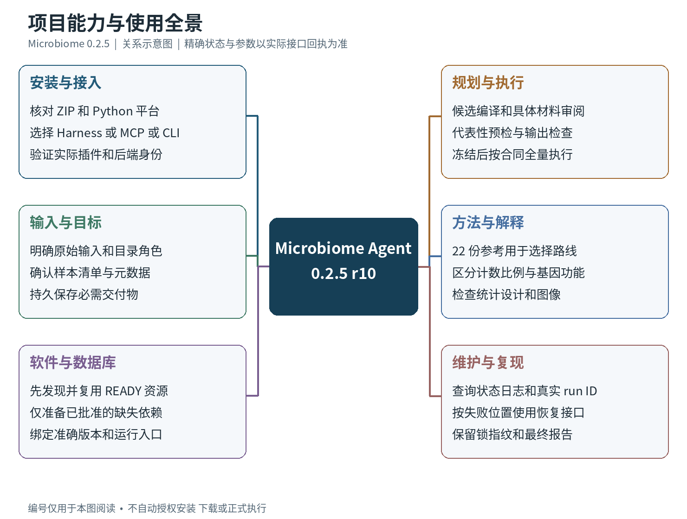
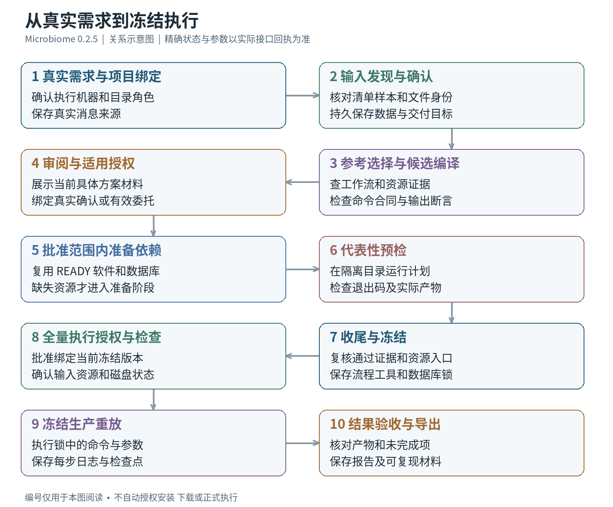
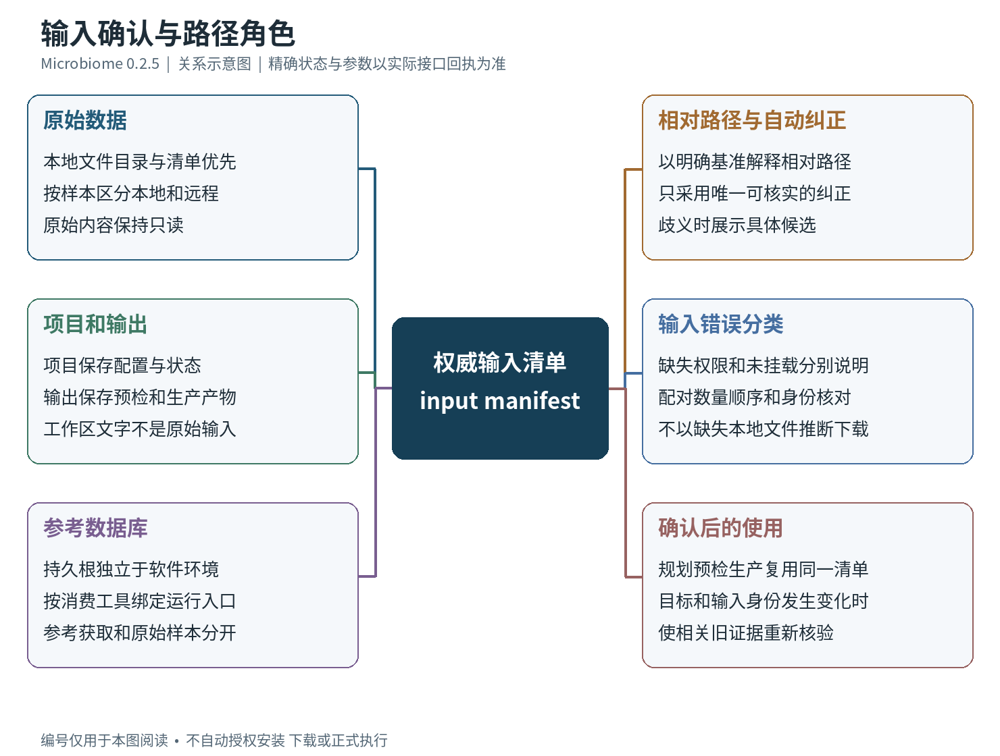
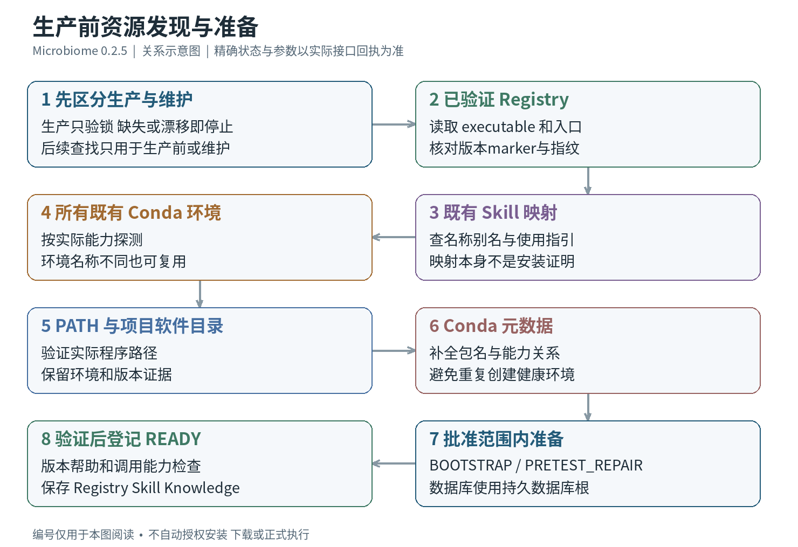
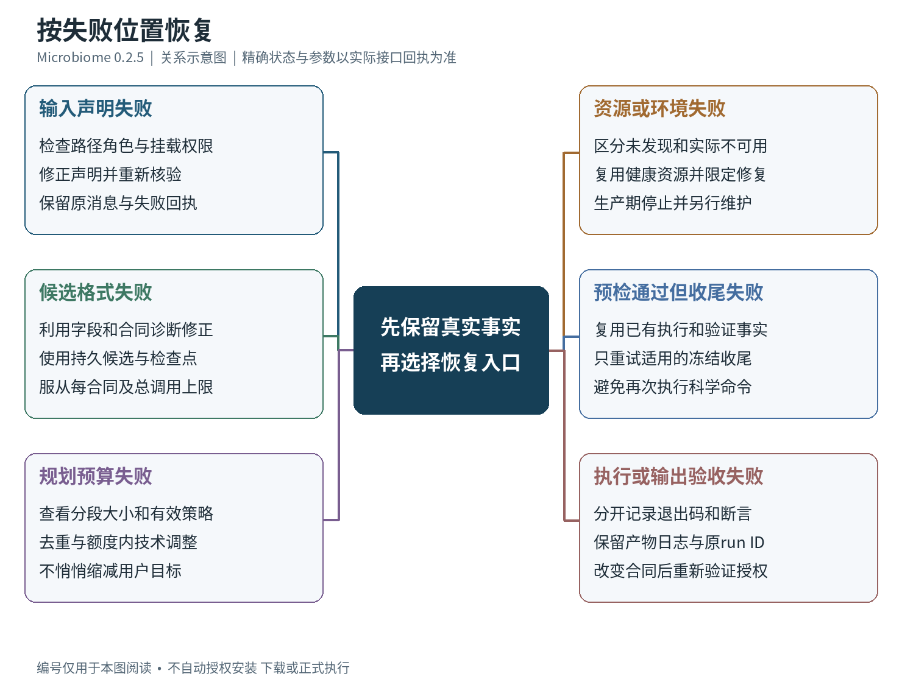
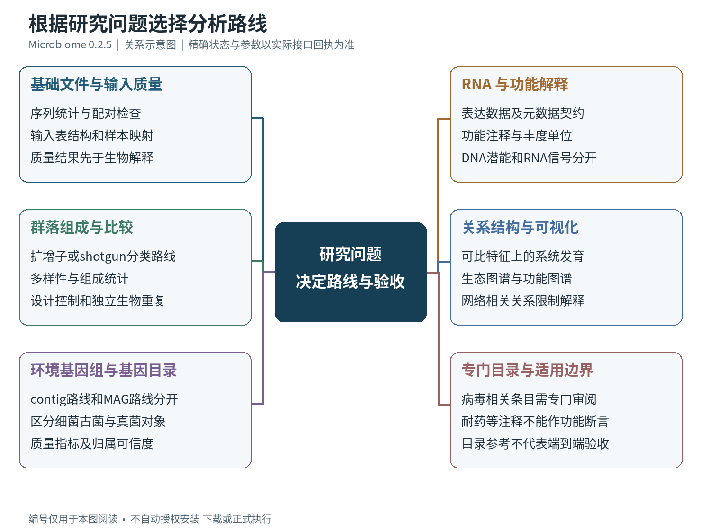
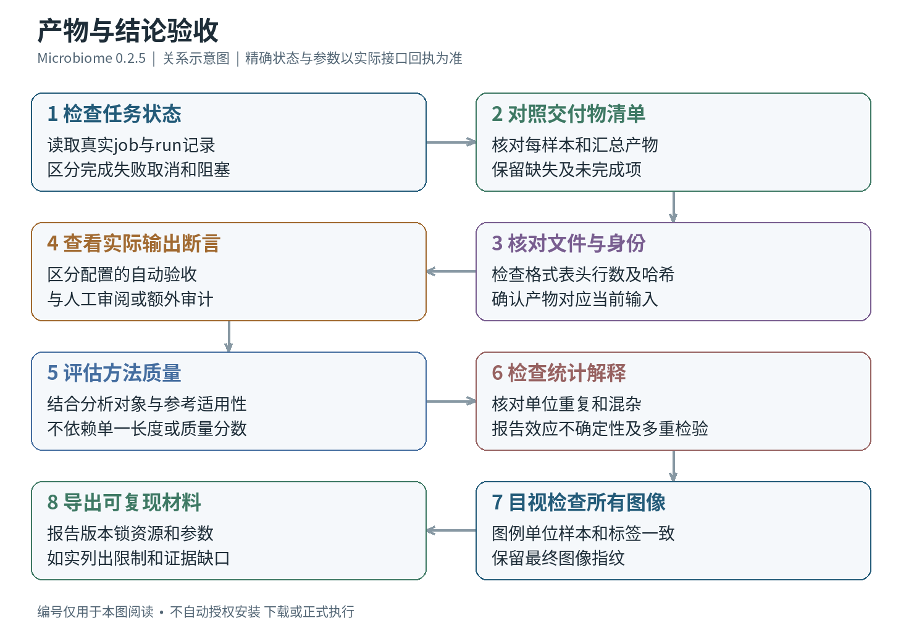

# Microbiome Agent 0.2.5 完整说明书

安装 · 适配 · 使用 · 方法 · 运维

版本范围：0.2.5 r10｜编写日期：2026-10-19｜源码与实测边界见第一篇及第五篇。

# 第 1 篇　认识系统与流程思维导图

## 1.1 版本范围与阅读方法

本说明书面向使用 Microbiome Agent 的研究人员、安装维护人员和宿主集成开发者。它说明如何取得正确版本、安装与接入宿主、表达任务、检查输入与依赖、审阅方案、完成预检和冻结执行，以及如何判断结果和恢复失败。方法章节以环境微生物、普通统计任务与人工数据为示例；涉及特定病原的目录条目只介绍用途、输入输出及解释边界。

本书对应 2026 年 10 月 19 日公开的 **Microbiome 0.2.5 r10**。当前公开仓库为 https://github.com/ylifc/microbiome-agent ，固定版本发布页为 https://github.com/ylifc/microbiome-agent/releases/tag/v0.2.5 。仓库使用源码快照与 Release 附件发布；完整源码在 `microbiome-0.2.5-source.tar.gz` 与完整 ZIP 的 `bundle/source/` 内。仅查看仓库根目录的历史手册，可能会读到 0.1.0 或 0.2.0 的接口说明。

“agent”在这里指模型与受约束工具共同工作的系统。模型负责理解问题、提出候选和解释回执；Microbiome 后端负责验证字段、管理项目事实、控制写入范围和执行命令。自然语言中写出“完成了”不等于磁盘上已经有合格结果。使用者应以当前项目的结构化状态、实际执行记录、输出检查和冻结版本为依据。

### 1.1.1 本版发布身份

| 项目 | 本书采用的事实 |
| --- | --- |
| 引擎版本 | 0.2.5 r10 |
| 初始发布资料提交 | 37b453eccc16a30ae565ef838fe9179c02e47b23 |
| 初始 ZIP 大小 | 92,992,994 字节 |
| 初始 ZIP 文件项 | 1,433 项 |
| 完整源码文件 | 888 个 |
| 工作流参考 | 22 份 |
| Skill 清单 | 107 软件资源、33 数据库资源、2 宿主 Skill |
| 离线 wheel 适用平台 | Linux x86_64 与 CPython 3.13 |
| 实际原生宿主验收 | DeepSeek Harness 0.1.0-rc.12 的服务和 agent loop |

初始公开 ZIP 的 SHA-256 为 `ca49adc748334ec99bb3bceb59f9ffefb34ae99303aadeae77d939a15c75c1ac`，以上数字是历史验收基线。本次补入完整手册后，ZIP 大小、条目数和摘要均已更新，已验收的引擎 bundle 不变。现行身份以 Release 的 `microbiome-latest.zip.sha256` 和仓库 `release-manifest.json` 为准；不要用上述旧值校验更新包。

### 1.1.2 不同读者的阅读路线

第一次使用的研究人员，应先阅读系统组成和总流程图，再完成安装章节的最小检查，随后使用“真实用户消息”的任务模板。先确认路径、样本与预期产物，再审阅方案，不需要自己编写内部审批记录或冻结 JSON。

负责执行服务器的维护人员，应完整阅读安装、目录角色、软件与数据库、权限、备份恢复和验证章节。维护的核心是保存已经验证的资源身份，并让新安装、下载或修复发生在允许的阶段；不要因一个环境名字与建议不同，就删除健康环境重新安装。

接入其他宿主的开发者，应重点阅读原生 Harness、MCP、JSON CLI 的差异、消息来源、参数契约、幂等任务、错误分类和开发者验证章节。同名工具出现在两种宿主中，也可能拥有不同签名和调用责任，不能只复制工具名。

### 1.1.3 书中标记的含义

| 标记或表述 | 使用含义 |
| --- | --- |
| 已实测 | 有当前版本的真实运行或测试证据，并在相关位置说明范围 |
| 代码支持 | 源码和契约存在该接口；不表示所有宿主或科学数据均已测试 |
| 方法参考 | 用于选型与审阅的指南，需要形成当前项目的具体合同 |
| 示意路径 | 例如 `/work/demo-project`，必须替换为执行机器实际路径 |
| 示例消息 | 用户可根据真实任务改写的表达方式，不是预先存在的授权 |
| 回执示意 | 用来解释字段，不能直接写入项目作为真实执行证据 |

目录、样本 ID、比较组、数据库版本和输出文件名是不同概念。说明书会分别解释它们，避免将“有一个目录”当成“资源 READY”，将“生成一个文件”当成“科学目标已经满足”。

## 1.2 系统组成与事实来源

### 1.2.1 从用户消息到实际文件

一次分析由用户给出真实需求开始。宿主将消息和当前项目绑定；后端先解析输入，再把相关工作流参考、资源状态和已确认要求交给规划器。规划器提出候选，编译器将候选转成可校验合同。经适用的真实审阅和批准后，系统准备批准范围内的依赖，执行代表性预检，保存通过的证据，生成冻结锁，再执行全量任务。

用户看到的聊天窗口只是其中一个界面。实际运行发生在后端所在的执行机器上；它所能读取的路径、可执行程序、数据库以及内核隔离能力，都取决于那台机器。浏览器能打开文件、宿主能看到附件、远程服务器能读取目录，是三件需要分别验证的事。

### 1.2.2 五个功能层

| 层 | 主要职责 | 不能替代的事实 |
| --- | --- | --- |
| 宿主模型与对话 | 理解需求、提议方案、调用工具、解释结果 | 不能以叙述代替真实批准或运行 |
| 接入与工具合同 | 原生插件、MCP、JSON CLI、条件参数校验 | 工具显示在列表里不表示本机依赖齐备 |
| 项目与规划 | 输入清单、需求版本、候选、检查点、预算 | 通过 schema 不等于实际命令通过 |
| 资源基础设施 | 软件登记、数据库入口、Skill、Knowledge | 指南中的路径和历史命令不是当前事实 |
| 验证与执行 | 预检、冻结锁、生产、日志、断言、报告 | 退出码为零不等于全部输出验收通过 |

这种分工允许技术问题在合适的位置修复。例如，输入误识别应修正声明与清单；候选格式不合法应修正候选；模型上下文不足应检查有效预算和宿主容量；输出断言失败应保留真实命令退出事实，再分析断言和输出。把这些问题一律归为“权限不足”会导致错误的处理路径。

### 1.2.3 当前项目的事实优先级

生产执行依据当前有效冻结锁、批准绑定、已确认输入和验证过的资源。进入生产前，位置和版本事实来自已验证的 Registry；资源 Skill 用于解释如何使用，Knowledge 保存成功和失败的经验。工作流 GUIDE 用于选型与设计。聊天摘要帮助理解上下文，但不能覆盖持久清单、锁或实际运行回执。

软件的“可用”必须至少能回答：真实 executable 在哪里、对应哪个环境、探测到什么版本、执行能力如何验证、当前项目是否批准使用它。数据库的“可用”必须能回答：资源身份和版本是什么、根目录在哪里、每个 consumer 使用哪一个文件或索引入口、marker 和指纹是否一致、获取来源与验证是否齐全。

### 1.2.4 为什么先确认输入再设计分析

路径通常会同时出现在原始数据、数据库、项目工作区、输出、安装环境和说明文字中。后端应先确定角色，再确认存在性和可读性。已确认的输入清单具有持续效力，后续聊天中的模糊路径不应使它变成别的数据来源。目录未挂载、文件不存在、当前身份没有权限和符号链接越界，也应给出不同诊断。

任务目标同样需要持久保存。例如，“按样本给出清洗后的统计表及质量汇总”是交付要求；候选缩减或预算修复不能悄悄删除其中一项。计划的每个要求都应找到对应步骤、产物和验收依据。只有结构化目标与实际可执行断言都清楚，审阅才有意义。

## 1.3 完整流程思维导图

这些图描述功能与执行关系。图中的简短中文节点用于阅读，不替代后端返回的精确枚举名；精确状态和参数见后面的接口与排错章节。单独的 SVG 可放大查看，PNG 适合插入报告，Mermaid 文件可继续编辑。

### 1.3.1 项目全景



图 1 将安装接入、输入设计、资源管理、执行验证、结果解释和维护联系起来。阅读具体分析路线之前，先确认安装与输入两条分支；仅有软件名称和研究目标还不能形成可执行任务。

### 1.3.2 安装与宿主选择


图 2 中的原生 Harness、MCP 和 JSON CLI 是不同接入路径。原生插件使用宿主原有的模型路由和后台任务能力；MCP 由支持协议的客户端调用；JSON CLI 适用于脚本或能够执行命令的宿主。每条路径均需核对实际安装身份。

### 1.3.3 从任务提出到冻结生产



图 3 中的审阅节点需要真实、适用的授权来源。某些项目已经配置了有范围的真实委托，后端可以据此确认允许的材料；没有这份委托时，应向用户展示具体材料。授权变化、需求变化或冻结内容变化都需要按当前契约重新核验。

### 1.3.4 输入角色与清单



图 4 强调清单是后续分析的共同输入。将某个样本从一个文件改成另一个文件，会影响输入身份和下游证据；纯粹补足明确且唯一的路径表达则应保留原始来源和修正记录。

### 1.3.5 软件与数据库就绪



图 5 描述生产前及维护阶段的资源发现顺序。冻结生产只按既有锁核验；缺失或漂移时立即停止，不沿图中后续步骤搜索替代资源或安装。只有发现现有资源无法满足能力和版本合同，并且安装或获取属于当前批准范围时，才能进入相应准备动作。READY 的含义是已经验证的持久资源，不是可随意覆盖的缓存。

### 1.3.6 失败分类与恢复



图 6 把规划失败、输入失败、预检收尾失败和真实执行失败分开。尤其是命令成功而后置验收失败的情况，系统应保留退出码与日志，不能重写成“命令没有运行”。对已通过预检的收尾失败，也应优先复用既有证据。

### 1.3.7 分析路线选择



图 7 按研究问题分组，不表示各分支都需要运行。群落分类、基因功能、基因组恢复和系统发育回答的问题不同；统计比较还要求可用的独立样本与元数据。完整的 22 项目录及其限制在方法章节逐项解释。

### 1.3.8 产物与结论验收



图 8 将文件检查、身份核对、方法质量、统计解释和图像检查放在同一条验收链上。自动检查能证明其实际配置的条件；不在合同中的科学判断，应作为人工审阅项明确列出，不能写成引擎已经自动保证的结论。


# 第 2 篇　安装、升级与宿主适配

本章面向 Microbiome **0.2.5（r10）公开发行包**。安装目标分为两条独立路线：使用 DeepSeek Harness 原生模式，或者安装通用 CLI 后接入 Codex、VS Code、WorkBuddy。两条路线使用相同发布源码与后端 wheel，但安装位置、启动入口和升级命令不同。用户可以同时安装两者；安装其中一条不会自动激活另一条。

本章命令已经对照该发行包的安装器、参数解析代码及安装后的 `--help` 核实。示例中的 `/srv/...` 是应替换的执行机器路径；命令不会因为文档展示而自动执行。安装、验证与升级均应由拥有相应目录权限的普通用户运行。软件包声明支持 Python 3.11+，本次公开的离线依赖包则限定为 **Linux、x86_64、Python 3.13 次版本**。这些声明不能互换。

## 2.1 先认识四层组件

**宿主层**负责聊天、模型、账号、会话和工具调度。DeepSeek Harness、Codex、VS Code 与 WorkBuddy 都属于这一层。宿主须先能够正常使用；Microbiome 安装器不会替用户创建模型账号、购买额度或者修复宿主登录。

**Microbiome 引擎层**包含输入合同、规划、状态机、资源注册、预检、冻结执行、诊断、恢复和报告。主程序使用专用 Python 虚拟环境，与用户既有 Conda 环境分开。普通 CLI、MCP 和 doctor 不需要模型密钥，也不会自动连接模型。

**科学软件层**是具体分析需要的外部可执行程序、R 包和相关运行环境。软件知识 Skill 的存在，仅代表包中具有使用指导。是否已经安装、版本是否合适、实际执行文件在哪里，必须在执行机器上探测。安装引擎不会一次性安装目录中列出的全部软件。

**数据资源层**包括原始文件、样本清单、数据库、索引、项目结果和审计证据。原始输入和持久数据库分别管理；数据库不放进 Python venv 或 Conda 环境。已有 READY 资源应被复用，其路径和版本不能在生产中自动替换。〔I01、I02〕

安装路径与各层关系参见第一篇图 2“安装与适配决策”；安装后的完整运行阶段参见图 3。

## 2.2 平台、目录和权限准备

### 2.2.1 已验证范围与未验证范围

| 项目 | 本发行包的事实 | 安装时如何理解 |
| --- | --- | --- |
| 后端版本 | 0.2.5 | 版本号相同仍应比较发布清单和插件指纹 |
| 离线构建解释器 | Python 3.13.13 | 安装器核对 3.13 次版本，不要求完全相同补丁号 |
| 离线平台 | Linux、x86_64 | 不可把该 wheelhouse 当作 macOS、ARM 或 Windows 原生依赖包 |
| 源码 Python 声明 | 3.11+ | 表示源码包声明；依赖解析和目标平台仍要重新验收 |
| Harness | 0.1.0-rc.12 | 验收覆盖原生宿主服务、模型桥接、工具与状态链路 |
| Harness 桌面 UI | 本轮未验收 | 不能把服务测试写成所有 Electron 界面操作均已通过 |
| Codex、VS Code | 有 Skill 导出和 MCP 配置模板 | 导出与协议检查不等于各客户端版本的完整现场分析实测 |
| WorkBuddy | 有本地 Skill 和统一 CLI | 导出器没有生成 WorkBuddy MCP 配置文件 |

Windows 用户可在合适的 Linux/WSL2 执行环境中部署，但本发行验收没有覆盖所有 WSL2 发行版和宿主组合。关键是 Python、Microbiome、数据和实际命令运行在同一套可见的 Linux 路径环境里。macOS 或 ARM 用户应重新构建匹配依赖并测试；Harness 安装器本身明确要求 Linux。〔I03、I04〕

建议把运行时、原始数据、项目、数据库和下载暂存分开。例如：

```text
/srv/microbiome/
  releases/                 下载与解压后的发行包
  runtimes/                 独立 CLI 安装根目录
  raw/environment-study/    用户原始数据，只读使用
  projects/environment-study/  项目状态、计划和证据
  results/environment-study/   分析输出
  databases/                持久数据库和索引
  downloads/                经批准的下载与暂存
```

这些目录只是组织建议，不是必须逐字使用的硬编码布局。用户主目录中的普通目录也可以使用。原始数据目录应只包含用户希望分析或声明的数据，不能把整个主目录当作原始输入。项目目录应由当前用户写入；数据库目录根据组织管理方式设置读取或维护权限。不要通过把全部目录改成任何人可写来解决路径错误。

首次安装前可以在执行机器上检查基础条件：

```bash
uname -s
uname -m
python3.13 --version
python3.13 -m venv --help
command -v bwrap
df -h "$HOME"
```

`command -v bwrap` 只能证明找到了程序，不能证明内核允许其创建所需命名空间。引擎的原生命令、软件探针及批准后的资源维护使用 bubblewrap 建立文件边界；缺失 `bwrap` 或用户命名空间不可用时，会明确返回 `FILE_POLICY_UNAVAILABLE`。此时规划和部分只读维护仍可用，但执行不能继续。不要把这个错误解释成数据损坏，也不要去掉执行边界作为安装修复。组织管理员应按其系统标准配置 bubblewrap 和命名空间，再运行合成验收。〔I05〕

内存与磁盘没有一个对全部分析通用的固定最低值。主引擎、科学软件、数据库、原始数据和中间结果分别消耗空间；实际任务应在依赖和资源预检时评估。公开 ZIP 大约 93 MB，不代表安装后或科学分析只需要这一容量。离线安装只解决 Python 依赖来源，不提供离线模型、离线检索或尚未取得的科学数据库。

### 2.2.2 带空格路径如何写

Shell 中每一个带空格的路径都要加引号，例如 `"/opt/DeepSeek Harness/resources/app"`。变量被用作路径时写成 `"$MICROBIOME_PREFIX"`，不能省略引号。JSON、TOML、YAML 又有自己的字符串规则；不要把 Shell 的引号写进 JSON 路径值内部。路径文字中的 `>` 在 Shell 中是重定向符，在自然语言里又可能只是分隔符，因此推荐用“原始数据目录：……；项目目录：……”明确标明角色。

安装器可以接受带空格的普通路径，但路径必须属于正确机器、存在或可按规则创建，并符合所有权检查。尽量使用真实目录路径，避免在受控写入根中依赖符号链接；执行文件策略会拒绝部分符号链接穿越。引号正确只能解决参数分割，不能解决目录不存在、挂载缺失或权限不足。

## 2.3 下载、校验和解压公开发行包

项目公开仓库为 [ylifc/microbiome-agent](https://github.com/ylifc/microbiome-agent)，本章固定版本对应 [v0.2.5 发布页](https://github.com/ylifc/microbiome-agent/releases/tag/v0.2.5)。建议从 Release 下载已经构建的 `microbiome-latest.zip`，不要把 GitHub 自动生成的“Source code ZIP”当作含完整离线 wheelhouse 的安装包。

2026-10-19 初始公开包的历史验收基线如下（不用于校验更新包）：

```text
文件：microbiome-latest.zip
字节数：92992994
ZIP 条目数：1433
SHA256：ca49adc748334ec99bb3bceb59f9ffefb34ae99303aadeae77d939a15c75c1ac
```

可在一个新的下载目录执行：

```bash
mkdir -p "$HOME/Downloads/microbiome-0.2.5-download"
cd "$HOME/Downloads/microbiome-0.2.5-download"
curl -fL -o microbiome-latest.zip \
  https://github.com/ylifc/microbiome-agent/releases/download/v0.2.5/microbiome-latest.zip
curl -fL -o microbiome-latest.zip.sha256 \
  https://github.com/ylifc/microbiome-agent/releases/download/v0.2.5/microbiome-latest.zip.sha256
sha256sum -c microbiome-latest.zip.sha256
unzip microbiome-latest.zip
cd microbiome-0.2.5/bundle
```

如果下载目录已有同名包，先确认它是否需要保留，再换一个新的下载目录；不要把多次不同发布解压到同一个旧目录。校验输出应为 `microbiome-latest.zip: OK`。如果校验失败，先检查下载是否完整、校验文件是否属于同一次发布，保留失败文件供诊断并重新下载。SHA256 可检测传输和文件差异，不能单独替代可信来源认证。

本次文档更新在 ZIP 的 bundle 外补入完整手册，引擎 bundle 和原始验收证据不变。当前 ZIP 身份以同一 Release 的 `.sha256` 文件及仓库 `release-manifest.json` 为准。本章旧摘要仅用于追溯初始公开包，不能校验补入手册后的更新包。

解压后应看到以下主要内容：

```text
microbiome-0.2.5/
  bundle/
    manifest.json              发布文件清单与摘要
    README.md、RELEASE.md       安装入口与平台说明
    install.sh                 通用 CLI 安装
    upgrade.sh                 通用 CLI 升级
    uninstall.sh               停用通用 CLI 入口
    scripts/                   安装器与验证器
    wheels/                    Microbiome 后端 wheel
    wheelhouse/                本平台的离线 Python 依赖
    requirements.lock          依赖约束
    harness/                   匹配的原生模式和插件
    source/                    888 个文件的源码快照
    skills/、workflows/         Skill 与工作流资料
    catalog/                   能力、源码和资源目录清单
    examples/                  合成数据演示
  validation/                  选定的验收记录与公开补充说明
```

`manifest.json` 管理 bundle 的文件完整性。不要在 bundle 内直接改配置、生成测试结果或保存临时缓存后再声称仍是原始发行包。安装器会逐文件验证清单；验证输出应写到 bundle 之外的新目录。项目和数据库也不应建在解压包内部。〔I06〕

## 2.4 路线 A：安装通用 CLI

### 2.4.1 标准离线安装

下面命令在解压后的 `bundle/` 中执行。`--prefix` 指定的目录必须尚不存在，或者已经是本安装器管理的目录。父目录可以存在；不要事先手工创建这个专用 prefix 的空目录，因为现有但没有管理标记的目录也会被拒绝。

```bash
MICROBIOME_PREFIX="$HOME/.local/share/microbiome-runtime"
MICROBIOME_INSTALL_PYTHON=python3.13 \
  bash install.sh --prefix "$MICROBIOME_PREFIX"
"$MICROBIOME_PREFIX/bin/microbiome" --version
"$MICROBIOME_PREFIX/bin/microbiome" doctor
```

`MICROBIOME_INSTALL_PYTHON` 决定安装脚本使用哪个 Python 解释器。发行包中的 `install.sh` 默认加上 `--offline`，因此不会因为机器上刚好有其他 Python 就自动重新解析一套在线依赖。如果 `python3` 实际是 3.11 或 3.12，应明确使用 3.13；不要靠改 wheel 文件名规避平台检查。

安装器依次完成完整性校验、解释器和平台核对、专用 venv 创建、受约束的 wheel 安装、入口映射核对、doctor 和 `pip check`，最后生成受管理的启动链接。安装器不会修改 shell 配置文件。正常完成后，会返回实际安装目录、运行时目录、PATH 提示和后续导出命令。〔I07〕

受管理布局类似：

```text
~/.local/share/microbiome-runtime/
  .microbiome-portable.json    管理标记、活动运行时与历史运行时
  bin/
    microbiome                当前 CLI
    biomni                    兼容命令别名
    microbiome-run            同一 CLI 的别名
    microbiome-service        JSON 工作流服务 CLI
    microbiome-mcp            MCP 入口
  runtimes/<随机标识>/
    bin/python                此次安装的专用解释器
    bin/...                   实际控制台入口
    installation-check.json  安装自检结果
```

`microbiome`、`biomni`、`microbiome-run` 在此版本指向相同的新 CLI。直接输入 `microbiome` 显示帮助，不会自动启动旧版聊天 Agent。兼容入口 `microbiome-legacy-run` 等仍存在于发行包的 Python 入口定义中，但不属于本章推荐安装后的日常启动路径。

为了避免 PATH 冲突，首次验收始终使用完整路径。确认正常后，可在当前终端临时加入：

```bash
export PATH="$HOME/.local/share/microbiome-runtime/bin:$PATH"
microbiome --version
microbiome doctor
microbiome call catalog.list
```

是否把 PATH 配置持久写入 shell 启动文件由用户自行决定；安装器没有代做这一步。若 `microbiome --version` 与完整路径输出不同，说明命中了其他安装入口，应先检查 `command -v microbiome`，再调整 PATH，而不是反复安装。

### 2.4.2 安装状态的正确解读

`doctor` 中 `ok: true` 表示包和基础接口检查通过；`model_owner: host` 表示模型由宿主负责；`model_connection: NOT_REQUESTED` 表示没有发起模型请求；`scientific_runtime: NOT_PROBED` 表示还没有验证具体科学软件和数据库。`file_execution_policy` 中可能显示已发现 bwrap，但 `kernel_probe: NOT_REQUESTED` 仍表示这次 doctor 没有运行内核命名空间探针。不要把这些“未检查”字段误读成“已可运行全部分析”。〔I08〕

如果看到 `already_installed`，说明该 prefix 已启用受管理运行时，普通安装请求没有替换它。需要升级时使用 `upgrade.sh`。如果提示非受管理目录，选一个新的 prefix；不要在已有 Conda 环境中伪造 `.microbiome-portable.json`。

### 2.4.3 在线安装与源码开发安装

离线发行包适合复现当前构建。在线安装适合需要重新解析依赖的目标机器，仍须满足平台和执行边界要求。在 `bundle/` 中直接调用 Python 安装器且不传 `--offline`，可走在线依赖路径：

```bash
python3.13 scripts/install_portable.py \
  --bundle . \
  --prefix "$HOME/.local/share/microbiome-online-runtime"
```

这会联系当前 pip 配置所指定的软件来源；具体结果取决于包索引、代理及可用 wheel。它不等于“任意平台保证兼容”。已发布的 `requirements.lock` 仍会作为约束使用。

若要修改和调试源码，应从 `bundle/source/` 开始，并使用另一套新 venv。开发环境示例如下：

```bash
cd /实际解压目录/microbiome-0.2.5/bundle/source
python3.13 -m venv "$HOME/.local/share/microbiome-dev-0.2.5"
"$HOME/.local/share/microbiome-dev-0.2.5/bin/python" -m pip install -e .
"$HOME/.local/share/microbiome-dev-0.2.5/bin/python" -m microbiome.cli doctor
```

`pip install -e .` 是开发安装，源码修改会影响后续导入；它不生成可追溯的新发布 ZIP，也不自动更新已经安装的 Harness preset。完成修复后，应重新构建、安装和验收再部署。不要把修改过的开发目录当作冻结生产运行时。开发安装使用普通 Python venv，与受管理 CLI prefix 是不同布局，不能对这个开发 venv 直接调用 `upgrade.sh --prefix`。

## 2.5 路线 B：安装 DeepSeek Harness 原生模式

### 2.5.1 安装之前明确宿主位置

DeepSeek Harness 应先正常启动并能使用其现有模型服务。本模式沿用宿主的模型路由与凭据，不要求用户在 Microbiome 中再次填写模型名、API Key 或模型地址。公开包不包含模型权重，也不会把其他机器的宿主账号迁移过来。

`DSH_HOME` 是 Harness 的状态目录。默认安装器使用环境变量 `DSH_HOME`，未设置时采用 `~/.dsh`。`--preset-root` 是模式搜索根目录，默认是 `DSH_HOME/.agent-presets`；这与程序安装目录不是一回事。`/opt/DeepSeek Harness/resources/app` 是本次验证机器上的应用目录示例，不是所有机器的默认安装路径。

如果用户改过宿主启动环境、状态根或 preset 搜索位置，应使用实际值。多个搜索根存在同名模式时可能发生遮蔽；仅看到磁盘上有 `microbiome` 文件夹不能证明当前会话加载了它。

### 2.5.2 正式安装命令

在 `bundle/` 中执行：

```bash
python3.13 scripts/install_harness.py \
  --bundle . \
  --dsh-home "$HOME/.dsh" \
  --offline
```

如果已经知道 Harness 应用或源码目录，可以要求安装器读取其中的 `package.json` 检查版本：

```bash
python3.13 scripts/install_harness.py \
  --bundle . \
  --dsh-home "$HOME/.dsh" \
  --harness-source "/opt/DeepSeek Harness/resources/app" \
  --offline
```

`--harness-source` 名称含有 source，但实现读取的是该目录下的 `package.json`；应给出确实含该文件的实际应用或源码目录。没有传此参数时，安装器说明宿主服务会在模式加载时检查，不能将其解释为已经验证了机器上任意 Harness 版本。

只有使用非默认模式根目录时才加：

```bash
python3.13 scripts/install_harness.py \
  --bundle . \
  --dsh-home "/实际/DSH状态目录" \
  --preset-root "/实际/preset搜索目录" \
  --offline
```

`--allow-untested-harness` 是允许继续尝试未列入版本清单的宿主版本的显式选项。它只绕过安装器的版本限制，不补齐缺失服务，不改变协议，也不证明兼容。一般用户应使用已验证版本；适配开发者才在独立环境中使用此选项并补做验收。〔I04〕

### 2.5.3 安装器具体做什么

Harness 安装器先验证 bundle，再根据“版本号 + manifest 摘要前缀”选择专用运行时目录。它创建 venv，安装后端和依赖，运行 doctor 与 `pip check`，保存发布清单和文档，比较实际导入的关键后端文件身份，然后在暂存目录准备 preset、插件、`runtime.json` 和管理标记。

存在旧受管理模式时，安装器使用 Linux 原子目录交换切换活动入口并保留旧模式备份。检查失败时保留旧入口；若文件系统不支持所需交换操作，应解决部署文件系统条件，不能直接删旧目录强行安装。非受管理的同名模式会被拒绝覆盖。

```text
DSH_HOME/
  .agent-presets/microbiome/
    runtime.json               本机 Python、运行时与状态目录
    .microbiome-managed.json    发布标记与身份
    ...                        preset 与插件文件
  microbiome/
    runtimes/<版本-清单摘要>/
      venv/                    专用 Python 环境
      docs/                    该运行时对应的说明
      installed.json           安装记录
      deployment-identity.json 实际导入身份检查
      release-manifest.json    发布清单
    preset-backups/            旧模式配置
    sessions/                  会话和项目绑定
```

安装器生成的 `runtime.json` 是本机部署记录，不是用户应随意修改的全局模型配置。模型请求次数、输出字节上限等技术字段也不能代替项目科学参数或授权。不要将别台机器的 `runtime.json` 直接覆盖进来。

### 2.5.4 必须在新会话里验证

安装完成后，重新加载模式列表，并打开**新会话**选择“Microbiome 生信工作流”。旧会话可能继续持有旧插件对象和旧路径；ZIP 已更新、安装器已运行，都不意味着它已切换。建议先发送：

> 请介绍当前 Microbiome 模式的能力，并调用 microbiome_capabilities 核对引擎版本、协议、插件和合同身份。现在只检查安装状态，不启动分析。

能力回执应能报告当前 `engine_version`、协议版本、后端位置、插件摘要、维护与数据库合同摘要及可用功能。核对重点是实际加载的插件与后端一致，而不只是显示“0.2.5”。不一致时应停止创建新的分析，检查模式遮蔽、旧会话和安装身份。〔I09〕

本版本从宿主实际模型元数据以及同次请求的 prepared context 获得容量信息，宿主原有请求配置保持不变。缺少上下文容量时，应给出 `MODEL_CONTEXT_METADATA_MISSING` 等明确诊断；不得靠模型名称猜容量。`MODEL_CONTEXT_LIMIT` 表示完整请求预算不适配，需要查看各部分用量、去重与有效策略；不能把任意扩大数字视为解决。宿主模型认证、网络失败和额度问题仍由宿主侧处理。

## 2.6 分层安装验收

安装成功和完整任务成功是两种不同证据。建议按以下顺序记录每层结果，避免把上一层通过扩大解释成下一层也通过。

分层验收与后续冻结执行的关系参见第一篇图 3“完整生命周期”和图 8“结果验收与报告”。

### 2.6.1 CLI 的安装版验证

在 `bundle/` 中执行以下命令，输出目录须为 bundle 之外尚不存在的新目录：

```bash
python3.13 scripts/verify_portable_release.py \
  --bundle . \
  --prefix "$HOME/.local/share/microbiome-runtime" \
  --output "$HOME/microbiome-install-check-01"
```

验证器检查安装身份、隔离 venv、启动入口、源码摘要、依赖一致性、doctor、工作流目录、三种宿主导出及固定合成演示。绘图检查中产生的图片仍标为预览，必须实际查看才可完成视觉验收；图片能生成不等于科学结论成立。最终结果写入新目录的 `verification.json`，各子检查有独立标准输出和错误日志。此验证不会调用模型，也不会下载科学数据库。〔I10〕

如果不是受管理 CLI prefix，而是另一套已安装 venv，可使用 `--python /实际/venv/bin/python` 代替 `--prefix`。两个参数互斥。必须传入 venv 内的解释器路径，不能先把解释器符号链接解析成系统 Python 再交给验证器，否则会检查错环境。

### 2.6.2 Harness 的 doctor 与固定执行验收

默认安装路径可从当前 preset 的 `runtime.json` 读取解释器：

```bash
MICROBIOME_PY=$(python3 -c 'import json,os; print(json.load(open(os.path.expanduser("~/.dsh/.agent-presets/microbiome/runtime.json")))["python"])')
"$MICROBIOME_PY" -m microbiome.harness.doctor
"$MICROBIOME_PY" -m microbiome.harness.smoke \
  --directory "$HOME/microbiome-harness-smoke-01"
```

自定义 DSH_HOME 或 preset 根时，把读取路径替换为当前活动模式的 `runtime.json`。不要从猜测的旧运行时目录读解释器。

`smoke` 是显式请求的固定人工数据验收，会在全新目录写入合成输入和输出，真实运行复制、计数、预检、冻结重放和恢复检查，预期样本计数为 one=20、two=30。它不使用真实样本、不验证外部生信软件或数据库，也不调用付费模型。它内部对固定测试的阶段推进不能被复制为真实项目的“自动批准技巧”。〔I11〕

最后再在实际新宿主会话中运行一个范围明确的人工小任务，检查工具、状态事件、用户确认、回执和最终报告。实际模型请求会使用宿主账户额度；没有价格资料时费用应标为未知。本次发布的真实 Harness 验收采用人工数字 TSV 和系统复制命令，证明报告列出的链路；它不能证明所有科学软件和所有工作流都已经验收。

## 2.7 通用宿主的 Skill、MCP 与 CLI 适配

### 2.7.1 先区分说明能力与执行能力

Skill 告诉宿主何时使用工具、怎样读取项目、怎样审阅输出；MCP 或 CLI 才是与后端实际交互的入口。只导入 Skill 而没有可运行的后端，宿主只能读到指导文字。只添加 MCP 而没有流程指导，宿主可能缺少正确的阶段与资源解释。建议成套导出两个正式 Skill：`microbiome-workflow` 和 `microbiome-visualization`。

导出命令只写到一个**新目录**，不自动修改宿主配置。它拷贝 Skill 目录及全部附属资料，校验字节并返回指纹。输出位置已经存在时会失败，防止混入上一版文件；升级时换一个新导出目录，再审阅替换。〔I12〕

```bash
microbiome export --host codex \
  --output "$HOME/microbiome-adapters/codex-0.2.5"
microbiome export --host vscode \
  --output "$HOME/microbiome-adapters/vscode-0.2.5"
microbiome export --host workbuddy \
  --output "$HOME/microbiome-adapters/workbuddy-0.2.5"
```

三条命令是不同宿主的选择示例，不要求用户全部执行。每个导出目录都含两个 Skill 文件夹。Codex 另外生成 `config.toml`；VS Code 另外生成 `mcp.json`；WorkBuddy 不生成连接器配置。实际导出的 Python 路径来自运行该命令的解释器，升级运行时之后应重新导出，而不是假设旧配置会自动改变。

### 2.7.2 Codex 接入

将导出的两个 Skill 目录放到当前 Codex 支持的用户或项目 Skill 目录中，例如项目的 `.agents/skills/` 或用户 `~/.agents/skills/`，保留整个文件夹，不要只复制 `SKILL.md`。把导出的 `config.toml` 中 MCP 表合并到实际配置文件，不要覆盖已有模型、其他 MCP 或权限配置。Skill 搜索路径及配置层级以安装的客户端版本为准。[Codex 官方 Skill 文档](https://developers.openai.com/codex/skills/)

本发行模板的 stdio 配置形态为：

```toml
[mcp_servers.microbiome]
command = "/实际运行时/bin/python"
args = ["-m", "microbiome.integrations.mcp_server"]
startup_timeout_sec = 30
tool_timeout_sec = 120
```

正常导出已替换 `command` 为实际解释器，用户不应保留 `/实际运行时/` 这样的占位符。MCP 由宿主按需启动时，标准输入输出承担协议通信；手工在终端运行后没有欢迎界面，并不代表进程卡住。Codex 支持 stdio 和 Streamable HTTP 配置，具体启用和重载以官方文档为准。[Codex 官方 MCP 文档](https://developers.openai.com/codex/mcp/)

重载配置或新建会话后，先让 Agent 调用能力和目录工具，核对版本，再读取一个已初始化项目的状态。不要第一次接入就提出大量下载和复杂执行。宿主能够读本地文件，不代表工作流中的每个写入动作都获得授权；项目阶段和文件所有权仍由后端检查。

### 2.7.3 VS Code 接入

把导出的 `mcp.json` 合并到工作区 `.vscode/mcp.json`。其 stdio 结构为：

```json
{
  "servers": {
    "microbiome": {
      "type": "stdio",
      "command": "/实际运行时/bin/python",
      "args": ["-m", "microbiome.integrations.mcp_server"]
    }
  }
}
```

需要保留已有 `servers` 条目，只新增或有意更新 `microbiome`。两个 Skill 目录放到当前版本支持的项目 Skill 位置；本项目接入文档使用 `.github/skills/` 示例。远程 SSH/WSL 工作区中，MCP 配置、Python 路径和数据路径必须对应远端执行环境，不能把本机解释器路径填给远端项目。VS Code 的服务器管理、工作区和远程配置行为见 [官方 MCP 配置说明](https://code.visualstudio.com/docs/agent-customization/mcp-servers)。

首次启动可能需要按宿主界面确认信任该 MCP 服务；这属于宿主连接层。连接成功之后，再检查 Microbiome 能力和项目状态。宿主显示已连接仅证明协议建立，不表示软件、数据库和分析计划已完成审批。

### 2.7.4 WorkBuddy 接入

本版本的 `--host workbuddy` 只导出两个本地 Skill，并返回明确说明：MCP 连接器配置需要针对宿主版本核实。可以按 WorkBuddy 当前提供的本地导入流程分别导入完整 Skill 文件夹，并让 `microbiome-service` 在实际执行机器的 PATH 中可用。[WorkBuddy 官方技能说明](https://www.workbuddy.cn/docs/workbuddy/From-Beginner-to-Expert-Guide/Function-Description/Skills-Market)

若当前 WorkBuddy 支持连接 stdio MCP，可使用已核实的 Python 启动命令配置连接器，但本手册不虚构特定配置文件名或菜单名称。只有完成当前客户端实际导入、工具发现、路径可达和状态读取后，才能记录“此版本接入成功”。不能因为导出器接受 `workbuddy` 就声称全部 MCP 和后台任务交互已经实测。

没有可用 MCP 连接器时，Skill 可以通过宿主允许的 CLI 能力调用统一 JSON 操作。例如 `microbiome-service call catalog.list`；实际项目操作仍需真实路径、真实用户来源和阶段许可。

### 2.7.5 原生 Harness 与通用 MCP 的工具名并不完全相同

Harness 原生模式提供以真实用户消息驱动的 `microbiome_workflow` 和原生检查点接口，结合宿主 jobs 服务推进阶段。通用 MCP 则暴露输入解析、需求提案、计划验证、依赖预览、审阅、作业提交等拆分接口。两者共用后端规则，但不是把所有工具名称机械复制一遍。

因此，在 Codex 或 VS Code 中没有找到 `microbiome_workflow`，不能直接认定安装坏了；应查看该客户端实际发现的 `microbiome_capabilities`、`microbiome_catalog`、`microbiome_project_status`、`microbiome_plan` 和作业工具。宿主应按照各自接口契约编排，不能捏造不存在的操作名称。〔I13〕

默认交互模式下，通用 MCP 提供完整审阅材料，用户在自己的交互终端通过 `decide` 记录决定；该操作会校验材料指纹和实际终端交互。明确的项目委托可以启用范围受限的宿主决定通道，仍须保存真实用户请求和授权来源。安装适配不自动创建委托，不把终端操作伪装成用户批准。具体决策与阶段使用见后续使用篇。

## 2.8 MCP 的两种传输方式

**stdio** 是默认方式：宿主启动专用 Python 子进程并通过标准输入输出通信。它无需选择 TCP 端口，适合同一执行环境中的宿主。独立运行命令为：

```bash
microbiome mcp
```

**HTTP** 需要先启动服务，再导出指向它的配置：

```bash
microbiome mcp --transport http --port 8765
```

上述进程需保持运行。另一个终端中可执行：

```bash
microbiome export --host codex \
  --mcp-url http://127.0.0.1:8765/mcp \
  --output "$HOME/microbiome-adapters/codex-http-0.2.5"
```

HTTP 服务绑定 `127.0.0.1`，默认端口 8765；端口范围必须在 1–65535。导出器仅接受带显式端口、路径为 `/mcp`、无账号密码、查询和片段的回环 HTTP URL。导出配置不会帮用户启动服务。〔I13〕

`127.0.0.1` 总是指发起连接的环境自身。在远程桌面、WSL 或容器场景中，浏览器所在电脑的回环地址与计算服务器不是同一个对象。当前发行版没有内置公网认证部署、SSH 隧道安装或远程调度器。应使用宿主已经支持并经过组织配置的远程工作区；不要把这个本机服务随意映射成公网工具服务。

## 2.9 可选：连接已有的兼容模型端口

这一分支只用于用户已经拥有并能够访问的 OpenAI 兼容服务。它与 MCP 服务用途不同：MCP 的 `/mcp` 暴露工作流工具，模型端口提供 `/v1/models` 和 `/v1/chat/completions`。把 8765 的 MCP 地址填给模型端点不会让它变成推理服务。

```bash
microbiome endpoint --endpoint http://127.0.0.1:8000 --check
```

`--check` 会读取模型列表，并对最多三个候选发出短推理请求以验证聊天能力。因此它确实调用模型，可能使用服务额度；它不是纯静态配置检查。程序只使用显式地址，不扫描端口、不启动模型、不下载权重、不读取其他宿主的私有凭据。需要客户端认证但当前入口不具备认证时，应由已有授权网关或宿主接入解决。〔I14〕

确认可用之后，可针对已有项目运行：

```bash
microbiome endpoint \
  --endpoint http://127.0.0.1:8000 \
  --project /srv/microbiome/projects/environment-study
```

非交互调用还需要 `--prompt`；交互终端可继续对话。此入口会建立实际对话，并可能按用户请求推进项目；它不用于安装阶段自动试探真实数据。关闭前台对话与取消一个已提交的持久作业是不同动作，恢复时先查项目和 job ID。

## 2.10 升级、回退和卸载

### 2.10.1 升级之前保存什么

先结束或按项目支持的方式暂停当前执行，再保存当前发行 ZIP、摘要、安装标记、活动运行时身份、项目状态和锁。运行中切换代码可能导致长进程与新工具请求使用不同版本；用户看到的版本号也可能混合，因此不能把升级当作运行中修复命令。

升级不会自动迁移所有旧计划或重写冻结锁。旧锁必须保持其原有含义；需要改变工具入口、资源路径或执行规则时，走独立维护、重新验证和新版本冻结。保留旧运行时不仅为回滚，也可能是旧锁继续复现所需。

### 2.10.2 通用 CLI 升级

从新发行包的 `bundle/` 中执行：

```bash
MICROBIOME_INSTALL_PYTHON=python3.13 \
  bash upgrade.sh --prefix "$HOME/.local/share/microbiome-runtime"
"$HOME/.local/share/microbiome-runtime/bin/microbiome" --version
"$HOME/.local/share/microbiome-runtime/bin/microbiome" doctor
```

升级会新建运行时，通过验证后逐个切换受管理启动链接，并保留旧运行时。**0.2.5 的 CLI 多入口切换不是整体事务原子操作**；极端中断后可能需要核对五个入口是否指向同一运行时，再重新执行受管理升级或重新部署。不要宣传它拥有 Harness preset 的原子目录交换保证。

此 CLI 安装器没有 `--rollback`。需要回退时，可以从保留的可信旧 bundle 部署到一个新的独立 prefix，完成验证后把宿主配置和 PATH 有意切换过去；或者由维护人员根据受管理记录执行审阅过的修复。不要给 `upgrade.sh` 添加不存在的 `--rollback` 参数，也不要未经核对直接重写链接。〔I07〕

### 2.10.3 Harness 升级与回滚

Harness 升级就是使用新 bundle 再运行 `install_harness.py --bundle . --offline`，配合原来的 `--dsh-home` 与必要的 `--preset-root`。相同发布会复核并复用已有运行时，不同发布创建独立版本目录。之后必须新开会话，再做能力握手。

回滚命令为：

```bash
python3.13 scripts/install_harness.py \
  --dsh-home "$HOME/.dsh" --rollback
```

自定义 preset 根必须同时传回原值。回滚选择最近可用的旧模式备份，并验证其配置、运行环境和身份；没有备份或校验失败时，不会凭空制造一个旧环境。回滚后仍须使用新会话确认实际加载版本。

### 2.10.4 停用入口与删除数据不同

CLI 停用：

```bash
bash uninstall.sh --prefix "$HOME/.local/share/microbiome-runtime"
```

Harness 模式停用：

```bash
python3.13 scripts/install_harness.py \
  --dsh-home "$HOME/.dsh" --uninstall
```

两者保留项目、数据库、运行环境和历史证据。它们不会卸载整个 DeepSeek Harness，不会退出所有宿主进程，也不会递归删除用户数据。是否清理旧运行时应另行检查：有没有活动进程、冻结锁、宿主配置或恢复记录仍引用它。不能把目录名“旧”作为可删除的充分依据。

## 2.11 备份、迁移与远程部署边界

备份至少应覆盖：原始输入或可验证的原始数据副本、`project_config.yaml`、`project_state.yaml`、计划和需求记录、批准和委托记录、资源注册、冻结锁、执行检查点、日志、结果及其索引。外部数据库应另有版本和指纹记录。发行 ZIP、SHA256、依赖清单和当前运行时身份也应一起保存。宿主账号凭据与分析交付资料分别管理，不混入公开报告。

备份应在项目没有活动写入时进行，或者使用能保证一致性的文件系统快照。只复制最终图片和报告无法恢复审计链；只复制项目状态而遗漏真实输出，也不能证明运行已经完成。

迁移到新机器时，推荐顺序是：复制可信发行包；在新机器重新运行安装器；恢复原始输入、项目及持久资源；确认路径和权限；在维护阶段重新定位和验证资源；运行安装与项目预检；生成适用于新机器的运行记录。不要直接复制旧 venv 后就开始生产，Python 启动脚本、环境前缀、数据库入口及 `runtime.json` 中存在本机绝对路径。

旧 READY 注册表和冻结锁不能通过批量字符串替换就变成新机器的有效锁。路径变化不仅是文本变化，还影响资源身份、marker、版本检查、消费者入口和文件指纹。原机器的锁应保留为历史证据，新机器形成新的验证记录。

远端部署的所有路径都指实际执行机器。用户在浏览器上传的小附件不等于服务器自动获得了指定目录；在 Windows 文件管理器看到的盘符也不等于 Linux 下可访问。路径错误应区分不存在、未挂载、无权限和声明角色不正确，而不是一律让用户重新复制数据。

容器部署可以作为管理员的工程方案，但当前公开包没有提供已经验收的通用容器镜像或集群调度配方。必须单独验证用户命名空间、bubblewrap、挂载权限、持久目录、进程取消、资源探针和冻结路径语义。这里不提供通过扩大容器权限绕过现有执行约束的操作。

## 2.12 常见安装与适配故障的处理顺序

| 现象 | 最先检查 | 应保存的证据 |
| --- | --- | --- |
| 离线 Python/平台不匹配 | 解释器次版本、系统与架构 | manifest 的构建字段、实际版本输出 |
| prefix 被拒绝 | 是否为已有非受管理目录或错误路径 | 错误信息、所选 prefix |
| `microbiome` 版本不对 | PATH 是否命中旧入口 | 完整路径和 `command -v` 输出 |
| Harness 模式未出现 | 实际 DSH_HOME、preset 根、同名遮蔽 | 安装回执与新会话选择情况 |
| 新模式仍是旧代码 | 是否一直使用旧会话 | capabilities 和插件身份 |
| MCP 连接不上 | 解释器、命令、stdio/HTTP 类型、执行机器 | 宿主 MCP 日志，导出配置中非敏感字段 |
| HTTP 地址能打开但工具不可用 | 是否访问 `/mcp`，是否为正确机器回环地址 | 服务启动命令、端口、宿主连接日志 |
| `FILE_POLICY_UNAVAILABLE` | bwrap 与内核命名空间 | 原始 bwrap 错误、操作系统信息 |
| 模型容量未知 | 宿主元数据接口是否提供容量 | 结构化容量诊断，不填写猜测数值 |
| doctor 通过但分析缺软件 | 科学资源尚未探测或未 READY | 资源发现与依赖预览回执 |
| 项目忙 | 是否已有活动操作或持久作业 | 原 job ID、项目状态，避免重复提交 |
| 升级后配置失效 | 导出配置是否仍指旧解释器 | 新旧 runtime 身份与实际导出文件 |

报告问题时优先提供版本、发布摘要、操作系统、Python 次版本、宿主版本、失败阶段、结构化错误码、对应日志路径和已经执行的操作。不要提交私有凭据、完整宿主账号配置或无关原始数据。文件名只是线索：例如存在 `compiler_last_failure.json` 不必然表示当前仍失败，应读取其中真实状态和错误字段。

## 2.13 本章命令核验与技术来源

本章编写时只运行只读帮助检查，没有安装、升级、联网调用模型或启动真实科学分析。下列八类命令的 `--help` 均返回 0；行为说明另由固定发行源码核对。

| 命令族 | 核验的关键参数 | 结果 |
| --- | --- | --- |
| `scripts/install_portable.py --help` | bundle、prefix、python、offline、upgrade、uninstall | 通过；没有 rollback |
| `scripts/install_harness.py --help` | bundle、dsh-home、preset-root、harness-source、offline、rollback、uninstall | 通过 |
| `microbiome export --help` | host、output、mcp-url | 通过 |
| `microbiome mcp --help` | transport、port | 通过 |
| `microbiome endpoint --help` | endpoint、check、project、prompt | 通过 |
| `scripts/verify_portable_release.py --help` | bundle、python/prefix 互斥、output | 通过 |
| `scripts/build_portable_release.py --help` | output、offline-deps、wheel-cache、no-index、verify | 通过 |
| `python -m microbiome.harness.smoke --help` | directory | 通过 |

以下路径相对于本次固定源码快照 `bundle/source/`，安装器同时在 `bundle/scripts/` 分发。行号对应 0.2.5（r10），后续版本可能变化。

| 引用 | 文件与定位 | 支持的事实 |
| --- | --- | --- |
| I01 | `AGENTS.md:1` | 本地输入、持久资源、阶段和冻结生产规则 |
| I02 | `pyproject.toml:7`、`pyproject.toml:45` | 包版本机制、Python 声明与控制台入口 |
| I03 | `docs/DeepSeek_Harness_Microbiome_Guide.md:44`；`bundle/manifest.json` | 平台、宿主版本和离线构建身份 |
| I04 | `scripts/install_harness.py:174` | Harness 参数、Linux 限制、版本和离线检查 |
| I05 | `microbiome/pipeline/process_file_policy.py:55`、`:65` | bwrap 要求、文件和网络边界，无非沙箱回退 |
| I06 | `scripts/install_portable.py:30` | 清单、路径、wheel 与依赖校验 |
| I07 | `scripts/install_portable.py:73`、`:100`、`:151`、`:187` | 所有权检查、安装/升级/卸载、逐入口切换 |
| I08 | `microbiome/cli.py:9`、`:40` | doctor 的实际范围、新 CLI 和别名行为 |
| I09 | `microbiome/integrations/capabilities.py:13`、`microbiome/harness/plugin.mjs:382` | 能力身份与宿主模型元数据 |
| I10 | `scripts/verify_portable_release.py:121` | 安装版验证器、全新输出目录与合成范围 |
| I11 | `microbiome/harness/smoke.py:10`、`:65` | 固定人工数据、真实执行检查和不覆盖范围 |
| I12 | `microbiome/integrations/cli.py:29`、`:60`、`microbiome/integrations/host_skills.py:35` | 导出条件、宿主差异、完整 Skill 指纹 |
| I13 | `microbiome/integrations/mcp_server.py:10`、`:230` | 通用工具集合、回环绑定和传输参数 |
| I14 | `microbiome/integrations/endpoint_cli.py:78`、`docs/portable_integration.md:59` | 显式模型端口及实际请求边界 |
| I15 | `scripts/install_harness.py:92`、`:195`、`:294` | 旧 preset 校验、回滚与原子切换 |

公开资产身份另外来自本机发布回执 `packaged/github-publication-20261019/github-publication-receipt.json` 和 `release-manifest.json`。宿主官方页面用于解释连接位置和产品操作，Microbiome 的参数、默认值和支持范围以该版本实际代码为准；官方页面可能随宿主版本更新。


# 第 3 篇　具体使用、权限与故障恢复

## 3.1 日常使用：先确定入口、项目和事实

本章以公开发行版 **Microbiome 0.2.5，r10 产品代码** 为基准。所有目录都是运行后端的计算机上的目录；浏览器所在电脑、聊天附件所在位置和计算服务器目录可能是三个不同位置。首次使用时，先确认实际后端版本，再提供项目路径和任务目标。以下 `/srv/microbiome-demo/…` 均为示例占位路径，必须替换为你实际拥有权限的目录；不表示安装后自动存在。

这个 agent 把自然语言需求转换成可审阅方案，再由工作流引擎执行经过验证的合同。你与模型的聊天是需求来源，持久输入清单、需求记录、已批准方案、资源注册表及冻结锁是阶段推进的事实来源。模型说“已经完成”不等于任务完成；应看到对应阶段的持久回执、真实命令记录和验证报告。

### 3.1.1 三种操作入口的关系

| 入口 | 谁组织规划 | 你实际使用的界面 | 任务查询方式 | 适用场景 |
| --- | --- | --- | --- | --- |
| DeepSeek Harness 原生 Microbiome 预设 | 原生工作流调用宿主当前模型 | 正常聊天；agent 调用 `microbiome_workflow` 等工具 | 宿主 `job_output`、`job_list`、`job_kill` | 已安装 Harness 的日常分析、会话式审阅和恢复 |
| MCP 适配 | 接入 MCP 的宿主 agent 组织步骤和方案 | 宿主的 MCP 工具，例如 `microbiome_plan`、`microbiome_job_start` | `microbiome_job_status`、`microbiome_job_cancel` | Codex 等外部宿主通过正式服务接口访问引擎 |
| JSON CLI | 操作者或调用程序组织请求 | `microbiome-service call 操作名 --file 参数文件` | `job.status`、`job.cancel` 等版本化操作 | 运维核查、自动化集成、可复核的结构化调用 |

三者共享重要的后端合同，但**函数名、参数和作业系统并不相同**。原生 `microbiome_workflow` 没有 `mode`、`prompt`、`approved` 参数。MCP 工具也没有一个与原生工作流完全同形的总入口；它提供解析输入、提议需求、保存计划、审阅决策和启动作业等细分工具。不要把另一个入口的示例参数直接复制到当前工具。

JSON CLI 的 `call` 不会自动替你完成整段会话。它执行指定操作、返回结构化结果。把一次 `plan.validate` 成功当作分析完成，或把 `job.start` 返回编号当作生产成功，都是使用错误。

### 3.1.2 每次新会话的推荐开场

对原生 Harness，可以直接发送：

> 请先检查当前实际加载的 Microbiome 后端、插件和契约是否兼容，然后读取本会话已有项目绑定。已有路径和目标请继续沿用；只列出仍缺少且确实影响下一步的事实。

agent 应先调用无参数 `microbiome_capabilities`。重点看 `engine_version`、协议版本、契约摘要、`features`、`compatibility.compatible` 和不匹配字段。安装目录里存在某个新文件，不能证明当前会话已经加载新插件。升级后应新建会话并选择对应预设；若能力检查报告组件不一致，应先修复部署，继续猜参数通常只会增加无效重试。

项目已绑定后，可发送：

> 请读取项目状态和维护摘要，说明当前阶段、输入是否已确认、当前阻塞、已经保留的成功事实，以及下一步是系统操作还是需要我提供新信息。

这应产生状态查询或维护只读结果，而不是重新启动整个分析。原生状态工具无参数，读取的是本会话绑定项目；MCP 的同名状态工具需要明确 `project`。

### 3.1.3 新项目要交代什么

最少需要明确原始数据目录、持久数据库目录、结果项目目录和分析目标。建议一次提供以下信息：

| 信息 | 为什么需要 | 一个合适的表述 |
| --- | --- | --- |
| 原始输入 | 确定输入来源和只读范围 | “输入是 `/srv/project/raw` 中我指定的文件，以清单为准。” |
| 持久数据库根 | 发现、验证和复用已有资源 | “已有数据库放在 `/srv/reference`，先检查并复用已验证资源。” |
| 项目/结果目录 | 保存状态、审阅材料、运行结果 | “新建项目 `/srv/project/results/demo-01`。” |
| 必需交付物 | 防止方案偏离目标 | “交付清洗后的表格、汇总统计、可追溯报告和命令记录。” |
| 样本/分组/设计 | 决定统计解释是否合法 | “样本对应关系见清单；分组表不完整时先指出缺项。” |
| 已知资源约束 | 防止超出机器能力或依赖范围 | “优先使用已有环境；新增安装和大规模下载先列出范围。” |
| 允许的自动化程度 | 明确哪些决策由用户亲自作出 | “先展示方案，再由我确认预检；全量阶段另外确认。” |

下载目录和知识目录为可选项。未单独提供时，项目初始化有默认规则，但应以 `effective_paths` 回执为准。不要假定“没有明确下载目录”就绝不会写文件；默认目录也必须被正确解释和记录。

原生新项目工具参数如下。这是接口结构说明，不是需要普通用户亲自填写的配置：

```json
{
  "project": "/srv/microbiome-demo/project",
  "data_dir": "/srv/microbiome-demo/raw",
  "db_dir": "/srv/microbiome-demo/database",
  "download_dir": "/srv/microbiome-demo/download",
  "knowledge_dir": "/srv/microbiome-demo/knowledge"
}
```

其中 `download_dir`、`knowledge_dir` 可以省略。已有项目通常只需提供 `project`。同一原生会话一旦绑定项目，不能把它偷偷换成另一项目；另一个项目使用新会话。项目根与结果根在底层可以不同，所有查看和排错应从持久配置读取，不应依赖当前 shell 工作目录。

### 3.1.4 怎样提出容易成功且不丢目标的请求

优秀请求把目标、输入和约束写清楚，但不要求用户替模型填写内部计划 JSON。例如：

> 原始数据：`/srv/example/raw`。数据库：`/srv/example/database`。结果项目：`/srv/example/results/run-01`。请先核实本地输入清单与已有资源，再根据数据类型提出分析方案。必需交付物是每个输入的质量统计、汇总表、方法说明和真实执行报告。请保留完整输入集合；遇到预算或格式问题先修复技术问题，不要自动减少交付物。先给我可审阅方案。

如果只是维护，应直接描述维护目标：

> 请检查这个项目目前卡在哪里，读取完整的当前诊断，保留已经验证成功的输入和预检事实。先给出可执行的修复动作；不要把历史错误当成当前阻塞。

如果要查看文件，应明确“列目录”或“读取文本”：

> 请列出已绑定数据库根第一层目录，并读取当前数据库注册表中与本项目相关的条目。说明哪些只是发现的目录，哪些已经验证，哪些是可复用的 READY 资源。

这里 agent 有正式的受限读取接口，不应让你代读它已经能够访问的绑定目录；但它也不是任意文件浏览器。超出绑定范围、需要凭据或文件系统权限不足时，应报告具体缺口。

## 3.2 六个用户阶段与真实生命周期

用户看到的是六个主要阶段；后端记录更细的生命周期状态。细分状态是为了区分“计划已生成”“依赖已批准”“命令已成功”“冻结已完成”“生产已获准”等不同事实，而不是要求用户记住全部枚举。

### 3.2.1 阶段一：路径与输入确认

入口通常经过 `NEW → PATH_CONFIRMATION → DATA_DISCOVERY → DATA_CHARACTERIZATION`。显式传入并确认的路径可能使初始化直接进入发现阶段；并不需要人为再走一遍形式上的提问。

该阶段完成的证据包括：有效路径绑定、明确输入来源、样本/文件映射、文件存在性与格式检查、输入清单及对应确认记录。仅仅“找到若干 FASTQ”还不表示已确认它们都是本次样本；样本身份、配对、清单过滤及分组关系仍需一致。

本地优先规则贯穿整个项目：

1. 明确本地文件、目录或清单优先。
2. `sample_list.txt` 这类清单首先是输入声明，不因注册表缺项就变成下载请求。
3. 本地文件缺失分别判断不存在、无权限或挂载不可达；不能改口说需要远程获取。
4. 混合清单按每个样本分类，只处理明确声明的远程记录。
5. 已确认清单成为后续事实来源，后续聊天中出现的模糊路径不能覆盖它。
6. 原始数据获取与参考资源获取属于不同合同，不能互相代替。

工作区、数据库、输出、下载和知识目录的角色不能混淆。写“工作区 > /srv/results”并不等于授权把结果目录当作原始输入。相对路径必须按照明确的服务器工作区或已绑定根解析；agent 应复用回执中的规范路径，不反复自行手写拼接。

对于目录内存在多个合理候选的情况，系统应列出具体候选和差异；对于在允许范围内唯一且可以核实的解释，可以通过 `repair_input` 保存修正，不需要你学习内部 JSON。修正仍应保留原始声明和修订历史，并展示 `sample_change` 中新增、删除、变化的样本。

### 3.2.2 阶段二：需求、目标、资源和证据

常见状态为 `GOAL_DEFINITION → REQUIREMENTS_CONFIRMED → RESOURCE_DISCOVERY → EVIDENCE_REVIEW → PLAN_DRAFTING`。

目标需要从笼统动词转化成可验收交付物，例如“有一个汇总表”还应说明表的对象、列含义、样本覆盖和是否需要图形。必需交付物应被持久保存；技术修复时不能为了通过预算而删掉你已确认的目标。

资源发现应先检查已有能力。没有对应 Skill 并不代表软件不存在；已有工具也不一定装在模型预期的环境名中。后端区分逻辑工具名、软件家族、包名、可执行文件、环境名和 Skill ID。资源检查可记录版本、帮助输出、真实入口和指纹；不能仅凭目录名推断可用。

文献或指南证据也有状态。`未检索`、`检索失败`、`无结果`不同；无结果不是证明某种方法没有依据。审阅时应查看缺口影响哪些需求、是否阻塞和建议下一动作。人工文件复制这类软件验证可能得到非阻塞文献缺口；不能因此把检索状态伪装成成功。

### 3.2.3 阶段三：具体方案与依赖范围审阅

方案进入 `PLAN_CONFIRMATION` 后，应展示真实输入、步骤、参数、输入输出绑定、资源、验收断言和缺口。r10 新原生草稿使用 `structured_native_review_v1` 从结构合同生成正文；原模型文稿另存只读审计文件，不作为当前执行或授权依据。

审阅时按下面顺序核对，比单看“方案看起来专业”更可靠：

| 核对项 | 应能回答的问题 |
| --- | --- |
| 输入集合 | 样本数量、文件映射与已确认清单一致吗？有没有未经同意添加或删掉样本？ |
| 目标覆盖 | 每一项必需交付物由哪个步骤或引擎报告实现？ |
| 命令与参数 | 关键选择明确了吗？是否仍夹杂待回答问题或互相矛盾的备选项？ |
| 软件 | 逻辑能力对应哪一个真实可执行文件和版本？ |
| 数据资源 | 资源身份、版本、consumer 入口和指纹是否明确？ |
| 依赖变更 | 哪些只是复用，哪些要安装、获取、构建或修复？ |
| 预检策略 | 抽样对象是什么，是否保留必要样本与配对，是否适用于当前输入类型？ |
| 验收 | 哪些是实际执行的 `success_criteria`，哪些只是方法描述或期望？ |
| 权限与成本 | 本次批准覆盖什么，不覆盖什么；未知费用是否明确为未知？ |

依赖审阅通常进入 `DEPENDENCY_REVIEW`、`INSTALL_APPROVAL`。当前依赖计划是边界：发现额外依赖并不自动扩大已批准范围。需要新增依赖时应生成新版本并按现有授权机制审阅，而不是临时在生产命令里安装。

原生默认交互模式下，按系统展示的当前确认点给出真实回复。引导模式可能先要求“确认方案”，再选择预检比例，最后“确认执行”。“确认执行”只启动当前展示范围内的资源准备和预检；它不等于未来所有生产都获准。“暂停”“请解释一下”“修改某个参数”不应被当作确认。

### 3.2.4 阶段四：依赖准备与预检

进入 `BOOTSTRAP` 后，只准备当前已批准依赖范围。软件创建/修复允许的阶段为 `BOOTSTRAP` 或 `PRETEST_REPAIR`；健康环境和 READY 资源应复用。数据库与索引放在持久数据库根，不放进 Conda 环境目录。

预检过程常见 `PRETEST_PREPARATION → PRETEST_RUNNING`。对于读段型任务，引导策略通常是 5%–10% 数据预检；跨样本分析应保留全部必要样本，减少每个样本读数并保持配对。这个比例不是对所有数据类型机械适用的通用规则：**外部队列表格使用 `complete_external_cohort`，保留完整表格和全部记录组**。人工 TSV 示例正是这种模式。

失败时可进入 `PRETEST_REPAIR`。应先找出失败点属于命令、资源、输入、后置校验还是管理收尾，再确定修复范围。返回码为零并不证明全部输出合同成立；反过来，后置断言失败也不能抹去已经执行成功的命令事实。

系统支持的输出断言由编译器检查。不要在自然语言里要求一个名为 `sha256` 的断言，就假定当前引擎支持该类型。真正的哈希比对若未配置为受支持合同，需要独立核查并明确标注，不能冒充引擎自动验证。

### 3.2.5 阶段五：冻结、就绪和全量执行

预检成功后，后端会经过 `PRETEST_PASSED → PRETEST_FINALIZING → FROZEN → PIPELINE_LOCK_VALIDATING → PRODUCTION_READY → AWAITING_PRODUCTION_APPROVAL`。

旧项目可能保留兼容状态 `VALIDATED`。它与新状态名不同，但不能仅因名称旧就改写历史。

冻结保存的是可重放合同：流程、工具链、数据库入口与版本、参数、输入指纹、验证结果等。生产入口要再次核对运行条件和冻结记录。一个资源可以有多个合法 consumer 入口；预检、预览、冻结和执行必须使用同一套确定性规则，不能在最终命令中改用一个“看起来差不多”的通用目录。

全量审阅应针对当前冻结快照。真实确认后进入 `PRODUCTION_APPROVED → PRODUCTION_PREFLIGHT → PRODUCTION_RUNNING`，随后才可能 `COMPLETED`。预检成功、ready=true、批准成功和生产完成是四种不同事实。

冻结生产不调用规划器重新选择方法，不下载、重建或替换 READY 资源，不改变科学参数。发现资源漂移、锁不一致或前置条件失效，应停止并走重新验证路径。不能为了让旧锁通过而直接改文件里的指纹。

### 3.2.6 阶段六：结果验收和交付

最终交付应包含结果位置、实际完成的样本/步骤、失败或跳过项、验证范围、软件和数据库版本、执行日志及报告。结果解释必须来自真实输出，而不是从方案预测。

交付时推荐要求：

> 请按实际运行记录总结：最终状态、成功和失败步骤、每项交付物路径、执行过的验收检查、没有覆盖的检查、资源版本、报告与导出校验值。模型推断请与已验证事实分开。

若需要重新运行，先说明是“恢复原批次”还是“新建批次/新任务”。原生引导支持用户发出“恢复批次 `<batch-id>`”；编号必须来自实际回执。不要用重新提交同一句宽泛任务来代替恢复。

### 3.2.7 生命周期中的分支

| 状态/分支 | 实际意义 | 正确动作 |
| --- | --- | --- |
| `PAUSED` | 在生产确认附近明确暂停 | 查看当前待审阅材料；按实际意图恢复或取消 |
| `PLAN_MODIFICATION` | 需要修改方案 | 返回目标/方案流程，创建新版本并重新验证受影响部分 |
| `PRETEST_FINALIZATION_FAILED` | 预检之后的冻结/元数据收尾失败 | 查看失败类别；若 `requires_pretest=false`，只恢复收尾，不自动重跑预检 |
| `PRODUCTION_FAILED` | 生产实际失败 | 保留命令和输出事实，进入重新验证处理 |
| `REVALIDATION_REQUIRED` | 条件变化或失败导致旧验证不足 | 按受影响合同重做必要验证 |
| `CANCELLED` | 项目流程已取消 | 保留历史；若以后开展新目标，使用正式流程进入新目标阶段 |

## 3.3 原生 Harness 工具手册

原生预设暴露七个 Microbiome 工具，加上三个宿主作业工具。它不提供通用 shell 和任意服务器文件读取。下面列出的参数是 r10 插件实际契约；字段以当前能力回执为最终依据。

| 工具 | 参数 | 返回和注意事项 |
| --- | --- | --- |
| `microbiome_capabilities` | 无参数 `{}` | 实际后端/插件/契约能力及兼容性；不启动分析 |
| `microbiome_workflow` | 可选字符串 `project`、`data_dir`、`db_dir`、`download_dir`、`knowledge_dir` | 消费最近一条真实用户消息，通常返回宿主 `job_id`；不能传入代写确认 |
| `microbiome_project_status` | 无参数 `{}` | 当前会话绑定项目的状态、路径、报告和恢复指引 |
| `microbiome_maintenance` | `operation` 与按操作定义的 `arguments` | 九项维护操作；只读通常 inline，写入通常后台 |
| `microbiome_resume_planning` | `recovery_token`：当前回执中的 64 个十六进制字符组成的字符串 | 仅恢复规划到待审阅状态；不重放确认、不启动预检/生产 |
| `microbiome_database` | `operation` 与操作特定 `arguments` | 四项本地资源操作；不是下载工具 |
| `microbiome_checkpoint` | `action`、`checkpoint` 与该动作要求的指纹/理由 | 在真实已有受限宿主委托下审阅、确认、执行检查点 |
| 宿主 `job_output` | 由当前 Harness 的工具 schema 决定 | 查询已有后台任务输出；使用真实返回的作业编号 |
| 宿主 `job_list` | 由当前 Harness schema 决定 | 列出宿主作业，避免会话中断后重复提交 |
| 宿主 `job_kill` | 由当前 Harness schema 决定 | 取消所选宿主作业；不是全机进程清理工具 |

本说明书不猜测宿主 `job_*` 的可选字段，因为这些由宿主插件提供，可能随版本变化。agent 应读取当前宿主 schema。不要把 MCP 的 `microbiome_job_status(project, job_id)` 当作原生调用方式。

### 3.3.1 后台任务与 inline 返回

看到 `status=started` 和 `job_id` 时，保存编号并查询同一作业。不要连续再次调用工作流来“催一下”，否则可能引入新的用户事件或触发错误阶段。

看到 `delivery=inline`、`status=completed` 的短只读回执时，结果已经返回，不应再寻找不存在的后台作业。这包括常见维护摘要、目录/文件读取和检查点 `inspect`。

断线后优先查询已知作业。取消也应绑定具体作业，说明它只停止执行，不等于删除结果、释放所有存储或撤销历史批准。项目保留状态是恢复与审计所需材料。

### 3.3.2 检查点工具的三个动作

`checkpoint` 仅为 `pretest` 或 `production`。动作字段必须分别满足：

| `action` | 必填 | 不应出现 | 含义 |
| --- | --- | --- | --- |
| `inspect` | `action`、`checkpoint` | 审阅指纹、授权指纹、理由 | 返回当前完整审阅材料和指纹 |
| `confirm` | 前述字段，加 `review_fingerprint`、`authorization_fingerprint`、`reason` | 任意自创批准开关 | 对刚审阅材料记录已有委托范围内的决定 |
| `execute` | `action`、`checkpoint`、`review_fingerprint` | `authorization_fingerprint`、`reason` | 消费已确认决定，执行对应阶段 |

指纹必须来自当前真实回执，不能使用文档中的示意字符串。`confirm` 成功后按 `next_action` 执行；不要在同一预检确认后又无条件 `inspect` 一遍，使阶段发生变化后被守卫拒绝。材料变化时，应重新读取并重新审阅，而不是复用过期指纹。

这里的委托是宿主根据真实用户请求记录的、限定项目与范围的授权。检查点工具不能创建、扩大或伪造委托。没有有效委托时，使用默认真实用户确认流程。`reason` 应解释对当前材料的核对，不能只写“用户已经批准”来替代事实。

## 3.4 维护工具：九项操作与可操作示例

旧会话提到“八项维护操作”，不适用于最终 r10。当前共有 **九项**，新增 `planning_policy`。维护参数由同一机器契约提供给原生插件和后端，不能给 `inspect` 塞入 `path/file/scope/include`，期待它变成通用读文件接口。

所有维护操作还可有公共参数 `request_id` 和 `expected_revision`。前者为稳定请求标识，重试同一操作时保持不变；后者用于维护注册表的乐观并发校验。不要把 `expected_revision` 与输入修订号、策略修订号混为一谈。

### 3.4.1 `inspect`：优先读取当前事实

| 字段 | 范围/默认 |
| --- | --- |
| `section` | `summary`、`input`、`artifacts`、`pending`、`permissions`；默认 `summary` |
| `limit` | 1–100，默认 20 |
| `cursor` | 上次返回的分页游标，可省略 |

原生调用示例：

```json
{"operation":"inspect","arguments":{"section":"summary"}}
```

先看当前阻塞、保留事实、有效路径和下一动作。需要操作范围与参数时读取 `section=permissions`；需要已登记产物时读 `artifacts`；需要恢复中断维护请求时读 `pending`。报告目录为空不代表整个输出目录为空。

### 3.4.2 `list_directory`：列绑定根中的一个目录

必填 `root`，取值 `raw_data`、`database`、`output`、`download`、`knowledge`、`project`。`path` 是该根内的相对目录，默认 `.`；`limit` 1–100，默认 50；`cursor` 用于续页。

```json
{"operation":"list_directory","arguments":{"root":"database","path":".","limit":50}}
```

返回目录元数据、快照和分页信息。它可以列出未登记的用户文件；读取/发现不需要把文件冒充成 agent 自有产物。相反，列到了某文件也不赋予修改或删除它的权限。绝对路径和 `..` 路径穿越被拒绝。

### 3.4.3 `read_artifact`：分页读取受限文本

必填 `root` 和 `path`。`root` 同上；`path` 是绑定根内相对文件路径。可选 `offset` 为脱敏文本中的字符位置，默认 0；`limit` 为最多返回 Unicode 字符数，1–65536，默认 4096；`snapshot` 为预期源文件 SHA-256；`cursor` 携带续页状态。

```json
{"operation":"read_artifact","arguments":{"root":"project","path":"config/database_registry.yaml","limit":4096}}
```

续页时仍应保留 `root`、`path`，并使用返回的 `next_cursor`。仅发送 `cursor` 会因必填字段缺失失败；这是最终实机验收中出现过的一次可恢复错误。使用游标时不再同时手算 `offset`。遇到 `SNAPSHOT_CHANGED`，重新读取当前文件，不把两个快照的片段拼成一个“完整原文”。

该接口读取经过凭据脱敏的文本，拒绝链接、秘密存储、二进制和超过限制的文件。因此它适合配置、注册事实、日志片段和报告，不适合把大型原始测序文件逐页搬进模型上下文。`limit` 是返回字符数，不是磁盘字节上限。

### 3.4.4 `read_diagnostic`：区分当前与历史诊断

必填 `diagnostic_id`，当前支持 `input_resolution`、`compiler_failure`。`offset`、`limit`、`snapshot`、`cursor` 与文本分页规则类似，默认 limit 4096，最大 65536。

```json
{"operation":"read_diagnostic","arguments":{"diagnostic_id":"compiler_failure","limit":8192}}
```

先通过摘要了解有没有相应诊断，再按标识读取。诊断记录可能已解决或只是历史；判断应看当前状态、错误字段、是否仍阻塞及对应输入/候选指纹，而不是文件名。`compiler_last_failure.json` 存在并不自动证明发生过未解决的编译失败。

### 3.4.5 `write_draft`：保存管理草稿

必填 `path`、`content`；可选 `role` 为 `draft` 或 `scratch`，默认 `draft`。

```json
{"operation":"write_draft","arguments":{"path":"next-actions.md","content":"记录当前阻塞、保留事实和下一动作。","role":"draft"}}
```

真实写入根来自权限快照：通常在输出根 `.agent-workspace/drafts` 或 `.agent-workspace/scratch`。这是管理文本，不是直接覆盖实验计划、冻结锁、批准或结果的入口。已有非自有文件不能因为同名就覆盖；已登记文件发生外部变化也需要核对。

草稿在冻结阶段仍可写，用来保存说明；scratch 在冻结或执行忙碌时受限。两者权限不同，不要为了绕过限制把科学输出随意标记成 draft。

### 3.4.6 `repair_input`：修正输入声明而非删除项目

`declaration` 与 `selection` 二选一，可选 `expected_input_revision`。`declaration` 是真实输入说明文本；`selection` 可选 `files`、`directories`、`manifest`、`samples` 中一种来源，可加 `layout=single_end/paired_end`。

结构化来源含义如下：

| 来源 | 内容 | 注意 |
| --- | --- | --- |
| `files` | 明确文件路径列表 | 不用它冒充任意矩阵或输出目录 |
| `directories` | 允许发现的目录列表 | 仍需验证样本身份与布局 |
| `manifest` | 一个本地清单路径 | 与其他来源字段互斥 |
| `samples` | 每行含 `sample_id`，并提供 r1/r2、fasta 或 accession | 路径/远程标识不可混填；R1/R2不能指向同一文件 |

适合初学者的请求是：

> 原清单里路径的根目录写错了。请在已绑定原始数据根内核实唯一对应文件，保持样本 ID、样本集合和配对不变，通过输入修正接口保存，再报告实际验证结果。

`APPLIED` 只代表声明已保存，不能直接宣布输入修好。继续检查 `validation_status`、`resume_ready`、`sample_change`、`planning_recovery` 和 `next_action`。若状态是 `PENDING_CHANGE`，按回执处理待变更；受保护阶段不能靠输入修正偷换当前冻结合同。

### 3.4.7 `cleanup`：清理登记的自有产物

使用非空 `artifact_ids` 或 `paths`，二选一，每次最多 100 项。优先使用 `inspect` 返回的真实 artifact ID。`action` 为 `preview`、`quarantine`、`restore`、`purge`，默认 `preview`。

```json
{"operation":"cleanup","arguments":{"artifact_ids":["从inspect取得的真实artifact_id"],"action":"preview"}}
```

操作顺序通常是预览清单、核对对象，再隔离；需要时恢复。永久清理 `purge` 只允许已登记 scratch。草稿可以隔离/恢复，导出文件不能走清理接口。即使是自有 scratch，仍被有效计划或检查点引用时也会返回 `ARTIFACT_IN_USE`。清理不会“认领”未知用户文件，也不接受模型自报所有权作为授权。

正在运行的任务与活跃子进程会阻止不安全清理。隔离要求同文件系统；跨设备失败时应保留原文件，不能暗中改成复制后删除。原始输入、健康环境、READY 资源、冻结锁、批准、注册表和科学结果不在通用清理范围。

### 3.4.8 `export`：导出真实可见会话与项目回执

可选 `destination` 为用户明确指定的绝对 `.json` 文件名或已有目录。省略时使用后端默认导出位置。已有文件不会被覆盖。

```json
{"operation":"export","arguments":{}}
```

返回实际路径、覆盖范围、快照标识和校验值。原生宿主能提供可见正文、工具调用/结果及对应标识；MCP 若未提供宿主事件，导出应明确只有项目侧记录，不能称为完整聊天历史。

导出调用发生时，这次调用自己的工具结果及之后的最终回复尚未产生，可能出现 `pending` 或不覆盖最终答复。审计需要最终可见快照时，应在对话完成后再导出并检查 pending。推理内容、原始宿主数据库和全部原始事件不自动包含在内；人工摘要不能替代这些边界说明。

### 3.4.9 `planning_policy`：有限技术预算调整

必填 `action` 为 `inspect`、`estimate`、`apply`、`rollback`。`apply` 需要 `expected_policy_revision` 和 `changes`；`rollback` 需要当前预期修订号和 `rollback_revision`。修改只支持三项呈现预算：

| 字段 | r10 默认 | 契约范围 | 含义 |
| --- | --- | --- | --- |
| `evidence_bytes` | 65536，即 64 KiB | 1024–262144 | 证据摘要片段预算 |
| `guidance_bytes` | 131072，即 128 KiB | 1024–262144 | 指南材料预算 |
| `history_bytes` | 16384，即 16 KiB | 1024–65536 | 模型可见历史预算 |

项目管理员可以设定更小的有效上限；以 `adjustable_fields` 和 `limits` 回执为准。接口不能修改模型、费用上限、科学参数、输入、资源、批准或锁。

推荐先查看再测量：

```json
{"operation":"planning_policy","arguments":{"action":"inspect"}}
```

```json
{"operation":"planning_policy","arguments":{"action":"estimate"}}
```

`estimate` 展示已记录请求的测量，不保证未来任何请求都能放下。检查 `measurement_available`、`measurement_matches_policy`、测量来源以及最终宿主请求。没有测量时应明确“尚无记录”，不能伪造估算为成功证明。

只有在允许阶段、没有冻结锁且理由成立时才应用修改。示意结构如下，`expected_policy_revision` 必须替换为刚读取的真实值：

```json
{"operation":"planning_policy","arguments":{"action":"apply","expected_policy_revision":0,"changes":{"evidence_bytes":98304}}}
```

这里的 `0` 仅示意参数类型；不能盲目复制到已有项目。策略变化后调用维护 `operation=inspect`、`arguments={"section":"summary"}`，检查 `planning_recovery.available=true` 并从 `planning_recovery.recovery_token` 读取当前 token，再恢复失败的构建环节。这里不是 `planning_policy` 的 `action=inspect`；后者不会返回恢复 token。切换策略、改时间戳或换 token 不会补充格式修复额度。

完整请求还受模型输入、输出预留、协议余量和宿主实际容量约束。`MODEL_CONTEXT_METADATA_MISSING` 表示宿主容量缺失；增加 evidence 字节无法解决它。未知 tokenizer 的估算明确标注为 UTF-8 字节上界估计，不等于精确 token 数。

## 3.5 资源操作：发现、验证、绑定的区别

原生 `microbiome_database` 有四项操作。名称虽然叫 database，也用于已有参考/索引资源合同；本章只讲通用本地资源管理，不提供特定病原任务的操作方案。

| operation | 参数 | 做了什么 | 没有做什么 |
| --- | --- | --- | --- |
| `discover` | 可选 `path`、`limit` 1–100、`cursor` | 列本地候选及可追溯身份 | 不根据文件名注册 READY |
| `inspect` | 可选 `resource_id`、`limit`、`cursor` | 查看已验证注册事实和可复用引用 | 不修复或重建资源 |
| `validate` | 必填 `candidate_id`、`resource_id`、`consumer`；可选 `manifest`、`binding_id` | 读取现有清单或已保存方案合同，核验全部声明组件并保存回执 | 不下载，不修改资源，不直接注册 READY |
| `bind` | 必填 `validation_id`、`registry_revision` | 在当前批准范围和允许阶段内登记已验证本地资源 | 不接受 `approved=true` 等模型提供开关 |

候选 ID 来自 discover，验证 ID 和注册表修订摘要来自 validate。不要手工编造 ID 或只验证一个 marker 就宣称资源完整。资源名称、版本、入口类型、所需组件和 consumer 合同必须能被证据支持。

`bind` 只在 `BOOTSTRAP` 或 `PRETEST_REPAIR`，并且当前依赖范围已批准时允许。方案尚未批准时返回 `RESOURCE_PHASE_DENIED` 是正常阶段保护，不是让用户去修改注册表的提示。已有批准仍有效且范围匹配时应复用，不需要为了每次查看再索要一轮确认。

READY 资源可通过 inspect 返回的 `reference` 放入方案中的资源引用，保留 `resource_id`、`fingerprint`、`consumer`。不要在短引用上叠加路径或参数覆盖，让执行解释改变。资源版本可为有来源的发布标签、日期等，不必强行写成语义版本；`UNKNOWN` 本身不能证明可注册。

## 3.6 权限：可以自动做什么，为什么某些动作仍会拒绝

权限由动作、阶段、绑定根、文件所有权、引用关系和批准范围共同决定。操作系统给予进程广泛权限，不意味着工作流会开放任意注册表修改。反过来，工具没有 shell 也不意味着不能读必要证据：目录、文本和诊断有独立正式入口。

### 3.6.1 按阶段理解自动操作

| 场景 | 通常允许 | 受限制的动作 |
| --- | --- | --- |
| 发现和规划 | 读取绑定证据、写草稿、保存检查点、有限技术预算调整 | 不能把发现候选等同批准；不能直接改科学结果 |
| 依赖准备 | 在已批准范围内发现、复用或创建/修复依赖 | 新依赖范围需新计划；不能破坏健康用户环境 |
| 预检修复 | 保存失败事实，修复获准依赖，处理自有失败暂存 | 不能删除审计记录让失败消失；科学变更仍需相应确认 |
| 冻结和生产 | 读取冻结资源、写本批次结果与日志、写管理草稿、导出 | 不能重新规划、改变锁解释、下载或替换 READY 资源 |
| 长任务运行中 | 状态、只读诊断、必要草稿和导出 | 清理、输入修正、scratch 写入或策略写入可能因锁与阶段拒绝 |

权限快照中 `planning_policy` 允许查询不代表 apply 一定允许；策略服务另查允许阶段和冻结锁。`repair_input` 可用也不等于当前受保护输入会立即被替换，必须看其专用回执。

### 3.6.2 写权限与删权限分开

读取现有用户文件无需 ownership；更新/清理自有产物必须有持久注册和未变化的指纹。路径看起来在 output 下面，不代表它都归 agent 所有。科学运行结果由流水线生命周期服务管理，维护草稿由 `.agent-workspace` 管理，两者不能混用。

后端使用安全路径访问、链接检查、文件类型和指纹核对，避免符号链接、硬链接或外部替换把有限授权扩展到其他文件。遇到 `UNSAFE_PATH` 不应通过关闭全部保护来解决；应核实真实路径、挂载和文件类型，选择符合当前合同的存储位置。

### 3.6.3 用户确认与宿主委托

默认交互确认适合首次任务和需要判断方法的项目。宿主委托适合用户已经明确授权限定目标、依赖范围和阶段的自动化。两者都必须对应真实材料和真实来源。

MCP 的委托配置是宿主声明，保存真实用户请求、来源、范围和允许 topic；它不是独立的人类身份认证。原生检查点使用既有委托，不提供配置授权接口。普通用户不需要把授权写成 JSON，也不应把“已经得到批准”加入草稿来推进引擎。

需要改变方法、样本集合、新增未批准依赖或费用范围时，应给用户具体可审阅差异。格式规范化、读取诊断、保存管理草稿、在范围内修复可核实路径不应反复打断用户。

## 3.7 MCP 与 JSON CLI 的具体使用

### 3.7.1 查看能力和项目

安装后的 JSON CLI 可执行以下只读操作。示例路径需要替换，命令本身已按当前 argparse 与 dispatch 名称核对：

```bash
microbiome-service call runtime.capabilities --json '{}'
microbiome-service call project.inspect --json '{"project":"/srv/microbiome-demo/project"}'
microbiome-service call project.recovery --json '{"project":"/srv/microbiome-demo/project"}'
microbiome-service call catalog.list --json '{}'
```

参数较长时保存为 UTF-8 JSON 文件，再执行：

```bash
microbiome-service call project.inspect --file /srv/microbiome-demo/inspect-request.json
```

该文件内容示例为 `{"project":"/srv/microbiome-demo/project"}`。`--file -` 读取标准输入。CLI 成功退出码为 0，失败为 2；仍应检查返回 JSON 的 `ok`、`error` 和 `result`，不要只抓最后一行文本。

### 3.7.2 初始化一个真正的新项目

```bash
microbiome-service init \
  --project /srv/microbiome-demo/project \
  --raw-data /srv/microbiome-demo/raw \
  --database /srv/microbiome-demo/database \
  --output /srv/microbiome-demo/output
```

原始数据目录应已存在，四个路径应符合分离规则。已有项目不要重新 init；使用 project.inspect。原生 Harness 新项目流程会自行初始化，不需要先手工执行这一命令。

### 3.7.3 MCP 工具分组

当前 MCP 共 22 个工具，完整机器签名另见本说明书附带 `reference/interface-signatures.json`。下表概括其职责，避免与原生七工具混淆。

| 分组 | 工具 |
| --- | --- |
| 能力与项目 | `microbiome_capabilities`、`microbiome_project_status`、`microbiome_maintenance`、`microbiome_planning_recovery` |
| 指南与资源 | `microbiome_catalog`、`microbiome_software_inspect`、`microbiome_database` |
| 输入 | `microbiome_resolve_input`、`microbiome_resolve_derived_input`、`microbiome_resolve_external_cohort_input` |
| 需求和方案 | `microbiome_propose_requirement`、`microbiome_planning_context`、`microbiome_plan`、`microbiome_dependencies` |
| 审阅与委托 | `microbiome_decision_review`、`microbiome_approval_mode`、`microbiome_record_decision` |
| 后台作业 | `microbiome_job_start`、`microbiome_job_status`、`microbiome_job_cancel` |
| 独立轻量功能 | `microbiome_sequence_stats`、`microbiome_visualization` |

MCP `microbiome_maintenance` 需要 `project`、`operation`、`user_message`、`message_id`，另可有 `arguments`、`session_id`、`host_events`。其中用户消息与 ID 应由宿主转交真实来源，不是模型编写批准文本的地方。`microbiome_database` 也要求类似的真实消息来源。原生插件则从会话提取这些字段，模型不直接传它们。

### 3.7.4 结构化规划的一般顺序

外部宿主通常先读取能力/项目，解析输入形成待审阅提案，确认输入与 dataset/target/analysis_goal，再读取 planning.context，生成候选、validate/save，审阅方案和依赖，最后提交获准作业。`plan.validate` 只校验候选；`plan.save` 保存供审阅；`dependencies.preview` 预览资源缺口；`dependencies.review` 使用已确认的保存方案。

支持的决策 topic 为 `input`、`dataset`、`target`、`analysis_goal`、`analysis_plan`、`dependencies`、`production`。先 `decision.inspect` 得到当前材料与 `decision_fingerprint`，再由实际操作者交互决定或使用有效受限委托。

操作者 CLI 的形式是：

```bash
microbiome-service decide \
  --project /srv/microbiome-demo/project \
  --topic analysis_plan \
  --action CONFIRM \
  --expected '<decision.inspect返回的完整decision_fingerprint>'
```

占位符须替换为实际指纹。该命令要求真实交互终端，展示材料并要求操作者输入包含短指纹的挑战文本。它不接受管道输入，也不是 MCP 批准后门。文档不提供自动代输确认的脚本。

### 3.7.5 后台作业管理

MCP 的 `microbiome_job_start` 接受 `project`、`operation`、稳定的 `request_id` 和可选 `parameters`。作业操作包括 `bootstrap`、`resolve_databases`、`pretest`、`finalize`、`production`，仍受各自批准与阶段保护。

JSON CLI 对应查询与取消：

```bash
microbiome-service call job.status --json '{"project":"/srv/microbiome-demo/project","job_id":"实际作业编号"}'
microbiome-service call job.cancel --json '{"project":"/srv/microbiome-demo/project","job_id":"实际作业编号"}'
```

不要把示意编号当作实际请求执行。提交结果不确定时，保持 `request_id` 不变并先查询。死去的 worker 应报告 interrupted；取消只针对已验证的本地进程组，不清理项目产物。`job.recover` 是 JSON 服务操作之一，但不是本版单独暴露的 MCP 工具；不要由名称相似性推断 MCP 上存在 `microbiome_job_recover`。

## 3.8 可复核的完整案例：46 字节人工表格复制

这个案例用于理解阶段、审阅、冻结、真实执行和报告，不涉及真实生物样本。最终 r10 实机验收已经运行过同类型任务；你在自己机器上重做会产生新的计划、指纹、作业号和回执，不能复制历史批准记录冒充当前验证。

### 3.8.1 输入与目标

人工文件的精确内容为以下三行，字段之间是真实 Tab，最后有换行：

```text
record_id	batch_a	batch_b
row_a	1	2
row_b	3	4
```

总计 46 字节。历史输入 SHA-256 为 `a1d586e36446e12c8024119db47646b958e9c345224761c0549aad19fe5d5f24`。两个数字列只是人工记录组，不是生物样本。

如需自行建立教学文件，可在自己的新目录运行下面的普通文件准备命令。它只创建目录和人工文本，使用独占写入，不覆盖已有文件：

```bash
python - <<'PY'
from pathlib import Path
base = Path.home() / "microbiome-manual-demo"
for name in ("raw", "database"):
    (base / name).mkdir(parents=True, exist_ok=True)
target = base / "raw" / "artificial-records.tsv"
with target.open("xb") as handle:
    handle.write(b"record_id\tbatch_a\tbatch_b\nrow_a\t1\t2\nrow_b\t3\t4\n")
print(target)
print(target.stat().st_size)
PY
```

随后把打印的绝对路径提供给 agent。若文件已存在，命令会报错；核对原文件即可，不要为重复演示而覆盖数据。

可以发送以下请求，替换其中路径：

> 请在新项目 `/我的目录/microbiome-manual-demo/project` 做一次工作流软件验收。原始目录为 `/我的目录/microbiome-manual-demo/raw`，数据库根为 `/我的目录/microbiome-manual-demo/database`。输入只有 `artificial-records.tsv`，它是 46 字节人工数字表，没有生物学含义。`record_id` 为行标识，`batch_a`、`batch_b` 是两个人工记录组。目标是用现有 `/usr/bin/cp` 的一个步骤把完整表原样复制到本次运行输出，保留所有行列。由引擎生成预检、冻结、生产和验证报告；不增加自定义科学程序。请先展示方案及实际支持的验收检查，再由我确认预检和全量阶段。最终区分引擎检查与独立字节比对。

这个自然语言请求适合说明目标，但原生工作流不应把任意 TSV 自动当成测序样本清单。最终实机验收采用了正式 `external_cohort_tables` 输入合同，并在运行前由真实宿主范围声明建立已确认需求。初学者若在原生入口遇到表格类型不支持，应让宿主通过 MCP/JSON 的 `input.resolve_external_cohort` 正式提议该输入，再由操作者确认；不能靠改扩展名伪装 FASTQ，或把表格内容写进普通样本路径清单。

### 3.8.2 外部表格输入怎样表达

通过 MCP 的 `microbiome_resolve_external_cohort_input` 或 JSON CLI 的 `input.resolve_external_cohort` 提交以下类型的数据。它只是输入提案，不是批准：

```json
{
  "project":"/srv/microbiome-demo/project",
  "local_roots":["/srv/microbiome-demo/raw"],
  "samples":[
    {"sample_id":"batch_a","metadata":{"synthetic":true,"biological_meaning":false}},
    {"sample_id":"batch_b","metadata":{"synthetic":true,"biological_meaning":false}}
  ],
  "cohort_artifacts":{
    "records":{
      "path":"/srv/microbiome-demo/raw/artificial-records.tsv",
      "format":"tsv",
      "schema":{
        "id_column":"record_id",
        "sample_columns":{"batch_a":"batch_a","batch_b":"batch_b"},
        "integer":true
      }
    }
  },
  "provenance":{"synthetic":true,"biological_meaning":false,"purpose":"workflow software acceptance"}
}
```

保存为参数文件后可使用 `microbiome-service call input.resolve_external_cohort --file <实际参数文件>`。随后读取返回的 input 决策材料，按真实交互确认。数据表需要至少一份明确映射全部声明记录组的矩阵；列名、行标识、非负数/整数约束和完整表格语义均要一致。

### 3.8.3 预期审阅内容

这个案例只需要一个复制步骤，复用现有 `/usr/bin/cp`，没有新增安装包和数据库。输入是完整外部表格，预检模式为 `complete_external_cohort`，不能抽掉其中一个记录组或仅复制 5% 的行而声称完成相同目标。

审阅材料应清楚列出真实命令入口、完整输入绑定、独立运行输出、支持的验收断言及引擎报告。输出存在、非空、TSV 可解析、表头及 ID 唯一性等检查与逐字节相同是不同性质的检查。若计划没有原生哈希等同性断言，必须另行核对并在报告中明示。

### 3.8.4 最终 r10 的真实历史结果

以下是已经完成的历史实机记录，不是用户重做后必然得到的数字：

| 项目 | r10 历史事实 |
| --- | --- |
| 宿主 | DeepSeek Harness 0.1.0-rc.12 原生服务和 agent-loop；没有操作 Electron 界面 |
| 模型路由 | `deepseek-official / deepseek-v4-flash`，真实模型 |
| 完成时间 | 2026-10-19 13:13:43–13:17:11，Asia/Shanghai |
| 最终生命周期 | `COMPLETED` |
| 内部规划模型调用 | 4 次，格式修复 0 次 |
| 外层助手步骤/工具调用 | 22 步、29 次工具调用 |
| 真实执行 | 1 次预检复制、1 次生产复制，总计 2 条命令，均 `SUCCEEDED`、exit=0 |
| 就绪检查 | ready=true，17 个区域通过 |
| 输出 | 两份复制输出与 46 字节原始输入一致，独立验收脚本核查 |
| 独立审计 | 49 项通过，结论为 `PASSED_WITH_FINDINGS` |
| 最终可见会话导出 | 覆盖 22 条可见助手消息，pending 为空，摘要一致 |

该运行有一次分页调用遗漏 root/path，后来按 schema 补齐并成功。它不是“整个过程中没有出现任何报错”。助手最后还把历史诊断文件名误读成编译失败、把宿主大整数显示精度问题误读成输入 mtime 漂移；原始持久记录否定了这两项推断。验收报告采用原始事实。

历史成功只验证了所覆盖的软件阶段，不证明真实序列抽样、多工具科学分析、参考获取、索引构建、任何新宿主版本或所有异常组合都已通过。没有宿主计价依据，费用为未知。未在实机额外发起同一请求的重复生产重放，因此幂等代码回归和单次真实执行证据应分别表述。

## 3.9 诊断、恢复和避免无效循环

### 3.9.1 先把四类成功/失败分开

1. **模型/规划层**：消息构建、上下文预算、候选格式、资源收敛。
2. **工具/传输层**：请求参数、宿主任务、超时、连接、取消。
3. **实际命令层**：可执行文件、真实参数、返回码、stdout/stderr、输出。
4. **验证/管理层**：后置断言、冻结写入、指纹、就绪、报告收尾。

“复制成功但后置断言失败”不是“命令没执行”；“预检通过但冻结收尾失败”不是“需要重新跑一遍预检”；“只读诊断参数错”也不等于“格式修复额度减一”。r10 已专门保留这些边界。

每次错误反馈最好回答四件事：失败在哪一层；自动做过什么；哪些事实仍有效；下一步由系统还是用户完成。如果要用户处理，给具体路径、缺少的元数据或待判断候选，避免一句“提高权限”“缩小范围”结束。

### 3.9.2 规划恢复 token 的含义

`recovery_token` 是当前有效事实的摘要，不是密码，也不是执行批准。它绑定任务、输入、资源注册事实、有效策略、消息构建器与相关合同代码、候选和检查点等。新证据可能产生新 token；只改日志时间戳不会合理地创造新机会。

推荐流程：

1. `maintenance inspect` 查看当前阻塞和 `planning_recovery`。
2. 只读取诊断要求的具体材料，避免把所有目录反复扫一遍。
3. 通过正式接口修正唯一可核实输入或允许范围内的策略。
4. 再次 inspect，确认 `available=true`，取当前 token。
5. 原生调用 `microbiome_resume_planning`，等待其返回的真实 job_id。
6. 对恢复后的方案重新审阅；恢复本身不授予预检或生产权限。

常见恢复状态：

| reason | 含义 | 应对 |
| --- | --- | --- |
| `PLANNING_RECOVERY_AVAILABLE` | 当前事实允许一次有界恢复 | 使用当前 token |
| `UNCHANGED_ATTEMPT_RECORDED` | 同条件已记录过恢复 | 不重复撞墙；先修正真实输入/配置/合同缺陷 |
| `PROTECTED_PHASE` | 已进入保护阶段 | 使用对应检查点、批次或收尾恢复，不能回到随意规划 |
| `NO_USER_TASK` | 没有真实任务来源 | 提供真实任务需求 |
| `NEEDS_USER_ANSWER` | 尚有影响方案的待答问题 | 回答具体问题，而非反复让系统“继续” |
| `PLAN_ALREADY_READY` | 已有可审阅方案 | 读取并审阅，不再恢复规划 |

### 3.9.3 调用次数、格式修复和收敛次数

r10 默认总模型调用上限为 24，当前编译合同格式修复上限为 3，资源收敛轮次每合同为 3；技术策略调整另有默认 3 次计数边界。以当前有效策略与规划账本为准，不能把这些数相加当作“最多可以重试多少次”。

模型调用在发出前持久预留，崩溃或不确定传输响应不应额外赠送一次调用。格式修复轮次绑定实际安装的编译/输入合同代码；技术策略、宿主 profile 或 token 改变不会重置它。真正代码升级可以出现新合同轮次，但旧调用和累计计数保留；A→B→A 切回旧合同也不会再次重置 A。

一次只读 `read_artifact` 参数错、阶段拒绝或 worker 边界异常，不应被统一记为模型格式修复。读取 `planning_ledger` 中的真实计数和具体 blocker，区分“错误可能可恢复”与“已经实际消耗一次修复”。

### 3.9.4 成功编译后的检查点

候选编译成功后立即保存候选、阶段、合同指纹、证据与预算策略。之后如果证据展示超预算或保存环节出错，应优先复用最新已验证候选，从失败环节继续，不再生成一整份不同方案。

修复前后核对目标、输入、资源身份和核心参数。若只是格式规范化，用户可见科学含义应不变；若必须改变方法，显示差异并重新审阅。不能用重新建项目来清空历史，再把它称为原项目恢复。

### 3.9.5 冻结收尾失败的恢复

`PRETEST_FINALIZATION_FAILED` 需要看失败分类和 `requires_pretest`。若属于管理元数据问题且已有真实 PASSED 预检，引擎可验证原授权、输入、目标、资源与预检指纹后只做 Finalize。这个路径不能重新规划、改写旧锁或悄悄重新执行预检。

历史 r3→r5 恢复曾验证这一点：同一项目最终完成，内部模型调用累计 12→12，不增加调用；原有 10 个关键文件字节和 mtime 不变，仍只存在一次预检复制和一次生产复制。这个案例用于说明允许的恢复边界，不应把其具体指纹和批准复制到新项目。

### 3.9.6 幂等请求与并发

重试同一维护或作业请求时保持稳定 `request_id`。参数变了却复用同一 ID，会返回冲突；应先理解变更并生成新逻辑请求。幂等性保护的是同一个操作身份，不是保证任意新消息都不会产生新任务。

维护、CLI、MCP 和 worker 使用项目协调锁。`PROJECT_BUSY` 表明另一个有效操作占用项目，先查作业状态；不要删除锁文件来抢占执行。中断维护请求有 PREPARED 日志时，按提示重试同一请求完成恢复，再提交其他变更。

### 3.9.7 高频排错表

| 现象/代码 | 首先检查 | 正确修复方向 | 应避免 |
| --- | --- | --- | --- |
| `CAPABILITY_MISMATCH` | 实际加载插件/后端及契约摘要 | 同包更新、核验导入路径、新会话重载 | 绕到另一个工具继续猜参数 |
| `NEEDS_PATHS` | 缺少 data_dir/db_dir，宿主工作区 | 提供服务器真实路径 | 把 cwd 自动当原始输入 |
| `NEEDS_PROJECT` | 当前会话是否绑定项目 | 使用正确项目或新建会话 | 任意填写别的项目路径 |
| `UNSUPPORTED_MAINTENANCE_ARGUMENT` / `INVALID_ARGUMENT` | operation schema、字段错误、suggested_call | 改用正式 list/read 操作 | 给 inspect 继续添加 path/file |
| `SNAPSHOT_CHANGED` | 文件是否在分页时变化 | 重新读取同一新快照 | 混接旧页和新页 |
| `DIAGNOSTIC_NOT_FOUND` | 摘要是否声明有此诊断 | 查看现有诊断 ID 和状态 | 把无诊断等同隐藏失败 |
| 本地输入缺失 | 实际文件、权限、挂载和角色 | 修正可核实路径/挂载，保留目标 | 自动下载替代缺失本地文件 |
| `INPUT_REVISION_CONFLICT` | 当前输入声明 revision | 重新读当前输入和变更差异 | 用过期修订号覆盖 |
| `MODEL_CONTEXT_METADATA_MISSING` | host_model_profile 与实际宿主模型容量 | 修复宿主元数据传递 | 仅扩大 evidence_bytes |
| `MODEL_CONTEXT_LIMIT` | 最终请求、输出预留、协议余量与分项 | 去重、合理分配允许预算 | 删除必需输入或交付目标 |
| 证据片段超限 | 证据/指南/历史分项与重复项 | 复用候选，有限策略调整 | 反复重新规划整份方案 |
| `PLANNING_POLICY_REVISION_CONFLICT` | 当前 policy_revision | 重新 inspect 后再调整 | 把维护 revision 当策略 revision |
| `PLANNING_POLICY_PHASE_DENIED` | 生命周期及冻结锁 | 在合法规划阶段处理 | 生产中修改配置逃过守卫 |
| `PLANNING_FORMAT_REPAIR_LIMIT` | 当前编译合同、保留候选、账本 | 修复真实代码/合同缺陷并核查升级 | 换 token 或反复改预算重置额度 |
| `PLANNING_CONVERGENCE_LIMIT` | 资源事实是否稳定、候选是否被重复改动 | 保持无关字段，查具体差异 | 缩小用户范围凑成功 |
| `CHECKPOINT_PLAN_NOT_READY` | 草稿是否真正生成 | 查看规划恢复与当前候选 | 直接称草稿指纹损坏 |
| 过期审阅指纹 | 当前方案/需求/授权是否变化 | 重读当前材料并审阅 | 复用历史 confirm 参数 |
| `RESOURCE_PHASE_DENIED` | 是否 BOOTSTRAP/PRETEST_REPAIR，依赖已批准否 | 走正确依赖审阅阶段 | 手工写 READY 注册记录 |
| `PROJECT_BUSY` | 活跃作业和子进程证据 | 查询/取消指定作业或等待释放 | 删除锁、kill全部进程 |
| `REQUEST_ID_CONFLICT` | 同 ID 是否承载不同参数 | 区分重试与新操作 | 用变更参数硬续旧请求 |
| `MAINTENANCE_RECOVERY_REQUIRED` | pending 中断请求 | 按原身份恢复 | 删除 PREPARED 审计文件 |
| `OWNERSHIP_REQUIRED` | 文件是否真实登记且归当前项目 | 使用正式已登记 artifact | 把未知文件认领为 scratch |
| `ARTIFACT_IN_USE` | 有效计划/检查点引用 | 保留引用所需文件 | 先删再让状态“自动修复” |
| `PURGE_SCOPE_DENIED` | role 是否 scratch | 草稿隔离/恢复，受保护对象走专门流程 | 永久删审计、结果或锁 |
| `DESTINATION_EXISTS` | 导出目标已有文件 | 指定新的文件名/目录 | 假定 export 会覆盖旧文件 |
| exit=0 但验收失败 | 原命令记录和后置断言 | 保留成功执行事实，修复验收合同 | 重跑命令或宣称已通过 |
| 纳秒时间戳显示不同 | 原始持久整数与宿主显示 | 以无损原始记录比较 | 仅凭JS展示判输入漂移 |

## 3.10 项目文件：在哪里找依据

项目根保存配置与部分状态；结果根保存需求、计划、预检、冻结和生产材料。两根可能相同，也可能不同。以下路径均相对对应根；不存在的文件通常表示该阶段尚未生成，不应凭空补写。

| 相对位置 | 所属根 | 用途 | 运维注意 |
| --- | --- | --- | --- |
| `project_config.yaml` | 项目根 | 路径、项目配置和来源 | 从这里确认 output 等有效根 |
| `experiment_plan.yaml` | 项目根 | 保存的结构计划 | 不能手工改已批准计划后继续生产 |
| `config/tool_registry.yaml` | 项目根 | 工具真实入口、版本等 | 注册事实由正式服务维护 |
| `config/database_registry.yaml` | 项目根 | 数据库/索引注册事实 | READY 不可随意修改 |
| `config/tool_alias_registry.yaml` | 项目根 | 逻辑能力与入口映射 | 别名不是软件存在的唯一证据 |
| `state/conversation.json` | 项目根 | 持久对话状态、候选、输入和规划检查点 | 不删除它来解除次数限制 |
| `state/planning_runs/` | 项目根 | 按任务记录模型调用、修复与收敛账本 | 区分累计与当前合同轮次 |
| `state/planning_policy.json` | 项目根 | 技术策略变更与修订 | 通过维护接口修改 |
| `state/host_model_profile.json` | 项目根 | 宿主容量事实 | 缺失不是任意填容量的理由 |
| `state/last_host_budget.json` | 项目根 | 最终宿主请求预算测量 | 与策略指纹、测量来源一起读 |
| `state/input_commit.json` | 项目根 | 输入确认事务 | 未完成提交不能当确认成功 |
| `state/maintenance/registry.json` | 项目根 | 自有管理产物和完成请求 | 不是任意文件所有权声明 |
| `state/maintenance/requests/` | 项目根 | PREPARED/完成等维护回执 | 中断恢复必须保留 |
| `state/portable/jobs/` | 项目根 | 便携服务作业状态、进程证据 | 与宿主 job ID 不要混淆 |
| `requirements/requirements.yaml` | 结果根 | 已确认路径、输入、目标、交付物 | 确认事实的权威记录 |
| `requirements/input_manifest.yaml` | 结果根 | 已确认输入清单 | 后续不从模糊聊天重新推断 |
| `requirements/decision_log.jsonl` | 结果根 | 决策历史 | 历史只能追加/正式版本化 |
| `project_state.yaml` | 结果根 | 生命周期和状态指纹 | 直接改状态文本不能推进流程 |
| `plans/` | 结果根 | 草稿、依赖报告、证据、预算 | 区分当前材料和历史材料 |
| `plans/visible_plan_sources/` | 结果根 | 原模型草稿只读审计来源 | 不作为当前执行/授权依据 |
| `pre_test_run/` | 结果根 | 预检运行与验收材料 | PASSED事实应保留 |
| `pipeline/pipeline.lock.yaml` | 结果根 | 冻结流程 | 生产只读重放 |
| `pipeline/toolchain.lock.yaml` | 结果根 | 冻结工具链 | 检查真实入口/版本/指纹 |
| `pipeline/database.lock.yaml` | 结果根 | 冻结资源与consumer入口 | 不能用通用路径替代已验证入口 |
| `pipeline/validation_report.json` | 结果根 | 冻结所依据验证结果 | 不等于全量已经执行 |
| `pipeline/production_approval.yaml` | 结果根 | 当前生产批准 | 不允许模型伪造 |
| `runs/` | 结果根 | 生产批次记录和产物 | 按批次定位实际命令 |
| `reports/` | 结果根 | 人可读/机器报告 | 报告解释应与原始回执一致 |
| `.agent-workspace/` | 结果根 | 管理草稿、scratch、隔离区 | 仍按登记和引用关系清理 |
| `resource_skills/` | 结果根 | 项目学习的资源用法 | 指南不能代替冻结事实 |
| `knowledge/` 或配置位置 | 有效知识根 | 成功调用、失败/修复与来源 | 未验证历史不称为成功经验 |

读文件时若项目根和结果根不同，选择 `root=project` 与 `root=output` 会得到不同位置。不要看到 `project/reports` 不存在就断言报告丢失，先读 effective_paths。

## 3.11 日常运维与交付检查

### 3.11.1 开始前

核对能力兼容、路径角色、输入清单、目标与必需交付物。资源先发现复用，再谈安装。任务复杂或数据大时，先审阅真实依赖范围和预检方式。价格、网络和存储规模没有证据时记录为未知，不填虚构数字。

### 3.11.2 执行中

使用已有 job ID 查询，不重复提交。按报告定位具体失败步骤，保留 stdout/stderr、真实返回码和后置检查。不要清理正在引用的暂存；需要取消时操作具体任务并再次核查终态。

### 3.11.3 结束后

先核对 `COMPLETED` 与报告覆盖，再检查每项交付物实际存在且满足约定检查。最后导出实际可见会话和项目回执，记录文件路径、范围和哈希；需要包含最终答复时另取最终快照。归档时保留输入清单、需求、决策、三份锁、验证报告和批次记录。输入与持久资源仍按用户存储策略保留，不因“任务完成”自动删除。

### 3.11.4 交接给另一位操作者

最少交接项目根、有效结果根、当前状态、当前作业号或批次号、输入清单版本、计划/锁标识、最近阻塞与下一动作。新的操作者先 inspect，不需要复制整段聊天重新规划。迁移机器涉及路径、可执行文件、资源入口与指纹的重新验证，复制文件夹不等于冻结合同在新机器自动有效。

## 3.12 本章源码与证据索引

本章基准为公开 ZIP 内的 `microbiome-0.2.5/bundle/source/`。下列路径相对该 source 根；行号用于定位本次公开快照，后续版本可能变化。它们是本章接口与行为描述的主要依据，不要求用户直接修改这些文件。

| 主题 | 源码位置 |
| --- | --- |
| 原生工具允许清单与能力入口 | `microbiome/harness/plugin.mjs:604`、`:621` |
| 原生 workflow 参数、真实消息、项目绑定与后台任务 | `microbiome/harness/plugin.mjs:632` |
| 原生维护 inline/后台与导出快照 | `microbiome/harness/plugin.mjs:675` |
| 原生规划恢复 | `microbiome/harness/plugin.mjs:722` |
| 原生资源服务 | `microbiome/harness/plugin.mjs:755` |
| 原生检查点三个动作 | `microbiome/harness/plugin.mjs:782` |
| 原生项目状态 | `microbiome/harness/plugin.mjs:838` |
| 原生会话行为约定、六阶段与恢复用语 | `harness/agent.cordis.yml:5` |
| 九项维护的完整参数 | `microbiome/pipeline/maintenance_contract.json:1` |
| 四项资源操作完整参数 | `microbiome/pipeline/database_contract.json:1` |
| 生命周期与合法转换 | `microbiome/pipeline/state.py:16` |
| 实际权限、保护角色与写根 | `microbiome/pipeline/maintenance.py:186` |
| 清理所有权/引用/删除范围 | `microbiome/pipeline/maintenance.py:427` |
| 维护幂等、锁与中断恢复 | `microbiome/pipeline/maintenance.py:622` |
| 预算默认值、有效上限与可调整阶段 | `microbiome/pipeline/planning_policy.py:18` |
| 策略查询与测量边界 | `microbiome/pipeline/planning_policy.py:143` |
| 规划账本与合同绑定轮次 | `microbiome/agent/planning_runtime.py:15`、`:109`、`:160` |
| 恢复资格和证据token | `microbiome/agent/recovery.py:76` |
| 输入角色、结构化声明和本地优先 | `microbiome/input_resolution.py:1`、`:678` |
| 已确认输入及事务核验 | `microbiome/integrations/service.py:130` |
| 外部表格字段、完整表格模式 | `microbiome/pipeline/external_cohort.py:15`、`:139` |
| MCP工具完整定义 | `microbiome/integrations/mcp_server.py:10` |
| JSON CLI 参数及真实交互决策 | `microbiome/integrations/cli.py:13`、`:104` |
| JSON服务操作表 | `microbiome/integrations/service.py:435` |
| 项目根/结果根与各路径 | `microbiome/pipeline/project.py:64` |

实机证据位于公开包的 `validation/REPORT.md`、`validation/default-r10/report.json`、`validation/default-r10/conversation.json`、`validation/default-r10-independent-audit.json` 及 `validation/default-r10/execution-evidence/`。本章历史结果引用这些记录；原始失败试次保留，不以新说明书改写旧事实。


# 第 4 篇　分析方法、软件与数据库详解

本篇以公开发布的 Microbiome 0.2.5 r10 源码快照为依据，说明 agent 如何选择分析方法、怎样核实软件与数据库、每条参考路线能回答什么问题，以及如何审阅结果。示例以环境微生物、已生成的普通数据表和人工测试资料为背景。病毒和耐药相关目录只介绍适用范围与解释边界，不构成病原体序列恢复、功能增强或参考获取的操作配方。

## 4.1 能力目录应当怎样理解

发布包实际包含 22 份 workflow 方法参考、107 个软件资源 Skill、33 个数据库资源 Skill，以及 2 个宿主 Skill：microbiome-workflow 和 microbiome-visualization。合计 142 个 Skill；22 份 workflow 单独计数。旧版部分文档仍写 141，是因为当时只计入一个宿主 Skill。本手册采用对公开包的实际扫描结果，完整身份、相对路径、文档版本与 SHA-256 保存在 reference/catalog_inventory.json 和 reference/catalog_inventory.csv。

这几种能力层次必须分开理解：

| 层次 | 实际含义 | 不能据此推断 |
| --- | --- | --- |
| workflow 目录存在 | 项目带有版本化的方法参考与选择条件 | 本机已经装好所需软件或数据库 |
| Skill 结构可读取 | agent 能取得软件用途、格式和资源合同指导 | 示例参数适合所有数据 |
| 软件或数据库注册 READY | 该机器上的具体入口通过已声明的验证 | 任意输入、任意分析都已验证 |
| 小试通过 | 当前方案在代表性输入上通过声明的工程与输出检查 | 所有科学结论都正确 |
| 冻结生产完成 | 按已批准的输入、命令、工具链与数据库合同执行 | 统计显著性、物种鉴定或完整性自动获得证明 |

所有 workflow 的 YAML 都标记 CURATED_REFERENCE 和 executable: false，表示参考文档本身不是一份能够直接重放的科学 DAG。sequence-statistics 虽也以参考条目描述，却另有已实现的内置基础统计入口。其他路线仍需由当前项目形成候选方案、核实资源、完成审阅与小试，再冻结运行。

## 4.2 先选研究问题，再选分析路线

最有效的起点是把“我要分析这些文件”改成可检验的交付目标。例如，环境群落样本可以要求“描述物种组成和功能潜力，比较两个采样地点，同时控制提取批次，并交付每个样本的质量报告、原始矩阵、统计结果和带单位的图”。这句话仍需要样本设计，但已经区分了研究单位、比较因素和交付物。

规划时依次明确以下事实：

1. 输入究竟是原始 reads、已有 contigs、基因组、蛋白、计数矩阵，还是已完成的树文件；已有结果是否有可追溯来源。
2. 分子来源是 DNA、RNA 还是扩增子；测序平台、单端/双端、链特异和引物资料是否齐全。
3. 研究对象是混合群落、单一环境分离株、细菌/古菌，还是需要真核模型的微生物。
4. 输出需要组成、基因功能、表达、生态差异、系统关系，还是只需要格式检查；不能让“尽可能全面”变成无依据的分析叠加。
5. 生物学独立单位是什么，是否存在重复采样、配对、混样、批次或宿主因素。
6. 哪些输入、参考和软件已被验证，哪些仍是候选；缺少配套数据时应缩减可支持的结论，而不是伪造零值。

例如，只有 contig FASTA 时可以做适用范围内的序列注释与质量描述，但不能凭空生成原始 reads 的覆盖度或样本丰度。RNA 映射量可以支持表达分析，不能当成 DNA 分箱覆盖度。已经有受检 MAG 时，不应为了套用目录而重复生成一套新的 assembly。

## 4.3 全部 22 条 workflow 的使用说明

下面的“大阶段”解释方法结构，不等于本机命令清单。提到的软件都是路线候选；只有实际选中的工具进入依赖计划。参考状态统一为 CURATED_REFERENCE，资源的本地 READY 状态必须逐项目读取。

### 4.3.1 sequence-statistics：本地序列格式检查与基础统计

适合检查一个或两个明确本地核酸 FASTA/FASTQ 文件，包括 gzip 压缩文件。输入应有准确路径，输出使用新的结果目录；两个文件只有确属同一样本两端时才声明配对。流程由格式核验、完整计数和执行记录三部分组成，不需要模型、外部分类库或额外科学软件。

交付 stats.json、execution.json、execution.log.jsonl，包含记录数、总长度、最短/最长/平均长度、GC 与歧义碱基计数，以及输入和结果指纹。累计解压上限为 256 MiB，总记录上限为 200 万，双端两侧都计入。GC 分母只包含 A/C/G/T/U，歧义另列。损坏、输入漂移、配对错误或超限应失败，不能把部分扫描当成全部统计。它不提供 Q20/Q30、Phred 编码推断、分类、污染判定或基因组覆盖度。

### 4.3.2 amplicon：16S、18S 与 ITS 扩增子分析

适合已按样本拆分的扩增子 FASTQ 或明确可导入的 artifact。需要引物、目标区域、方向、平台、样本元数据和可用阴性对照。大阶段是导入与引物质量审查、误差学习和 ASV 推断、分类与污染审查、队列多样性分析。候选包括 Cutadapt、DADA2、QIIME 2、decontam、phyloseq、vegan。

主要产物是 ASV 计数表、代表序列、taxonomy、逐阶段 reads 保留统计和统计设计记录。SILVA、UNITE 或 QIIME 2 分类 artifact 必须匹配目标和格式；不同消费者可能需要不同入口。验收应检查样本集合、ASV ID、代表序列和分类表一一对应，审阅低深度样本及每次排除的理由。ASV 不是自动成立的物种或菌株标签，扩增子也不直接产生 shotgun 功能基因目录。DADA2 官方教程明确要求样本已拆分、非生物学序列已处理、双端次序匹配；教程数字不能替代本批数据的质量决策。[DADA2 官方教程](https://benjjneb.github.io/dada2/tutorial.html)

### 4.3.3 shotgun-taxonomy-function：非组装型群落组成与功能谱

适合不需要 contig 或 MAG 的环境群落 DNA 概览。输入为持久 manifest 中的 shotgun reads、样本表及条件性的宿主参考。大阶段包括质量与宿主处理、分类模型选择、条件性功能分析、跨样本矩阵汇总。分类候选有 MetaPhlAn、Kraken 2/Bracken；功能候选为 HUMAnN。

交付物种矩阵、基因家族/通路矩阵、有效输入和未分类/未比对摘要、单位说明。标记基因分类与全库分类的分母不同，不能把不同工具输出直接拼成同一丰度表。Bracken 还依赖与分类数据库及读长设计匹配的资源。HUMAnN 的分层与非分层结果须分别解释，数据库及相关分类 profile 的版本兼容必须验证。DNA 功能谱主要表示功能潜力，不等于表达或实际代谢活动。[HUMAnN 官方项目](https://github.com/biobakery/humann)

### 4.3.4 metagenome-contigs：群落 contig 与基因目录，不分箱

适合环境群落 DNA reads 或已有受检 contigs，研究目标是序列与功能目录而非 MAG。大阶段为条件性组装/contig 质控、基因预测与功能注释、条件性覆盖度与表格汇总。候选涉及 MEGAHIT/SPAdes、Prodigal、eggNOG-mapper、DIAMOND、CoverM、MMseqs2。

交付基因目录、功能汇总、query-gene-contig 对应和 no-hit 记录；只有存在匹配 reads 时才交付覆盖度。eggNOG、Swiss-Prot 等具体资源需要固定版本和消费者索引。验收重点是身份链、单位与原始命中的可追溯性。未分箱 contig 上的基因不能无证据归属某个 MAG，未恢复某类序列也不能单独证明对应微生物不存在。

### 4.3.5 assembly-mag：环境群落细菌与古菌 MAG

适合需要从群落 DNA 得到候选细菌/古菌基因组集合的研究。需明确数据类型、逐样本或共组装策略，以及对应的 DNA 覆盖数据。大阶段为质控与适配组装、DNA 覆盖及分箱、质量/分类/丰度汇总。参考候选包含 MEGAHIT 或 SPAdes、SAMtools、CoverM、MetaBAT 2、CheckM2、GTDB-Tk。

交付 MAG FASTA、成员关系、质量与分类表及可支持的 DNA 丰度表。分箱深度表必须满足所选工具的列、均值/方差和单位合同，不能把普通 mean 表改名充当兼容输入。CheckM2 与 GTDB-Tk 的具体数据库必须 READY；内部调用的 mapper 也属于真实依赖。验收需要完整记录未分箱序列和排除理由。MAG 的质量分数是模型证据，不意味着已得到完整无误的基因组。[CheckM2 官方项目](https://github.com/chklovski/CheckM2)、[GTDB-Tk 官方文档](https://ecogenomics.github.io/GTDBTk/)

### 4.3.6 metatranscriptome-bacterial-mag：RNA 与已有原核 MAG 联合

输入是 RNA reads、已经验证的 DNA MAG 与匹配注释，以及 DNA/RNA 样本对应关系。先固定共同基因参考与研究设计，再进行 RNA 质控和定量，最后汇总表达并进行适用的统计比较。候选为 fastp、SortMeRNA、Bowtie 2、Subread/featureCounts、Salmon、DESeq2 或 edgeR。

交付基因表达表、MAG 功能表达摘要和模型诊断。rRNA 过滤需要匹配的参考；MAG 本身与注释也必须作为明确输入绑定。验收包括 RNA 比对率、rRNA 残留、计数单位、链特异、样本映射和设计矩阵。没有配对 DNA 时，应说明物种组成与表达变化可能混杂。RNA coverage 不用于重新分箱，也不用于推算 DNA 基因组完整度。

### 4.3.7 microbial-rna：单一微生物转录组

输入是单一环境微生物的 RNA FASTQ、样本设计，以及可选的参考基因组和匹配注释。需要先澄清是单一微生物 RNA-seq 还是混合群落宏转录组。大阶段为参考适用性与共同 feature 定义、定量或适配转录本路线、表达和功能解释。候选涉及 Bowtie 2、Subread、Salmon、SPAdes 家族的适用 RNA 路线、DESeq2/edgeR 和条件性 DIAMOND。

产物是共同特征空间的表达结果与诊断，条件性输出功能证据。无参考比较必须先解决共同转录本集合；不能直接逐样本拼装后按任意名称合并计数。TPM 不能被改名为原始计数输入 count 模型；RNA 产物也不能被称为完整 DNA 基因组。所用参考、遗传模型和计数规则须适合具体对象。

### 4.3.8 fungal-metagenome-contigs：真菌候选 contig 与功能

适合环境群落中的真菌/真核序列探索，输入可为已有 contigs 或 DNA reads。大阶段是候选证据审查、真核基因模型与功能注释、条件性 DNA 覆盖和结果汇总。目录列出 DIAMOND、MetaEuk、eggNOG-mapper 及通用映射/序列处理候选；MetaEuk 属于需要进一步发现和验证的资源。

交付候选序列、分类与功能依据，以及有配套 reads 时的覆盖信息。真核/真菌参考与 gene model 必须适配；细菌基因模型不能直接代替内含子和复杂基因结构处理。验收保留宿主歧义、片段基因、no-hit、稳定 ID 和未能评价部分。contig 级结果不自动构成真菌 MAG。

### 4.3.9 fungal-mag：真菌 MAG 候选与真核质量评价

适用输入是群落 DNA assembly、对应 DNA reads 和真菌分类证据。大阶段包括候选与覆盖证据、成员划分与复核、真核质量及注释。MetaBAT 2 在此仅为需要验证的候选，不能直接套用细菌标准。BUSCO、EukCC、MetaEuk 和相应 lineage/model 资源在当前目录中存在发现需求，目录不声称它们已安装。

交付真菌 MAG 候选、成员/排除记录、真核质量表、基因模型和限制说明。完整度、重复标记、倍性、旁系同源、haplotig 和污染需要综合判断；BUSCO duplicated 不能直接改写为污染百分比。原核 CheckM/CheckM2 与 GTDB-Tk 不是该路线默认的真菌质量/分类标准。

### 4.3.10 metatranscriptome-eukaryotic-genomes：RNA 与真核微生物参考联合

适合具有真核微生物基因组或真菌 MAG、匹配注释和群落 RNA 的研究。先核查参考及真核基因结构，再进行适配的 RNA 定量，最后按设计进行统计和 DNA/RNA 联合解释。候选涉及 BUSCO/MetaEuk、STAR、Salmon、Subread、DESeq2/edgeR。

交付表达结果、模型诊断和联合解释。STAR、BUSCO、MetaEuk 等未知 Skill 是发现事件，而不是不存在的结论；数据库 lineage 也须独立验证。验收关注剪接、GFF/FASTA ID、一致的基因/同工型汇总、满秩设计和实际重复。不能把原核无剪接假设搬来，也不能由 RNA 覆盖推算 DNA 完整度或绝对数量。

### 4.3.11 host-associated-depletion：宿主相关数据的保留与过滤

输入包括 DNA 或 RNA reads、已经验证的宿主参考、文库和目标范围。先决定参考适用性及保留策略，再做映射分类，最后检查剩余数据并形成下游 manifest。候选可能包含 Bowtie 2、minimap2、STAR、SAMtools 和 SeqKit，取决于分子类型与比对假设。

交付保留 reads、各类别数量、配对核验、宿主处理报告和下游输入声明。宿主与共生微生物可能有同源片段，不能默认所有宿主命中都应删除。验收应能解释输入 reads 如何分配到保留、移除和歧义类别。参考缺失属于参考资源问题，不能将明确的本地样本改解释为远程获取任务。

### 4.3.12 short-read-isolate-wgs：环境分离株短读长分析

适合已确认单一来源的环境分离株 DNA；混合群落不能因目标中出现某个菌名而当作单菌。大阶段为读段质量、适配的序列重建与质量审查、条件性注释。候选软件为 fastp、SPAdes、QUAST、minimap2 和分类群适用时的 Bakta。

交付序列、结构/质量摘要和注释文件，验收配对身份、长度与覆盖证据、注释 ID 和资源版本。单个 contig、较大 N50 或图上成环不能单独证明完整无误。Bakta 的适用范围须逐对象核对，不能无条件移植到真菌或其他不支持的类群。本条不提供病原体特定的重建参数。

### 4.3.13 long-hybrid-isolate：环境分离株长读长或混合数据

输入为同一分离株的长读数据、平台/basecaller 资料，以及可选配套短读数据。大阶段是身份与平台质量、适配路线选择、证据驱动校正、结构与序列质量交付。参考候选包含 NanoPlot、Chopper、Flye、Unicycler、minimap2、SAMtools、Racon、QUAST。

交付 FASTA/GFA、质量记录和未解决区域说明。长短读必须来自同一研究单位，校正前后异常变化应可复核。此参考不自动适用于真核或群落长读数据；连续性不替代准确性，单一结构提示也不代替读段支持。目录没有为所有平台规定一套通用参数。

### 4.3.14 bacterial-archaeal-phylogeny：原核同源标记与系统关系

输入可为已验证的原核基因组/MAG，或已经核实同源性的标记序列。大阶段为质量与标记设计、同源比对、模型与支持度检查。候选涉及条件性的 CheckM2/GTDB-Tk、HMMER、MAFFT、IQ-TREE 2；只有标记输入时不应强迫重跑整个基因组质量流程。

交付比对、标记存在矩阵、树文件、支持度与限制。验收需要统一 ID、标记拷贝与缺失、分区/模型、参考版本和比对保留规则。ANI 是相似度指标，不是系统树；基因树可能受到重组或水平转移影响。MAG 中的未检出标记不能直接称为真实基因丢失。

### 4.3.15 comparative-outbreak-genomics：分离株比较与群体系统关系

该目录的英文 ID 含 outbreak，但输出是计算比较证据，不能单独认定传播链。输入为已核查的近缘分离株数据及一致元数据。参考覆盖质量和身份、共同注释或可比坐标、核心比较、系统关系及重组影响审查；候选软件族包括 QUAST、Bakta、Panaroo、FastANI、Gubbins、IQ-TREE。

交付基因内容矩阵、可比区域说明、受检比对、树与支持度。验收确保所有矩阵和树 tip 对应同一纳入样本集，记录缺失、核心定义、参考及重组处理。组装或注释缺陷可造成假性基因缺失；接近的树位置或小距离不能单独证明来源、直接传播或方向。本手册不提供病原体特定变异分析配方。

### 4.3.16 microbial-functional-annotation：基因与蛋白功能注释

适合来源明确的环境微生物 genome/contig、蛋白或 CDS，需保留 gene-protein-contig 对应。大阶段是分子类型和基因接口核查、正交/参考功能转移、条件性专项注释、可追溯结果合并。候选为 Prodigal/Bakta、eggNOG-mapper、DIAMOND、KofamScan、dbCAN、HMMER。

产物包含功能主表、原始证据、冲突表、no-hit 清单与数据库摘要。数据库按所选功能本体准备；不是要求所有库都进入计划。验收要能追溯每个 query，说明多命中策略、坐标、遗传模型、过滤与计数政策。功能同源性是候选证据，不能自动证明酶活；条目映射也不等于完整通路或代谢通量。

### 4.3.17 dna-virus、rna-virus：病毒相关目录的适用性边界

这两条参考区分 DNA 与 RNA 来源的输入假设，目录涉及序列分析、质量和注释证据。它们需要明确的样本来源、文库信息和适用的质量模型；不能因为文件名中含病毒名，就证明身份或完整性。本手册只说明目录和结果审阅范围，不展开序列恢复命令、参数或资源获取流程。

应审阅的交付是可追溯的质量记录、不确定区域说明和模型适用性；不支持的类群应记为未评估。单 contig、末端重复、参考长度接近、软件给出一个分数，都不是独立充分的完整性证据。RNA 读数也不能直接表示粒子数量。两条目录均是 CURATED_REFERENCE，发布验收未覆盖真实病毒分析。

### 4.3.18 virome、metatranscriptome-virome：环境病毒相关目录

virome 面向 DNA 来源的环境序列证据；metatranscriptome-virome 面向 RNA 来源的群落证据。二者需要不同文库假设和质量解释，不能互相替代。目录包含候选分类、质量与来源记录等方法参考，相关软件/模型仅作为条件性资源存在。

报告应区分候选、未分类和未评估状态，保留原始身份和判断依据。只有 contigs 时不能补造 read 覆盖或丰度；没有命中不能证明环境中不存在相应对象。分类评分不等于感染性、宿主确认或传播能力。目录存在不表示本包已对这些科学路线做真实数据端到端验证。

### 4.3.19 viral-phylogeny：病毒相关同源比较目录

目录面向已经具有来源记录的序列和同源比较问题，强调比较单位、元数据、模型、支持度和采样局限。交付物层面是受检比对、系统关系结果及方法记录，本手册不提供病原体序列获取或分析操作链。

不同片段、不同区域及不同采样背景不能无依据合并为一个进化历史。系统关系接近不能直接说明功能改变、传播方向或感染关系；低支持、参考偏差、重组与分节段限制需要明确披露。该条同样属于方法参考，真实数据适用性要单独评估。

### 4.3.20 mobile-amr：移动元件与耐药相关注释目录

该参考提供已有序列的计算注释和证据管理背景，涉及移动元件分类、参考命中与坐标关联。软件/数据库目录包含相关候选，但本手册不展开耐药或毒力增强、转移设计、目标筛选或操作参数。

可以审阅原始命中、数据库版本、分数、坐标、不确定性和 no-hit 记录；序列同源命中不能替代功能实验证据或临床药敏。共定位不证明实际转移，计算分类也不证明宿主范围或方向。该目录只是方法能力说明，不表示项目具有已验证的临床判定能力。

## 4.4 软件选择、安装与 READY 的正确关系

发布安装器安装的是 agent 的运行时、接口和声明的基础依赖，不会因为目录中有 107 个软件 Skill 就把 107 个科学软件全部安装。基础 Python 库是否随当前 bundle wheelhouse 提供，以安装清单和实际环境为准；R 包、Conda 科学工具及大数据库需分别核实。

软件解析按冻结工具链、已验证 Registry、Skill/别名/软件族映射、已有 Conda 环境、PATH 与项目软件目录、Conda 元数据，最后才是批准范围内的新安装进行。已有环境名称和模型建议不同不是问题，只要真实能力、版本与合同通过验证就可复用。Rscript 或 python 可执行文件存在，不代表相应 R/Python 科学包存在；必须探测具体包或函数。

| 要核对的事实 | 记录位置与含义 | 常见错误 |
| --- | --- | --- |
| 软件逻辑名 | 方案中的能力请求 | 将逻辑名当成包管理器包名 |
| software_family | 同一软件族或共享能力 | 因命令别名不同重复安装 |
| executable | 真正执行的程序路径 | 只看当前 shell 的 PATH |
| Conda prefix/解释器 | 实际环境 | 环境存在但包不完整 |
| 实际版本 | 探测结果与版本约束 | 把 Skill 的 version: 2 当作工具版本 |
| 帮助/能力探测 | 选中入口支持哪些命令与格式 | 安装命令退出 0 就标 READY |
| 指纹与状态 | 资源身份、验证时间和 READY 状态 | 挪动或替换文件后继续用旧验证 |

准备或修复只能在允许变更的阶段进行。READY 软件不会因每次启动而自动升级；生产执行冻结入口，不会“看到缺包就顺手安装”。新增依赖要进入更新的依赖计划。手册中不会给未经核实的“推荐统一版本”；版本选择应来自已部署软件的真实接口、数据库兼容性和项目目标。

## 4.5 代表性软件如何配合

### 4.5.1 质量与格式：FastQC、fastp、MultiQC、SeqKit

FastQC 读取 reads 生成诊断，fastp 可产生经过明确规则处理的 reads 及 JSON/HTML 指标，MultiQC 汇总支持工具的报告，SeqKit 处理通用序列统计与格式。它们各有不同职责：发现一个质量警告，不等于必须过滤某类序列；汇总报告也不会修复上游输入。

验收应核对输入/保留/丢弃数量、配对身份、压缩完整性和实际参数。MultiQC 页面漂亮但缺少某个样本，仍是失败线索；FASTQ 变小也不必然表示质量更高。内置 sequence.stats 与这些外部工具不同，它是有固定范围和上限的基础操作，不声称替代完整质量评估。

### 4.5.2 比对与计量：Bowtie 2、minimap2、SAMtools、CoverM

比对器产生映射证据，SAMtools 负责相应格式、排序、索引和统计，CoverM 将匹配参考的映射数据汇总为覆盖或丰度。每步必须共享同一参考身份与稳定序列名。排序方式、索引类型、过滤规则和多重映射处理会改变下游数值，应进入合同。

depth 是每个位点覆盖量的摘要，breadth 是达到既定规则的参考位置比例，relative abundance 是特定算法和分母下的相对量。三者不能互换。跨样本汇总前应检查每个 BAM 与参考是否匹配、样本是否混合、coverage 表是否满足消费者字段。一个目录里“有 BAM”并不表示它可用于当前参考。

### 4.5.3 环境群落质量与分类：CheckM2、GUNC、GTDB-Tk

CheckM2 提供所支持的基因组质量估计，GUNC 提供与谱系一致性相关的污染/嵌合线索，GTDB-Tk 提供 GTDB 体系下的分类。它们回答的问题不同，不能互相替代；一项分数好也不能消除其他质量疑点。数据库发行版改变可能影响分类与估计，所以跨项目比较要记录同一版本或解释差异。

MAG 汇总表至少应说明 MAG ID、来源、成员数量、质量方法/版本、分类版本、读段支持与纳入理由。完整度是估计值；污染度、混合序列和代表选择应保留原始证据，不能只交一个“合格/不合格”标签。

### 4.5.4 功能注释：DIAMOND、HMMER、eggNOG-mapper、KofamScan、dbCAN

DIAMOND 用于适配的蛋白或翻译相似性搜索，HMMER 用于 profile HMM 证据，eggNOG-mapper 整合正交关系与多种功能映射，KofamScan 提供 KO 相关模型证据，dbCAN 支持碳水化合物活性酶家族注释。选择由目标本体与输入分子类型决定，不是越多工具越好。

结果应保留原始 query、匹配对象、覆盖与评分、过滤标准、数据库版本、多重映射和冲突处理。同一个基因在多个数据库有注释时，主表可并列展示，但做丰度汇总时要明确是否重复计数。no-hit 是有效结果，不得为了提高注释率而随意放松标准。注释应使用“候选功能”或“支持某类功能”的准确表达。

## 4.6 数据库不是一个目录名：资源合同与多入口

数据库目录可读、文件不为空，只能证明“有东西在这里”。可运行的资源还要说明它是什么发行版、由什么来源获得、供哪个消费者读取、运行入口是什么、包含哪些组件，以及当前内容是否与验证时相同。数据库和索引是长期基础设施，放在用户指定的持久数据库根中，不应塞进某个 Conda 环境或本次 run 的临时目录。

| 层 | 回答的问题 | 应保存的信息 |
| --- | --- | --- |
| Registry | 本机实际有什么，在哪里 | 真实入口、版本/发行版、状态、标记、消费者、指纹和验证时间 |
| Skill | 资源如何使用，什么条件适用 | 数据内容、输入输出、格式、消费者约定、局限和验证规则 |
| Knowledge | 曾经发生过什么 | 实际调用、准备与验证历史、失败原因、经过验证的修复 |

这三层不能互相替代。Skill 中的示例路径不是本机事实；旧日志说成功不等于当前文件未漂移；Registry 写 READY 也要在相应验证规则下复核。生产阶段的事实来源是 pipeline.lock.yaml、toolchain.lock.yaml 和 database.lock.yaml，不能让一份新下载的 Skill 悄悄改变生产命令。

runtime_entry 是程序真正消费的入口，可能是目录、单文件或索引前缀。索引前缀不一定自身就是一个文件，但它关联的一整套后缀组件必须满足合同。consumer_entrypoints 则记录同一资源面向不同软件的入口。例如同一环境参考可以有可供序列检查读取的 FASTA，以及另一个消费者要求的专用索引；DADA2 可使用训练 FASTA，而 QIIME 2 可能需要兼容的分类 artifact。它们属于同一资源家族，并不意味着入口或格式可互换。

本版本统一冻结与命令渲染的入口规则，步骤应使用其消费者对应入口。审阅时应把“预览命令参数”“冻结记录”“实际运行参数”连起来核对，不能只验证资源通用路径。多个候选都存在时，应展示其发行版、格式和消费者差异，由明确证据消除歧义。

marker 用于检查声明组件，例如所需文件存在、非空、索引后缀成套和发行版清单完整；marker 本身不证明生物学准确性。provenance 记录来源、发行版、许可与构建/本地化背景。fingerprint 绑定实际字节或声明的组件身份，防止目录内容被替换后仍沿用旧验证。资源若只满足某一消费者格式，不应为了未选中的工具准备其他格式，也不能声称所有消费者都已 READY。

### 4.6.1 主要数据库家族如何选择

| 研究问题 | 目录中的资源家族 | 选择和验收重点 |
| --- | --- | --- |
| 原核基因组分类与质量 | GTDB-Tk、CheckM/CheckM2、GUNC | 软件和数据库发行版适配；质量与分类分开解释 |
| 扩增子分类 | SILVA、UNITE、QIIME 2 分类资源 | 目标区域、分类体系、训练/分类 artifact 格式与消费者兼容 |
| 群落物种组成 | MetaPhlAn、Kraken 2、mOTUs | 参考覆盖、分类算法、输出分母、未分类项；不同路线不直接混合 |
| 群落功能谱 | HUMAnN | 核酸、蛋白和映射组件相互兼容；分层及未比对项可追溯 |
| 蛋白功能与本体 | eggNOG、Swiss-Prot、NR、COG、Pfam、KOfam、dbCAN、TCDB | 模型/序列与本体版本、命中覆盖、许可、注释冲突和 no-hit |
| 基因组注释 | Bakta | 完整组件及软件兼容；对象适用性明确 |
| 通用参考 | reference-genomes、reference-sequences | 准确身份、版本、对应注释、消费者入口与构建来源 |
| rRNA 过滤 | sortmerna-rrna | 参考范围与实际版本所需格式；过滤统计不混入表达分母 |
| 专门目录 | 病毒、移动元件及相关注释资源 | 仅按明确适用性使用；模型覆盖和结论边界单列，不能由命中推导功能增强或传播结论 |

KEGG 的资源获取、使用和再分发须遵守对应许可，公开项目并不等于可公开再分发所有外部数据库。数据库 Skill 只提供能力说明，不意味着包中附带其真实数据。目录中的 mOTUs、dbCAN、KOfam、SortMeRNA rRNA 等家族存在发现文档；具体发行版和完整组件合同仍要验证。本文不把文档中的估算大小当成当前实际下载量。

## 4.7 群落生态分析：表、距离、模型与图必须一致

### 4.7.1 建立可比较的矩阵

群落矩阵必须声明行列方向、feature ID、样本 ID、单位、数据库版本、过滤规则和缺失值含义。某些工具用“特征 × 样本”，另一些函数用“样本 × 特征”，转置是格式变化，不能同时改变样本集合或单位。样本 ID 按字符串保留，001 与 1 不应自动合并；矩阵和元数据应做完整一致性检查，不能只取交集而悄悄丢失样本。

count 表、相对丰度、覆盖度、TPM 和经变换的数值是不同数据对象。缺失值表示未测定时不能随意补零；只有共同、可比较的特征空间里明确未检出的特征，才可能按预先定义政策补零。不同数据库版本导致的未出现项不能被当作真实生物学零值。

相对丰度 = 当前特征计量值 / 声明分母。分母可以是全部有效读数、已分类读数或某类特征的总和，必须写清。某一类比例升高可能来自它增加，也可能来自其他类减少。组成数据的封闭约束还会影响相关结构，普通相关网络容易产生难以解释的边。[组成数据方法背景](https://pmc.ncbi.nlm.nih.gov/articles/PMC5695134/)

### 4.7.2 独立重复、配对与批次

统计样本量不是文件数。一个环境采样点分成多个测序文件，通常没有因此增加独立生物学重复；同一对象不同时间点也不是彼此独立。混合样本的研究单位应按实际混合设计定义，不能把一个混样中的多个成分重新当成独立样本。

元数据至少记录样本 ID、独立单位、组别、采样条件、时间/地点、技术批次，以及任务相关协变量。配对比较需保留配对 ID，重复测量需采用相应模型或受限置换。若所有 A 组都在批次一、所有 B 组都在批次二，组别与批次完全混杂，软件无法凭计算消除这种不可识别性。agent 应报告设计限制，而不是自动删除批次变量来获得一个能运行的模型。

预检应保留全部生物学样本结构，只在适合时缩减各样本的数据量。把一个多组、多批次设计随意缩成两个样本，可能让统计模型失去可检验性；预检通过也不能替代样本量与效应可识别性的判断。

### 4.7.3 Alpha 多样性

丰富度关注观测到的特征数量，Shannon 等指标还包含均匀性信息。它们并非统一的“健康分数”，也不能跨不同过滤、测序深度和分类粒度无条件比较。说明书应要求 agent 报告使用的特征层级、深度处理、低深度排除、估计方式和独立样本数。

图可以采用每个样本的点叠加箱线或区间；配对设计应连出真实配对关系。不要只画柱形均值后隐藏原始分布。多指标、多组比较需要声明检验家族和多重校正。没有足够独立重复时，可以交描述统计和不确定性，不应追求一个形式上的显著性标签。

### 4.7.4 Beta 多样性与排序

Bray-Curtis、Jaccard、Aitchison 或系统发育相关距离对应不同假设，不能仅凭哪张图分组最好看来选。Aitchison 距离需要明确对数比与零值处理；系统发育距离需要可靠的树与同一特征身份。排序图是距离结构的低维表示，不是单独的组间显著性检验。

PCA 与 PCoA 不能混写：前者基于经说明的数值矩阵，后者基于距离矩阵。NMDS 应报告 stress 等适配诊断；PCoA 需解释所用距离及轴信息。图中颜色表示组别，点形可表达批次或独立单位，重复测量可用线连接，但不要通过任意删点来增加分离。

PERMANOVA 的结果可能同时受到组中心差异和组内离散度影响。vegan 文档明确提示这个问题，并提供 betadisper 检查离散度。报告至少包含距离、模型、置换设计、效应量、P 值、离散度结果和纳入样本集合；受限置换必须与配对或区组结构一致。[vegan adonis2 文档](https://vegandevs.github.io/vegan/reference/adonis.html)、[betadisper 文档](https://vegandevs.github.io/vegan/reference/betadisper.html)

### 4.7.5 差异丰度与多变量关联

ANCOM-BC2、ALDEx2、MaAsLin 3 提供不同的统计路线，不能因都能输出 P 值就视为互换。ANCOM-BC2 支持组成偏倚相关处理、多组及重复测量设计；ALDEx2 使用适合组成数据的建模与对数比思路；MaAsLin 3 区分丰度与出现率相关关联。应在设计阶段选择主分析、协变量、参考水平、过滤和敏感性检查，避免逐一尝试后只报告最显著的结果。[ANCOM-BC2 官方教程](https://bioconductor.org/packages/release/bioc/vignettes/ANCOMBC/inst/doc/ANCOMBC2.html)、[ALDEx2 官方说明](https://bioconductor.org/packages/release/bioc/vignettes/ALDEx2/inst/doc/ALDEx2_vignette.html)、[MaAsLin 3 官方项目](https://github.com/biobakery/maaslin3)

本包的 ANCOM-BC2 适配器要求非负整数计数、样本集合完全匹配、明确模型和分类水平顺序，并检查缺失、设计秩和残差自由度。它不会为了跑通自动删协变量或换对照组，也不会把“发现显著差异”定义为执行成功。结果应同时报告效应方向、大小、不确定性、校正后的统计量、结构零/敏感性信息及失败的特征；无显著结果也可以是完整有效的交付。

## 4.8 RNA 表达与 DNA 丰度必须分开解释

DESeq2/edgeR 一类 count 模型用于相应设计下的计数推断。DESeq2 官方文档强调使用未归一化 counts 或受支持的估计计数导入流程，不能把 TPM/FPKM 或按文库总量缩放的值直接作为普通 count 输入。Salmon 的输出同时含不同语义的定量字段，选择哪一列与怎样导入要写进方案。[DESeq2 官方文档](https://www.bioconductor.org/packages/release/bioc/vignettes/DESeq2/inst/doc/DESeq2.html)、[Salmon 输出格式](https://salmon.readthedocs.io/en/latest/file_formats.html)

一个合格的表达分析记录应说明共同基因参考、计数单位、链特异、片段计数规则、多重映射政策、设计公式、对比方向、参考组、归一化与离散度诊断。两个不同版本注释产生的基因名相同，也不能假设坐标和含义一致。若通过转录本汇总到基因，须保存 transcript-to-gene 映射以及使用的长度/导入政策。

TPM 常用于描述在特定定量模型与参考集合下的相对组成，但不能跨不同 feature universe 随意比较。DNA 来源的“基因 TPM”属于按所声明公式标准化的相对基因丰度，不应标成 RNA 表达量。RNA 丰度变化也可能由细胞组成、拷贝、文库偏倚与表达共同决定；即使有 DNA/RNA 配对，简单比值也需要可比较分母与误差讨论，不能直接命名为“代谢活性”。

火山图应明确效应单位及校正概率；热图要说明是否按行标准化。行 Z-score 热图展示的是同一基因在样本间的相对模式，不能用颜色比较不同基因的绝对丰度。显著性筛选后的热图是所选集合的展示，不是对独立发现的再次验证。

## 4.9 功能谱、KEGG、COG/arCOG 与 contig 位置的解读

功能分析至少包含三个层面：基因或蛋白的证据注释、按功能条目的计量汇总，以及对生物过程的解释。它们不能一步合并为“功能被激活”。应把 gene_id、protein_id、contig_id、坐标、数据库条目、方法、版本和命中状态作为可追溯关系保存。

一个基因映射多个条目时，可选择完整计入、分数分配或明确的主命中策略，但必须说明政策。同一基因因为同时命中两个数据库而在总量里被重复加入，会制造虚假的功能丰度。汇总表要包含未注释部分；“某类功能占比”必须注明分母是全部基因量还是已注释部分。

KEGG KO 是功能正交条目，pathway 是更广的过程图，MODULE 是有定义结构的功能单元。这些不是同一个层级。官方 MODULE 定义包含组合关系，不能简单把“命中几个 KO”除以任意条目数便称为通路完整度。基于成员存在的估计、基于丰度的汇总和实际代谢通量应分别命名。[KEGG MODULE 官方说明](https://www.genome.jp/kegg/module.html)

COG、arCOG、eggNOG 与其他本体可能有不同覆盖和分类组织方式。当前包有 cog 数据库 Skill，但没有名为 arcog 的独立数据库 Skill；需要 arCOG 时属于明确的资源发现与合同建立工作。不能因可视化目录写了 arCOG，就声称它已经准备好。NR 的广泛序列覆盖也不意味着每条注释具有同等人工审核水平；Swiss-Prot 的人工注释范围与覆盖又不同。

contig 上的相邻基因是物理坐标关系；跨样本相关是统计关系；两者都不能自动证明共同调控、直接互作或同一个完整通路。位置图应保留坐标单位、方向、截断和边界，避免把不同 contig 拼成连续区域。功能热图和桑基图需要防止多重映射造成视觉上的重复总量。来源不充分时，图标题应使用“候选注释”“成员覆盖”或“相对丰度”。

## 4.10 系统发育结果的读法

系统树需要与研究问题相符的同源序列、比对、模型、采样和定根依据。MAFFT/MUSCLE 产生的比对、IQ-TREE/FastTree 的树、GTDB-Tk 的分类放置，以及 ANI 距离回答的问题不同。不能把同一目录里的几个输出都叫“系统发育验证”。

验收先检查序列 ID 与元数据、树 tip 是否一致，再检查同源性、缺失、比对保留、分区、替换模型、随机种子和支持度类型。支持度高表示在相应数据和方法下的支撑，不证明模型假设正确，也不消除参考采样偏差。IQ-TREE 官方文档提供针对模型假设的检查，说明建树之外还需要评估适用性。[IQ-TREE 假设检查](https://iqtree.github.io/doc/Assessing-Phylogenetic-Assumptions)

树的枝长单位、是否定根、外群依据和支持度图例必须写清。时间树需要时间资料与时钟证据，是额外分析设计；不能根据一棵普通树把枝长改成日期。多个标记的冲突、重组和水平转移可能限制单一树的解释。对比较结果应使用“系统关系支持”“当前样本集下接近”等措辞，避免据此断言因果、传播或功能变化。

## 4.11 WGCNA：共丰度或共表达网络，不是一个绘图按钮

WGCNA 的核心是从跨样本变化中识别相关模块，再将模块与样本性状联系。模块 eigengene 是模块矩阵的第一主成分摘要，kME 描述基因与模块摘要的关联；它们不是生化通路活性或因果效应。原始论文也强调模块稳定性和独立验证，网络可产生待检验假设。[WGCNA 原始论文](https://link.springer.com/article/10.1186/1471-2105-9-559)

当前包的 WGCNA 路线位于 visualization Skill 中，不在 107 个软件资源 Skill 内。wgcna_analysis.R 将 preflight、powers、fit 分开：preflight 使用基础 R 检查输入、过滤、样本结构和资源估计，不拟合网络；powers 和 fit 需要当前 R 环境已有 WGCNA 包及明确的分析设计。依赖声明明确写 r_packages_bundled: false，因此“带脚本”不等于“已经安装 WGCNA”。

输入矩阵在该 helper 中是“样本 × 基因”，第一列 sample_id；元数据必须包含样本 ID、独立单位和组别。它做完整身份匹配，不以交集静默丢样本。基因数很多不能补偿独立样本很少；同一采样单位拆成多个技术文件也不会增加有效重复。本脚本小于 15 个独立样本时默认保留描述性解释，15–19 个也提示稳定性限制；任何数量本身都不是科学有效性的保证。脚本的低样本探索选择只是明确记录限制，不会把薄弱设计变成可靠网络。

规划时必须明确 DNA 还是 RNA、原始单位、变换、按组别盲法的特征过滤、缺失政策、相关方法、网络类型、软阈值依据、模块切分、模块合并、性状编码及稳定性分析。当前 helper 的建网实现固定为 signed/bicor 路线，并显式记录设置；它不是所有网络方法的通用前端。如果研究需要不同假设，应形成新方案，而不是假装一个不存在的参数已经支持。

不应先根据同一性状的差异显著性挑基因，再用这些基因证明与该性状相关的模块；这种选择会改变相关结构并引入循环解释。DNA 基因共丰度可能主要反映同一分类群数量、拷贝数、同 contig 和组成约束，不能称作共同表达。RNA 共表达仍可能受批次和组成影响，网络边不能直接称为调控或互作。

输出应包含纳入矩阵、过滤记录、样本 QC、软阈值评估、模块成员、eigengene、kME、全部声明性状的关联和多重检验，以及稳定性检查。不能只挑最漂亮的模块展示。模块颜色是软件标签，不同运行的“蓝色模块”未必是同一基因集合。eigengene 符号可翻转，解释方向要结合实现与负载；WGCNA 的 module 与 KEGG 的 MODULE 也不是同一对象。留一法等检查是敏感性分析，不能写成外部独立验证。

## 4.12 绘图能力、依赖与验收

可视化参考由 tables、phylogeny、functional、wgcna 主题组织。只有明确需要绘图的任务才引入图形合同；简单复制或序列统计不应因此增加新的分析义务。包中既有可执行 helper，也有仅作为路线说明的 recipes，应区分如下：

| 能力 | 包中实现 | 额外运行条件与边界 |
| --- | --- | --- |
| 基础表格图 | plot_table_base.R | Rscript 及相应图形设备；不自动计算未声明的科学统计 |
| Python 树图 | visualize_microbiome.py | 对应 Python 环境中的 Biopython、Matplotlib、Pillow |
| R 树图 | plot_phylogeny.R | ape 路线或另需 ggtree/ggplot2 的路线；按实际选择核验 |
| 功能聚合 | aggregate_gene_functions.py | 明确数据合同、分配政策和来源；聚合不等于新注释 |
| contig 功能位置图 | plot_contig_functions.R | 可验证的坐标、ID、方向及 R 图形能力 |
| WGCNA 预检/拟合 | wgcna_analysis.R | 预检与真实网络拟合分开；拟合需 WGCNA 包和科学设计 |
| 高级群落/功能图 | recipes 文档 | ggplot2、phyloseq、vegan、ComplexHeatmap 等依所选路线检查，并非全部预装 |

图形合同需要说明 dataset_kind、源科学状态、来源表、证据文件、图像输出、quantity、units 和 transformation。真实生物数据必须有来源证据；synthetic_fixture 只用于人工测试，不能更改标签后当真实数据发表。figure manifest 保存输入和图像身份，引擎检查结构与哈希，但不能仅凭 PNG 可解析就断定图可读或科学正确。

每张用于交付的图还应在实际显示尺寸下查看：长标签是否裁切、图例与颜色是否对应、坐标轴与单位是否一致、小样本是否被平滑图误导、热图是否说明标准化、树 tip 是否完整、重复样本身份是否正确。代理或人工提交的视觉复核只证明所记录的检查声明和文件绑定；它不是独立的科学认证。修改源表、图像或 manifest 后旧复核失效，新的生产运行需审阅实际新图。

图形交付最好同时提供可编辑或矢量版本、预览图、原始绘图表、参数/脚本、来源清单和图注。图注说明样本数、独立单位、统计方法、单位、变换、误差条和筛选规则，比增加装饰更有价值。统计改变与纯显示改变应分开记录；为了美观删除异常点、改变对照或选取显著结果都属于分析变更，不能绕过正常的方案审阅。

## 4.13 怎样验收一份完整分析报告

建议把交付拆成四个相互关联的部分，而不是只接收一份 PDF。

1. 原始结果与身份：每个样本和特征的稳定 ID，原始表格、未命中/未测定项目，输入到输出的对应。
2. 运行证据：实际命令、退出状态、日志、工具与数据库版本、冻结锁、检查点和输出断言。
3. 方法与统计：选择理由、输入适用性、单位、样本设计、批次与配对、多重检验、效应量和不确定性。
4. 可解释交付：图表、图注、明确结论、证据缺口和限制，以及后续可复查的文件位置。

报告中的“0”“未检出”“未测定”“不适用”“运行失败”必须分开。缺少配套 reads 输入、因此无法计算的 coverage 应记为未测定；实际完成有效计算且无覆盖时，0 可以是有效结果；没有适用模型的完整度应是未评估；失败命令后存在的半成品不能当有效结果。软件退出成功和输出验收成功也必须分开记载，防止一次后处理错误抹掉真实执行事实，或反过来把命令成功当成全任务成功。

本次发布的人工文件复制验收能证明通用状态流转、工具调用、审阅、冻结和执行证据链运行，但不能证明上述全部科学路线已经端到端通过。科学数据、统计模型和数据库需要各自任务级的小试与审阅。对“没有任何问题”的合理替代是：明确已经通过哪些检查、哪些结论仍缺证据，以及当前结果在哪些条件下可复现。

## 4.14 本篇依据与可核查位置

以下路径相对于公开 release 的 bundle/source；行号按该快照核对，后续版本可能变化。workflow 的详细字段均从对应 workflow.yaml 提取，版本号是方法参考版本，不是本机软件版本。

| 内容 | 源码或文档位置 |
| --- | --- |
| 本地输入、资源和生产规则 | AGENTS.md:5 |
| 工作流目录与 CURATED_REFERENCE 解释 | docs/workflow_catalog.md:3 |
| 基础序列统计范围与限制 | microbiome/workflows/sequence-statistics/workflow.yaml:35 |
| 三层资源记录和解析次序 | docs/resource_skills.md:40 |
| 消费者入口和索引合同 | docs/resource_skills.md:26；microbiome/pipeline/commands.py:74 |
| 冻结入口 | microbiome/pipeline/freeze.py:147 |
| 跨样本输入和预检 | docs/cohort_workflows.md:3 |
| DADA2 与 ANCOM-BC2 适配器 | docs/cohort_workflows.md:54；docs/cohort_workflows.md:77 |
| 图形规划与合同 | docs/visualization_integration.md:3 |
| 图形依赖非安装状态 | microbiome/integrations/templates/skills/microbiome-visualization/dependencies.json:5 |
| WGCNA 输入和独立样本检查 | microbiome/integrations/templates/skills/microbiome-visualization/scripts/wgcna_analysis.R:54 |
| WGCNA 预检与拟合分界 | microbiome/integrations/templates/skills/microbiome-visualization/scripts/wgcna_analysis.R:139 |
| WGCNA signed/bicor 实现 | microbiome/integrations/templates/skills/microbiome-visualization/scripts/wgcna_analysis.R:150 |
| 全部软件与数据库文档身份 | 本手册 reference/catalog_inventory.json、reference/catalog_inventory.csv |

方法事实的官方或原始来源已就近链接。外部页面核对日期为 2026-10-19；页面展示的最新版本不自动成为本项目运行版本。主要来源包括 DADA2、HUMAnN、CheckM2、GTDB-Tk、vegan、ANCOM-BC2、ALDEx2、MaAsLin 3、DESeq2、Salmon、KEGG MODULE、IQ-TREE 的官方文档，以及 WGCNA 原始论文与组成数据方法背景。本文的跨工具验收建议是结合本项目合同整理的工程与分析建议，不表示这些上游作者验证过 Microbiome 的全部流水线。


## 4.15 软件与数据库全量查阅索引

本附录对应公开 Microbiome 0.2.5（r10）源码中 **107 个软件 Skill 和 33 个数据库 Skill**。条目表示包内指导文档，不代表软件已安装、数据库已取得、资源已 READY 或相应分析已完成验收。具体已安装版本、资源发布版本、许可和消费者入口以当前项目的验证回执、注册表与冻结锁为准；Skill 的 `document_version` 是文档版本，不能当成软件版本。

软件原始说明位于 `bundle/source/microbiome/resource_skills/software/<ID>/SKILL.md`；数据库说明位于 `bundle/source/microbiome/resource_skills/database/<ID>/SKILL.md`。逐项来源、文档版本及 SHA-256 见同目录 `catalog_inventory.json`。本附录仅供选读与理解，不给出命令、参数或自动执行顺序。与病毒、病原性、耐药性相关的条目仅描述资料用途和解释边界。

### 4.15.1 软件 Skill：107 项

| ID / 名称 | 非操作用途 | 主要输入 → 输出 | 解释限制 |
| --- | --- | --- | --- |
| `abricate` / ABRicate | 依据选定标记库筛查已组装序列中的匹配记录 | 已有核酸序列、标记库 → 匹配注释表 | 序列相似性仅支持注释线索；不能据此证明耐药、致病或其他表型。 |
| `aldex2` / ALDEx2 | 对组成型计数资料进行差异与效应量分析 | 特征计数表、分组 → 差异统计和效应量 | 受样本设计、组成性及多重检验影响；显著关联不等于因果。 |
| `amrfinderplus` / NCBI AMRFinderPlus | 对已有序列进行耐药及相关标记注释 | 已有蛋白/核酸序列、参考库 → 标记注释记录 | 标记检出不能单独推断临床耐药、传播能力或治疗选择。 |
| `ancombc2` / ANCOM-BC2 | 微生物组成数据的差异丰度与偏差校正分析 | 丰度表、样本协变量 → 差异结果和不确定性 | 需要合理设计与模型假设；批次、混杂及重复测量不能忽略。 |
| `antismash` / antiSMASH | 对已有基因组资料作次级代谢相关区域注释 | 已有基因组及注释 → 区域与功能线索 | 预测不证明产物实际合成，也不验证生物活性或表达。 |
| `bakta` / Bakta | 细菌基因组、细菌 MAG 与质粒的结构和功能注释 | 已有序列、注释库 → 基因与功能注释文件 | 本目录范围为细菌及质粒，不推广到古菌；注释名称不代表功能已实验确认。 |
| `barrnap` / barrnap | 识别已有序列中的核糖体 RNA 特征 | 核酸序列 → rRNA 位置注释 | 部分序列和特殊谱系可能漏检；不单独构成完整性判定。 |
| `bbmap` / BBMap | 通用序列比对与读段处理工具集合 | 读段、参考或序列文件 → 比对/处理后文件 | 工具集合中的子程序含义不同；必须核对具体计划和参数合同。 |
| `bcftools` / BCFtools | 变异记录处理、统计及相关文件操作 | VCF/BCF、必要参考 → 变异文件与统计 | 变异质量依赖上游数据、参考和模型；文件可解析不等于变异可信。 |
| `beast2` / BEAST 2 | 贝叶斯系统发育与时间相关模型分析 | 对齐序列、模型与时间资料 → 后验树与参数分布 | 需要检查先验、收敛、采样充分性和时间信号；不自动证明传播方向。 |
| `biom-format` / BIOM format | 生物观测矩阵格式读写和转换 | 特征丰度表及元数据 → BIOM 或表格表示 | 格式转换不产生新的生物学证据；需保留ID和稀疏矩阵语义。 |
| `bowtie2` / Bowtie 2 | 短读段与参考序列的通用比对 | 读段、匹配版本的参考索引 → 比对文件 | 多重匹配、参考偏差和低复杂度会影响解释；比对不等于物种确认。 |
| `bracken` / Bracken | 在特定分类结果与数据库条件下估计丰度 | 分类统计、匹配资源 → 分类单元丰度估计 | 估计依赖上游分类和匹配数据库；不能消除参考缺失偏差。 |
| `bwa` / BWA | 读段与参考的通用核酸比对 | 读段、参考索引 → 比对记录 | 需核对具体算法入口与数据类型；比对质量不代表下游结论成立。 |
| `checkm` / CheckM | 依据谱系标记评价细菌/古菌基因组质量 | 基因组或分箱、参考数据 → 完整性和污染估计 | 标记模型具有适用谱系；估计不能直接推广到所有真核或病毒资料。 |
| `checkm2` / CheckM2 | 基于预测模型评价细菌/古菌基因组质量 | 基因组及配套数据库 → 完整性/污染估计 | 受训练分布、资源版本和输入质量影响；不等同真实完整序列证明。 |
| `checkv` / CheckV | 对已有病毒来源序列资料作质量与完整性评估 | 已有序列、参考资源 → 质量与完整性评估记录 | 仅为计算估计；不证明感染性、活性或实际生物风险。 |
| `chopper` / Chopper | 根据长读段质量和长度信息整理读段 | 长读段文件 → 过滤后读段 | 过滤改变保留的数据分布；阈值必须来自任务合同，不能只追求更好指标。 |
| `clonalframeml` / ClonalFrameML | 在已有细菌比对与树上建模重组影响 | 对齐、系统树 → 重组相关统计及校正树 | 依赖模型假设和采样；结果不能单独确定传播事件。 |
| `concoct` / CONCOCT | 结合序列组成与覆盖信息进行宏基因组分箱 | contig 特征、覆盖矩阵 → 分箱归属 | 分箱是统计分组，必须另做质量和污染评价。 |
| `coverm` / CoverM | 汇总读段对 contig 或基因组的覆盖与丰度指标 | 比对/读段及目标序列 → 覆盖和丰度表 | 覆盖量受比对策略、目标冗余及归一化定义影响。 |
| `cutadapt` / Cutadapt | 清理读段中的接头与指定非目标片段 | 读段、已知接头描述 → 修剪读段与统计 | 接头与文库信息需真实；错误描述会损失有效序列。 |
| `dada2` / DADA2 | 扩增子读段误差建模与特征推断 | 扩增子读段、设计信息 → ASV 表与代表序列 | ASV 不自动等同物种；区域、引物、质量与批次影响可比性。 |
| `dastool` / DAS Tool | 综合已有分箱结果形成一致的候选集合 | 多套分箱及序列 → 汇总筛选的分箱 | 集成不代替质量评价；输入分箱错误可能被保留。 |
| `dbcan` / dbCAN | 碳水化合物活性相关酶家族注释 | 蛋白/已有基因组、配套库 → 家族与功能线索 | 家族命中不证明具体底物、催化活性或表达。 |
| `decontam` / decontam | 根据实验控制和频率/出现率识别潜在污染特征 | 特征表、对照和样本资料 → 污染线索分类 | 需要适当阴性对照与设计；不能将统计判定当成普遍真实标签。 |
| `deseq2` / DESeq2 | 基于计数模型进行差异分析 | 整数计数矩阵、设计表 → 差异统计 | 设计、离散度和标准化假设必须适配数据；不直接用于任意比例表。 |
| `diamond` / DIAMOND | 蛋白序列及翻译层面的同源检索 | 查询序列、蛋白资源 → 相似性匹配 | 相似性支持候选注释，功能归属仍需覆盖与同源关系判断。 |
| `drep` / dRep | 对已有基因组集合去冗余与代表选择 | 基因组集合、质量资料 → 聚类和代表集合 | 代表选择会改变覆盖范围；需保留原集合和选择依据。 |
| `edger` / edgeR | 计数资料的差异统计建模 | 计数矩阵、设计/对比 → 差异结果 | 小样本、混杂和组成性会影响结论；需核对适用假设。 |
| `eggnog-mapper` / eggNOG-mapper | 依据直系同源关系转移功能注释 | 蛋白或支持的核酸输入、同源库 → 功能注释表 | 同源转移依赖分类范围与参考质量；功能仍为计算注释。 |
| `fastani` / fastANI | 估计可比较基因组之间的平均核苷酸一致性 | 基因组 FASTA → ANI 与匹配片段统计 | 低覆盖、片段化和远缘比较影响可靠性；ANI不能单独证明同株。 |
| `fastp` / fastp | 读段质量整理与统计报告 | FASTQ → 处理后读段、质量报告 | 处理会改变保留读段；应保留原始输入与完整处理记录。 |
| `fastqc` / FastQC | 检查原始或处理后读段的质量特征 | FASTQ/支持的读段文件 → 质量模块报告 | 告警是需解释的线索，不是统一删除数据的判决。 |
| `fasttree` / FastTree | 从已有多序列比对近似构建系统树 | 多序列比对 → 近似系统树 | 近似方法与支持度定义有局限；不能代替模型适配与独立验证。 |
| `flye` / Flye | 长读段数据的通用组装 | 长读段 → 组装序列及图/日志 | 重复区、混合群体和读段误差影响结果；组装成功不证明完整正确。 |
| `genomad` / geNomad | 对已有序列作病毒/质粒来源分类与注释 | 已有序列、配套资源 → 分类和注释线索 | 计算分类不证明感染性、可移动性或宿主关系。 |
| `gget` / gget | 查询公共基因、序列与参考资料元数据 | 明确物种/记录标识 → 元数据或版本化资料 | 资料检索需核对范围、记录版本和权限；不是原始样本来源推断器。 |
| `gtdbtk` / GTDB-Tk | 按指定 GTDB 发布版对细菌/古菌基因组分类 | 基因组、匹配参考库 → 分类与放置结果 | 分类依赖数据库版本与输入质量；与其他命名系统可能不同。 |
| `gubbins` / Gubbins | 在已有细菌基因组比对中识别重组相关区域 | 多样本核酸比对 → 重组线索和树 | 输入比对、群体结构与模型假设影响结果；不单独证明传播联系。 |
| `gunc` / GUNC | 根据分类一致性检查基因组嵌合/污染线索 | 基因组、参考库 → 一致性与质量指标 | 数据库覆盖不足与真实基因组多样性可能影响判定。 |
| `hmmer` / HMMER | 用隐马尔可夫模型进行序列家族检索 | 蛋白/序列、HMM模型 → 匹配与统计 | 命中置信度、覆盖和模型适用性需共同解释。 |
| `humann` / HUMAnN | 群落功能组成与通路潜力概述 | 宏基因组读段、配套功能资源 → 家族与通路丰度 | DNA层面功能潜力不等于转录、蛋白或代谢活性。 |
| `instrain` / inStrain | 在已有映射结果中描述微生物群体序列变异 | 比对、目标序列 → 多样性、覆盖与群体比较 | 受覆盖、混合群体和参考偏差影响；不能凭单一指标确定传播。 |
| `integronfinder` / IntegronFinder | 注释已有序列中的整合子相关结构线索 | 已有核酸序列 → 候选结构注释 | 结构预测不证明可转移性、表达或耐药表型。 |
| `iqtree2` / IQ-TREE 2 | 最大似然系统发育推断与模型比较 | 多序列比对、模型说明 → 树与支持度统计 | 需核对比对、模型、分区与支持度定义；不等同事件因果。 |
| `iqtree3` / IQ-TREE 3 | 新一代最大似然系统发育工具能力 | 多序列比对、模型说明 → 树与相关统计 | 与IQ-TREE 2的功能/入口不可凭名称互换；以已安装版本合同为准。 |
| `islandpath` / IslandPath-DIMOB | 对已有细菌序列作基因组岛相关注释 | 已有注释基因组 → 候选岛区域 | 候选区域不证明转移历史、功能或致病意义。 |
| `kneaddata` / KneadData | 面向微生物资料的质量整理与非目标背景处理 | 读段、适配的参考资源 → 整理后读段和统计 | 参考不完备、序列相似与来源不清会影响保留集合。 |
| `kofamscan` / KofamScan | 依据KOfam模型关联KO功能条目 | 蛋白、模型及阈值资料 → KO注释 | KO关联不能单独证明完整通路、表达或代谢能力。 |
| `kraken2` / Kraken2 | 参考库驱动的读段分类 | 读段、分类数据库 → 分类记录和汇总 | 参考组成、污染与共享序列影响结果；低丰度检出需谨慎解释。 |
| `maaslin3` / MaAsLin 3 | 丰度和出现率的多变量关联分析 | 特征表、样本元数据、模型设计 → 关联与诊断结果 | 关联不等于因果；不能为获得显著性随意删协变量。 |
| `macsyfinder` / MacSyFinder | 依据模型识别已有基因组中的多基因系统 | 蛋白及基因位置、系统模型 → 候选系统注释 | 模型命中不证明系统实际工作、表达或生物学作用。 |
| `mafft` / MAFFT | 多序列比对 | 核酸/蛋白序列集合 → 多序列比对 | 非同源、重复、缺失及远缘序列会影响可比性。 |
| `mash` / Mash | 基于序列草图近似比较距离 | 序列文件或草图 → 近似距离/相似性 | 近似距离受数据规模与组成影响，不能直接等同物种或同株判定。 |
| `maxbin2` / MaxBin 2 | 宏基因组片段分箱 | contig、丰度信息 → 分箱及汇总 | 分箱需另行评价质量、污染和样本代表性。 |
| `medaka` / Medaka | 对适配的长读段结果进行共识质量处理 | 相关读段、已有组装及模型 → 处理后序列/相关记录 | 模型必须适配测序与数据条件；不能假定修正后每个位点均正确。 |
| `megahit` / MEGAHIT | 短读段宏基因组通用组装 | 读段 → contig与运行日志 | 复杂群落、低丰度和重复区会限制恢复；长度增加不等于正确性增加。 |
| `metabat2` / MetaBAT 2 | 利用组成和覆盖信号分箱 | contig、覆盖资料 → 候选基因组分箱 | 不能把一个bin自动当成单一完整基因组。 |
| `metaphlan` / MetaPhlAn | 基于标记基因概述群落分类组成 | 读段、版本匹配标记库 → 分类丰度表 | 覆盖受标记库限制；不同版本与单位的表不能直接混比。 |
| `minimap2` / minimap2 | 长序列、读段和转录本的通用比对 | 查询序列、参考序列/索引 → 比对记录 | 不同数据类型的比对语义不同；需冻结实际入口和合同。 |
| `mlst` / mlst | 对已有基因组进行多位点序列型注释 | 已有序列、适配方案库 → 位点/序列型记录 | 型别依赖方案和版本；相同型别不能单独确定传播。 |
| `mmseqs2` / MMseqs2 | 大规模序列检索、聚类和相关比较 | 核酸/蛋白序列、资源 → 匹配/聚类资料 | 聚类定义和检索结果取决于方法；不能把相似自动转为同功能。 |
| `mob-suite` / MOB-suite | 对已有细菌资料作质粒相关注释与分类 | 已有序列、配套资源 → 质粒相关报告 | 计算归属不证明完整质粒、可转移性或实际传播。 |
| `motus` / mOTUs | 基于标记资料概述群落组成 | 宏基因组读段、标记参考 → mOTU丰度表 | 标记单元与其他物种命名体系不必一一对应。 |
| `multiqc` / MultiQC | 汇总多个软件产生的质量与运行报告 | 已有质量报告/日志 → 汇总HTML和数据表 | 汇总不重新验证原始数据，也不修复上游报告错误。 |
| `muscle` / MUSCLE | 核酸与蛋白的多序列比对 | 序列集合 → 对齐文件 | 输入同源关系、算法版本与不确定区域需核对。 |
| `nanoplot` / NanoPlot | 长读段测序质量与长度可视化 | 读段/测序摘要 → 统计图和报告 | 图形显示不替代原始记录与科学验收；不同输入口径需说明。 |
| `ncbi-blast` / NCBI BLAST+ | 序列相似性检索 | 查询序列、匹配类型的数据库 → 比对命中 | 命中不自动等同物种、同源功能或生物活性。 |
| `ncbi-datasets` / NCBI Datasets CLI | 获取/查看NCBI数据包及元数据的标准接口 | 明确记录或资料范围 → 数据包/元数据 | 必须保存记录与发布范围；存在远程记录不代表本地已验证可用。 |
| `ncbi-edirect` / NCBI Entrez Direct | 查询NCBI记录与关联元数据 | 明确数据库与检索标识 → 记录/元数据 | 检索命中需审阅；自由词匹配不能自动决定分析对象。 |
| `paml` / PAML | 基于进化模型的序列比较与参数估计 | 对齐、树与模型设计 → 参数和检验结果 | 模型、同源关系及多重检验影响结论；不把模型信号直接当成机制。 |
| `panaroo` / Panaroo | 汇总已有细菌基因组注释的泛基因组结构 | 多基因组注释 → 基因簇、存在缺失等资料 | 注释质量、混杂谱系和输入一致性会影响基因簇定义。 |
| `phigaro` / Phigaro | 对已有细菌序列作前噬菌体相关区域注释 | 已有序列、模型资源 → 候选区域 | 候选注释不证明能诱导、感染或形成活性颗粒。 |
| `phispy` / PhiSpy | 对已有细菌基因组作前噬菌体线索检测 | 已有基因组及注释 → 候选区域 | 边界与分类为预测；不证明生物活性或风险。 |
| `phyloseq` / phyloseq | 管理微生物群落表、元数据与分析对象 | 特征表、样本信息、分类/树 → 统一对象与统计图 | 对象整合不修复ID错配；统计解释仍依赖设计和方法。 |
| `pilon` / Pilon | 根据支持证据检查与处理已有组装差异 | 已有组装、相关比对 → 处理后组装与变更记录 | 必须保留变更和支持证据；局部修正不能证明整体无误。 |
| `plasclass` / PlasClass | 依据序列特征给出质粒来源分类线索 | 已有序列 → 分类分数/结果 | 不证明完整质粒、宿主或可移动性。 |
| `plasflow` / PlasFlow | 已有片段的质粒/染色体来源预测 | 已有序列 → 预测类别与分数 | 短片段、训练分布和混合来源影响可靠性。 |
| `prodigal` / Prodigal | 原核序列蛋白编码基因预测 | 已有核酸序列 → 基因坐标、蛋白/CDS | 预测不等于实际表达；不适用于任意真核基因结构。 |
| `pvga` / PVGA | 病毒序列重建相关研究工具的目录条目 | 序列资料 → 计算重建与运行资料 | 本附录仅作能力索引；不提供重建操作或优化方案，结果不证明感染性。 |
| `qiime2` / QIIME 2 | 扩增子与微生物组分析平台及来源追踪 | 类型化数据工件 → 分析工件和可视化 | 插件版本和工件类型必须匹配；平台可运行不等于全部方法适用。 |
| `quast` / QUAST and metaQUAST | 汇总组装长度、结构及参考比较质量指标 | 组装、可选参考 → 质量统计与报告 | N50等长度指标不单独证明准确性；参考比较有参考偏差。 |
| `racon` / Racon | 基于读段与比对证据处理已有共识序列 | 序列、读段和对应比对 → 处理后共识 | 需保持输入/比对版本一致；不能把处理轮数当作准确性证明。 |
| `rgi` / Resistance Gene Identifier | 使用CARD模型注释已有序列中的耐药相关线索 | 已有序列、CARD资源 → 模型匹配报告 | 基因或模型命中不能单独推断临床耐药表型。 |
| `salmon` / Salmon | 对适配转录资料估计转录本丰度 | 读段、转录本参考 → 丰度估计与诊断 | 参考与文库类型影响估计；转录本丰度不直接等于细胞量。 |
| `samtools` / SAMtools | 比对文件整理、索引与统计 | SAM/BAM/CRAM等 → 处理文件和统计 | 文件排序/索引成功不代表上游比对或下游推断正确。 |
| `scikit-bio` / scikit-bio | 序列、距离及生态统计的Python分析组件 | 数据表/距离/序列对象 → 统计与分析对象 | 是库而非单一固定流程；需审阅具体适配器和输入假设。 |
| `semibin2` / SemiBin2 | 利用学习型特征进行宏基因组分箱 | contig、覆盖信息 → 候选分箱 | 学习模型和数据条件影响结果，仍需独立分箱质量评价。 |
| `seqkit` / SeqKit | 序列格式、统计与通用整理 | FASTA/FASTQ → 统计或整理后文件 | 格式和基础统计不能代表完整科学质量评价。 |
| `skani` / skani | 近似计算基因组ANI与对齐比例 | 基因组/MAG及草图 → ANI、对齐比例 | 必须同时看对齐覆盖；低覆盖时不能仅凭ANI下结论。 |
| `snippy` / Snippy | 已有细菌分离株资料的参考比较变异分析 | 读段/已有序列、参考 → 变异与比对资料 | 受参考和数据质量影响；不直接证明病例联系或传播方向。 |
| `snp-dists` / snp-dists | 汇总已有比对中的SNP差异距离 | 核酸比对 → 差异计数矩阵 | 可比较位点、缺失和过滤口径影响距离；不是通用传播阈值。 |
| `snp-sites` / SNP-sites | 从已有多序列比对提取可变位点 | 对齐序列 → SNP位点资料 | 位点集合取决于输入与缺失处理；提取不验证变异真实性。 |
| `sortmerna` / SortMeRNA | 按rRNA参考对读段作来源分类整理 | 读段、rRNA资源 → 分类读段与统计 | 受参考覆盖与序列相似性影响；不等于完整RNA功能注释。 |
| `spades` / SPAdes | 多种读段场景的通用组装工具集合 | 读段 → 组装序列及相关文件 | 模式适用性必须按数据核对；不能把一种场景的成功泛化到所有输入。 |
| `sra-toolkit` / SRA Toolkit | 处理明确公共测序记录及其文件格式 | 已明确的SRA记录/本地资料 → 读段与元数据 | 必须先确认远程输入来源；本地缺失不是自动下载依据。 |
| `subread` / Subread | 读段比对与基于注释的计数工具集合 | 读段/比对、注释 → 比对或特征计数 | 需区分具体可执行入口；注释坐标、链特异性和计数单位影响结果。 |
| `sylph` / Sylph | 基于草图和参考相似性的群落概述 | 宏基因组资料、草图参考 → 丰度/覆盖等估计 | 参考覆盖和近似方法限制解释；不是独立物种鉴定。 |
| `treetime` / TreeTime | 在已有系统树上进行时间相关推断 | 树、比对及日期资料 → 时间树与相关统计 | 日期质量、时间信号和采样偏倚影响结论；不自动证明传播方向。 |
| `unicycler` / Unicycler | 细菌分离株短读段/混合数据的组装整合 | 适配的读段资料 → 组装及图信息 | 环化或连续性不自动证明完整正确；混合来源资料需特别核查。 |
| `vadr` / VADR | 对已有病毒来源序列作注释与验证 | 已有序列、配套模型 → 注释及告警 | 校验适用范围依赖模型；不能据此证明活性或感染性。 |
| `vamb` / VAMB | 学习型宏基因组分箱 | contig特征和丰度 → 分箱集合 | 训练条件与群落结构影响分箱；须另查污染和完整性。 |
| `vegan` / vegan | 群落生态统计、距离与排序分析 | 群落矩阵及设计信息 → 多样性、排序和检验 | 距离、变换、置换及混杂结构决定解释；图上分离不自动等于显著效应。 |
| `vibrant` / VIBRANT | 已有宏基因组序列中的病毒相关分类与注释 | 已有序列、模型资源 → 候选分类和注释 | 仅为计算线索，不证明感染性、活性或真实宿主。 |
| `virsorter2` / VirSorter2 | 对已有序列资料进行病毒来源筛查 | 已有序列、模型资源 → 候选分类与评分 | 评分不是感染性概率，也不能直接代表完整性。 |
| `vsearch` / VSEARCH | 扩增子序列检索、聚类及通用整理 | 序列、可选参考 → 聚类/匹配与整理结果 | OTU与ASV概念不同；聚类单位不能自动当成精确物种。 |

### 4.15.2 数据库 Skill：33 项

数据库条目的输入输出栏列出资源内容和解释用途，不表示具体 acquisition 或构建步骤。即使名称相同，不同发布版、索引类型和消费者入口也可能不可互换。数据库存在、通过候选验证、已注册 READY 和被本次冻结锁绑定是四个不同事实。

| ID / 名称 | 非操作用途 | 资源类型 / 支持的解释 | 解释限制 |
| --- | --- | --- | --- |
| `amrfinderplus` / AMRFinderPlus database | 耐药及相关标记的配套注释参考 | 已整理的序列家族、模型和元数据 | 软件/资源格式需匹配；标记注释不等于临床表型或治疗建议。 |
| `antismash` / antiSMASH databases | 次级代谢相关区域的注释支持 | 模型、参考簇与功能资料 | 不证明产物实际生成或生物活性；子资源版本和许可分别核对。 |
| `bakta` / Bakta database | 细菌与质粒注释的配套参考 | 蛋白、功能标识及注释资源 | 注释覆盖有限，不能推广为古菌通用参考；软件与数据库版本应兼容。 |
| `card` / CARD | 耐药相关模型与术语参考 | 本体、参考序列和注释模型 | 模型检出不能单独推断临床耐药；需保留资源版本与结果类别。 |
| `checkm` / CheckM reference data | 细菌/古菌基因组质量估计参考 | 谱系树、标记模型与关联数据 | 适用谱系与标记模型有限；不用于任意类群完整性证明。 |
| `checkm2` / CheckM2 database | 基因组质量预测所用配套资源 | 蛋白/模型检索参考 | 预测受训练及参考分布影响；软件版本与数据库格式必须对应。 |
| `checkv` / CheckV database | 已有病毒序列质量评估参考 | 参考序列与质量估计模型资料 | 评估是计算估计，不证明感染性、活性或实际风险。 |
| `cog` / COG2020 | 原核蛋白的直系同源组与粗粒度功能分类 | COG家族、类别及映射表 | 粗粒度类别不等于具体生化反应；记录明确发布版。 |
| `dbcan` / dbCAN annotation bundle | 碳水化合物活性相关家族注释 | HMM、相似性参考及辅助映射 | 多个子资源应配套；家族命中不直接确定底物或活性。 |
| `eggnog-mapper` / eggNOG-mapper database | 直系同源和功能注释转移参考 | 同源组、蛋白检索资料与功能映射 | 分类层级与版本影响映射；不证明表达或实验功能。 |
| `genomad` / geNomad database | 已有序列来源分类的配套模型 | 病毒/质粒相关标记和分类资料 | 分类结果不是感染性、可移动性或宿主证据。 |
| `gtdbtk` / GTDB-Tk reference data | 细菌/古菌基因组分类参考 | 标记、参考树、分类与相似性资料 | GTDB发布变化可改变分类名称；需与软件支持发布版匹配。 |
| `gunc` / GUNC database | 基因组分类一致性和嵌合线索参考 | 带分类信息的基因/蛋白资源 | 参考缺失与真实多样性影响判定；异常指标需结合其他质量证据。 |
| `humann` / HUMAnN functional profiling databases | 群落基因家族和通路概述支持 | 核酸、蛋白及通路映射等配套资料 | 子资源版本和单位必须一致；DNA功能潜力不等于活性。 |
| `kegg` / KEGG database | 功能条目、反应及通路关系参考 | KO、通路、反应和关联映射 | 授权/获取范围依具体资源；若干KO命中不证明完整或活跃通路。 |
| `kofam` / KOfam profile bundle | KO功能模型注释参考 | KO HMM模型及阈值/描述表 | 模型与阈值表须匹配；KO赋值不证明具体表达或代谢流。 |
| `kraken2` / Kraken2 database | 参考驱动分类的已构建资源 | 分类索引及相关分类学资料 | 不同构建集合结果不可直接等同；库中未覆盖对象可能无法正确归类。 |
| `metaphlan` / MetaPhlAn marker database | 标记基因分类和丰度概述参考 | 标记序列、索引及分类元数据 | 标记库发布决定覆盖范围；必须与软件和解释口径匹配。 |
| `mob-suite` / MOB-suite databases | 已有质粒相关资料的分类注释参考 | 质粒与相关标记资料、索引 | 不能把参考匹配解释成实际传播能力或完整质粒证明。 |
| `motus` / mOTUs marker reference | 微生物标记单元丰度概述 | 标记序列、索引和分类映射 | mOTU定义与其他分类系统不完全等价；要保留发布版。 |
| `nr` / NCBI non-redundant proteins | 广覆盖蛋白相似性注释参考 | 非冗余蛋白记录及分类/说明元数据 | 非冗余不等于无注释错误或分类唯一；资源规模和更新范围需核对。 |
| `pfam` / Pfam database | 蛋白家族和结构域识别参考 | HMM模型及家族注释 | 结构域出现不等于整个蛋白功能确定；版本影响家族边界和命名。 |
| `plasmidfinder` / PlasmidFinder database | 已有序列中的质粒复制子相关注释 | 复制子标记参考序列与元数据 | 复制子匹配不证明完整质粒、宿主归属或可转移性。 |
| `qiime2` / QIIME 2 classifier | 与目标扩增区域和分类体系对应的分类器 | 训练后的类型化分类器工件 | 目标区域、训练数据、版本和类别定义必须对应；不能通用替换。 |
| `reference-genomes` / Local reference genome collection | 保存有来源的版本化参考基因组资料 | 基因组、匹配注释、来源清单及消费者派生资源 | 参考组装与坐标体系必须一致；某子集合READY不证明任意对象都存在。 |
| `reference-sequences` / Local accession-pinned reference sequences | 保存明确记录版本的独立序列资料 | 核酸/蛋白记录、元数据与清单 | 单条记录不等同完整组装或原始样本；记录版本与用途要明确。 |
| `silva` / SILVA ribosomal RNA reference | rRNA分类与序列注释参考 | 小/大亚基rRNA参考及分类资料 | 区域、发布版和分类体系影响解释；不能替代全部基因组分类。 |
| `sortmerna-rrna` / SortMeRNA rRNA references | 读段rRNA来源分类的配套参考 | rRNA序列集合及相应索引 | 库覆盖与消费者索引格式需匹配；未匹配不证明一定为mRNA。 |
| `swissprot` / UniProt Swiss-Prot | 经人工整理的蛋白功能参考 | 蛋白记录、注释与证据标签 | 覆盖比广泛自动库更有限；证据等级和物种背景仍需核对。 |
| `tcdb` / Transporter Classification Database | 转运蛋白分类与功能线索参考 | 转运系统分类、序列与说明资料 | 同源命中不直接证明底物、方向性或实际转运活性。 |
| `unite` / UNITE ITS reference | 真菌ITS分类与序列参考 | ITS参考、物种假说及分类资料 | 物种假说、区域和版本决定解释；不能直接视为全部真菌精确鉴定。 |
| `vfdb` / VFDB (Virulence Factor Database) | 已有序列的毒力相关注释资料索引 | 已整理的相关参考与元数据 | 仅为注释关联；检出不能单独证明致病性、毒力强弱或实际风险。 |
| `virus-genomes` / Local virus genome collection | 版本化病毒参考资料与来源记录索引 | 已有序列资料、记录元数据和清单 | 单条或单节段完整不等于完整个体；不证明活性或感染性。 |

### 4.15.3 如何使用这份索引

先在主说明书选择符合输入和目标的方法类别，再查该类别涉及的目录条目。进入项目后，由正式资源发现与验证接口报告本机事实；目录中的用途文字不能替代可执行文件探针、资源完整组件、consumer入口、发布来源或指纹。文档所列输入输出是概念概述，具体格式与有效版本必须回到当前方案和该工具的版本化说明核对。

数据库的“已取得”“已验证”“READY”“本次冻结引用”应分别报告。未经验证的下载、旧索引或零字节marker不构成READY。任何需要新增获取或构建的资源，仍须处于当前批准的依赖范围和允许维护阶段；本附录不授予这些操作。

统计、分类、质量估计和功能注释使用不同证据口径。质量分数不是完整正确的证明；相似性不是功能实验；DNA层面功能潜力不是活性；相关性不是因果；系统发育相近也不能单独确定传播。保留这些解释边界，才能让结果在新数据、新版本或交接时仍可复核。


# 第 5 篇　开发验证、验收与参考索引

## 5.1 开发者维护与版本交付

### 5.1.1 在固定版本副本上排查

维护人员先记录用户运行的版本、插件和后端实际路径、宿主版本、项目根目录、失败阶段、错误码与相关 job/run ID。源码工作区与已安装 wheel 可以不是同一版本；只修改工作区文件，不代表正在运行的宿主已经加载修改。0.2.5 的安装身份检查正是用于发现这种差异。

本书引用的源码位置均相对于公开 ZIP 的 `microbiome-0.2.5/bundle/source/`。对照安装脚本时，也应检查 `bundle/scripts/` 中的实际随包副本；它是离线安装执行的文件。不要直接编辑 `site-packages` 作为长期修复方式，否则软件包记录、发布清单和运行身份会分离。

建议把复现材料分为四部分：原始只读证据、最小人工输入、修复候选、验证结果。原失败项目不应为了展示成功而被改写。新的成功回执需要标明重试的入口、复用了哪些证据、产生了哪些新文件和执行了多少次命令。

### 5.1.2 模块定位表

| 需要检查的问题 | 主要源码区域 |
| --- | --- |
| 默认命令和安装检查 | `microbiome/cli.py` |
| JSON CLI 与操作分派 | `microbiome/integrations/cli.py` 和 `service.py` |
| MCP 工具签名与传输 | `microbiome/integrations/mcp_server.py` |
| 宿主导出与双 Skill | `microbiome/integrations/host_skills.py` 与 `templates/skills/` |
| 原生 Harness 插件 | `microbiome/harness/plugin.mjs` 及随包 contracts |
| 对话状态与候选检查点 | `microbiome/agent/workflow.py` |
| 恢复指纹与重复尝试 | `microbiome/agent/recovery.py` |
| 审阅正文生成 | `microbiome/agent/review_rendering.py` |
| 规划证据与输入合同 | `microbiome/pipeline/planning_context.py` 和 `study.py` |
| 资源冻结与命令参数 | `microbiome/pipeline/freeze.py` 和 `commands.py` |
| 软件与数据库资源 | `microbiome/resource_skills/` 与 `microbiome/pipeline/database_service.py` |
| 工作流参考读取与检索 | `microbiome/workflows/catalog.py` |
| 可视化接口 | `microbiome/visualization/` |
| 便携包与宿主安装器 | `scripts/build_portable_release.py` 和 `install_harness.py` |

模块定位不构成绕过公开接口修改项目状态的建议。源代码修复与用户项目迁移是不同动作：先修复代码并验证，再通过已支持的接口恢复项目。尤其是审批、冻结锁、资源注册和原始输入，不应被通用文本替换工具当成普通临时文件修改。

### 5.1.3 开发验证顺序

先复现失败，并确认它出现在消息构建、候选编译、资源入口、命令执行还是输出验收阶段。选择能证明该问题的最小人工输入，再写有意义的回归。不要只断言新函数返回了自己刚写入的字段；应验证持久状态、失败前后的输入身份、命令调用次数、锁是否改变，以及错误分类是否准确。

项目明确要求的冻结流水线测试从源码根目录运行：

```bash
pytest -q tests/test_frozen_pipeline.py
```

这个命令需要当前开发测试环境具备项目依赖和 pytest。离线生产包中的运行依赖并不意味着每个开发测试工具也已经安装。若测试环境缺少依赖，应在单独开发环境解决，不能为了跑测试改动用户的健康分析环境。

原生 Harness 的兼容测试可以在已经确认的宿主源码或应用资源目录上执行。以下路径是本次验收机器的例子，其他机器应先核实；该命令用于工程测试：

```bash
MICROBIOME_HARNESS_HOST_ROOT='/opt/DeepSeek Harness/resources/app' \
  node --test tests/test_harness_*.mjs
```

环境变量只传入这次测试命令，不改变宿主全局配置。若目录不存在，不能换成不相关版本后仍声称验证了 rc.12。测试中的模拟对象可以检查参数边界和异常处理；真正的宿主服务调用用于验证导入、原生契约和消息边界，两类证据应分别报告。

### 5.1.4 便携发布与校验

修改后的源码先构建到一个新的空目录。构建脚本使用源文件允许清单，避免把数据库、原始样本、凭据、运行目录和旧归档混入安装包。构建默认行为、依赖解析和网络访问应以当前脚本的帮助为准：

```bash
python scripts/build_portable_release.py --help
python scripts/build_portable_release.py --verify /work/release/bundle
python scripts/package_release_zip.py --help
```

若需要创建带离线依赖的新包，可在已经准备好的开发环境执行下列形式。`--output` 必须指向新的发布位置；离线依赖解析受当前 Python 与平台约束。该步骤是发布工程动作，不是科学项目的 bootstrap：

```bash
python scripts/build_portable_release.py \
  --output /work/new-release \
  --offline-deps
```

有经过核实的 wheel 缓存且不允许访问包索引时，使用脚本支持的 `--wheel-cache` 与 `--no-index`。缓存中缺少所需 wheel 应报错，不能借“离线安装”之名自动从其他未知位置获取文件。需要换平台时，应为目标平台重新准备依赖并验证，不应把 CPython 3.13 的 wheelhouse 宣称为跨平台通用包。

完整发布目录由 `bundle/` 和精选 `validation/` 组成。打包器校验 bundle 后写入暂存 ZIP，检查 CRC、文件项与逐文件摘要，最后替换目标文件：

```bash
python scripts/package_release_zip.py \
  --release /work/new-release \
  --output /work/delivery/microbiome-latest.zip
```

打包器输出整包 SHA-256 与大小。发布系统应把这些值同时写进校验附件和交付回执。源码一致性、安装一致性、运行结果一致性和整包一致性属于不同检查；仅一个 ZIP 的 CRC 正常不足以证明其内部后端与插件属于同一版。

### 5.1.5 安装后的真实身份验证

必须从源码目录之外检查已安装的解释器和模块路径，以免当前工作目录或 PYTHONPATH 让测试误用工作区源码。确认活动 preset 指向的 runtime，核对后端关键模块、原生插件、contracts 与 manifest，再用该安装的入口运行能力查询。

0.2.5 r10 验收核对了 Harness 和 CLI 的关键文件，以及受管启动器。验证器还应检查版本相同但构建不同的情况：版本号相同不意味着文件摘要相同。旧 runtime 可以保留回滚，但活动入口应明确且可追踪。

对原生 Harness，preset 的切换具有相应原子交换和身份验证；独立 CLI 的多个启动器更新没有被宣称为一个全局原子事务。如果安装被中断，应逐个核对受管启动器，而不是只看到其中一个 `--version` 正确就认定全部入口一致。

### 5.1.6 对外发布前检查

公开交付应只包含用户确实打算发布的源码、文档、许可证、安装材料和精选测试证据。扫描凭据模式只是一个检查手段，还应检查文件来源与允许清单。人工测试日志可能保留用户名、本地路径和会话标识；这些内容应作为发布范围明确说明，不能把“没有 API key”误写成“没有任何本机信息”。

第三方依赖除软件名称和版本外，还要保留其适用许可证和版权通知。当前公开包增加的 MIT 通知来自相应官方发布提交，并记录对应 wheel 的摘要；这项补充只改变最终 ZIP 的摘要，没有改变运行文件。

上传后以无登录请求检查仓库可见性、最新标签、附件名、附件大小和下载摘要。源码快照与 ZIP 应各自核验；避免只更新主页版本号，却仍让固定下载链接指向旧包。

## 5.2 验证结果应如何理解

### 5.2.1 本版实际完成的工程验收

0.2.5 r10 最终的原生任务使用 46 字节人工数值 TSV，并以系统已有的 `/usr/bin/cp` 作为确定性工具。任务完成规划、审阅、预检、冻结、生产与导出；真实执行总计两条命令，分别用于一次预检和一次生产，退出码均为零。独立核对发现产物与人工输入逐字节一致。

这项案例的价值是检验真实模型、原生工具、审批绑定、后台执行和冻结重放之间的连接。它没有检验真实生信工具的所有参数、参考数据库获取、复杂分支 DAG 的科学质量，也没有检验 Electron 桌面界面的全部交互。不能把人工复制成功转换成“所有分析方式都已验证”。

| 验证项 | 最终记录 | 如何使用这一结论 |
| --- | --- | --- |
| 相关 Python 回归 | 131 项通过 | 覆盖包括 frozen pipeline 的相邻工程行为 |
| 审阅与恢复专项 | 25 项通过 | 与其他集合有重叠，不相加成唯一测试总数 |
| Node 宿主测试 | 60 项通过且无跳过 | 面向实际 rc.12 宿主路径与插件边界 |
| 原生人工任务 | COMPLETED | 当前安装上该任务完成全部必要阶段 |
| 独立审计 | 49 项通过并记录发现 | 保留发现，不能改写为无任何问题 |
| 公开包独立复核 | 7 项通过 | 原 bundle 及原始证据内容不变、更新后的清单正确、源码与 ZIP 身份一致 |

最终记录中仍有一项可恢复的工具调用错误：读取分页只给了 cursor，缺少 root/path，契约拒绝后补齐参数成功。模型摘要还出现了从诊断文件名推断旧失败、把 JavaScript 大整数显示舍入推断为输入漂移的表述问题。真实持久记录与文件校验未显示对应漂移。这说明用户仍要区分模型叙述与结构化事实。

### 5.2.2 自动断言与独立审计的区别

独立验证器比较过人工输出与输入的字节身份，但不能据此声称执行引擎在没有配置相应断言时会自动作同样比较。审阅时，应逐项查看方案中的 `success_criteria`，并核对冻结锁对应的 `success_assertions`，确认其中的条件受支持、已编译且会实际执行；期望、解释文字和审计人员额外做的检查，应分别记录。

类似地，基础序列统计只证明对应输入的记录、长度、字符和配对检查；它不自动给出样本来源真实性、测序污染率或分类结论。绘图脚本正常退出只证明程序完成；仍需检查图例、单位、样本映射、颜色与文字是否正确。

### 5.2.3 新项目验收表

| 要回答的问题 | 应找到的证据 |
| --- | --- |
| 分析的是哪些输入 | 当前确认清单、样本 ID、文件指纹和来源 |
| 目标是否全部覆盖 | 持久需求、计划要求映射、最终交付物清单 |
| 用了什么软件 | 真实 executable、环境、版本与验证回执 |
| 用了什么参考 | 身份、版本、consumer 入口、marker 和指纹 |
| 谁批准了哪些动作 | 真实用户事件或有效范围委托、材料指纹 |
| 是否真的运行 | job/run ID、实际 argv、退出码、stdout/stderr、时间 |
| 产物是否通过合同 | 对应断言的结果、失败详情、产物身份 |
| 解释是否有统计依据 | 独立重复、设计、效应量、不确定性、多重检验 |
| 能否复现 | 冻结锁、输入身份、软件和数据库合同、报告 |
| 是否完整交付 | 每样本状态、失败/未完成项、文件索引与限制 |

## 5.3 术语与文件格式索引

### 5.3.1 工程术语

| 术语 | 在本项目中的意思 |
| --- | --- |
| Agent | 理解需求的模型与执行受约束工具的系统组合 |
| Host 或宿主 | 提供对话、模型、工具调用和会话管理的应用 |
| Harness | 管理模型循环、上下文、工具与后台任务的运行框架 |
| Preset | 宿主可加载的一组插件、配置和指令材料 |
| MCP | 客户端与工具服务交互的协议，不是模型推理服务 |
| stdio | 通过子进程标准输入输出传输协议消息 |
| JSON CLI | 接受结构化参数并返回结构化结果的命令行接口 |
| Manifest | 经过定义的文件或样本清单，包含身份及对应关系 |
| Contract | 机器可校验的输入、资源、命令和结果约定 |
| Registry | 当前资源位置、版本、状态和验证身份的登记 |
| Skill | 资源或工作方式的使用指南，不能单独证明安装事实 |
| Knowledge | 有来源的历史调用、失败、修复和验证经验 |
| READY | 已通过相应核验的资源状态 |
| Candidate | 尚待编译、审阅或收敛的候选方案 |
| Checkpoint | 用于继续工作而保存的阶段事实或工具审阅材料 |
| Fingerprint | 对特定结构化材料计算的内容身份摘要 |
| Freeze | 将通过验证且适用的方案和资源绑定保存为执行锁 |
| Lock | 生产重放所依据的固定合同文件 |
| Preflight | 执行前核验身份、批准、资源和目录约束 |
| Pretest | 对代表性输入运行计划并验证产物的预检阶段 |
| Production | 按冻结合同执行已批准的正式全量任务 |
| Bootstrap | 在批准范围内准备缺失依赖的阶段 |
| Idempotency | 相同任务标识与合同不应因重复调用产生重复副作用 |
| Assertion | 在执行后检查文件或内容的可执行验收条件 |
| Provenance | 数据、资源、操作和结果的来源及生成链 |
| Drift | 当前内容或环境偏离已经记录并批准的身份 |
| Runtime entry | 消费工具实际接收的文件、目录或索引前缀 |
| DAG | 以依赖关系组织步骤的有向无环图 |
| Token budget | 模型请求的容量预算，不能等同于任意文本字节数 |
| Recovery token | 绑定恢复条件的系统回执，不是账号密码或无限重试权限 |
| Frozen replay | 依照既有锁重放步骤，不重新调用规划器选择方法 |

### 5.3.2 数据与方法术语

| 术语 | 读法和解释要点 |
| --- | --- |
| FASTQ | 序列及逐位置质量字符；必须保持记录结构和质量长度一致 |
| FASTA | 序列标识与序列文本；没有 FASTQ 的逐位置质量信息 |
| Paired end | 同一片段的双端记录，配对关系需要实际核验 |
| Sample ID | 稳定样本身份，用于连接文件、元数据、结果和图像 |
| Biological replicate | 独立生物学单位，不是同一样本重复上机或拆文件 |
| Count | 计数单位需明确定义，不能与比例或 TPM 混用 |
| Relative abundance | 以共同总量归一的组成比例，不直接等于绝对数量 |
| TPM | 按长度与样本总量归一的相对量，须说明来源是 DNA 还是 RNA |
| Contig | 连续序列片段；单一长度指标不能证明整体正确性 |
| MAG | 从群落数据获得的基因组集合，质量评估依赖对象与方法适用性 |
| Gene family | 根据定义归并的基因功能或同源组，与单个坐标位点不同 |
| KO COG arCOG | 不同功能分类体系，成员规则与版本应分别保存 |
| Alpha diversity | 单个群落内部的多样性描述，受采样和处理方法影响 |
| Beta diversity | 群落之间差异的度量，解释依赖距离与预处理选择 |
| Ordination | 将差异结构投影到少量轴的探索性展示 |
| Effect size | 比较差异的量级，需要与不确定性一起报告 |
| Multiple testing | 同时检验多项特征时对错误发现进行控制 |
| Confounding | 与比较组共同变化、可能影响结论的因素 |
| Phylogeny | 基于可比数据和模型推断的关系，支持度与根位置需解释 |
| WGCNA | 加权相关网络方法，需要合适的样本数、矩阵和解释范围 |

### 5.3.3 常见文件

| 扩展名或文件类型 | 用途与注意事项 |
| --- | --- |
| `.tsv` `.csv` | 表格；须定义分隔符、编码、表头、缺失值和样本身份 |
| `.json` `.yaml` | 结构化配置与事实；字段含义由 schema 决定 |
| `.jsonl` | 一行一条事件，便于追加审计；不能将多行当单一 JSON 对象 |
| `.lock.yaml` | 冻结合同，不应作为日常可编辑配置 |
| `.md` | 文档或审阅视图；不是执行成功证据本身 |
| `.log` | 日志，需要结合真实退出码、阶段与运行 ID 解读 |
| `.svg` | 可缩放矢量图；本书思维导图同时保留此格式 |
| `.png` | 栅格图片，适合报告插图；缩放过大会失去清晰度 |
| `.mmd` | Mermaid 思维导图源文本，可修改后重新渲染 |
| `.docx` | 可编辑 Word 说明书，标题层级可用于导航 |
| `.whl` | Python 分发包，适用平台和 Python ABI 必须匹配 |
| `.zip` `.tar.gz` | 归档容器，下载后用发布的摘要检查身份 |

## 5.4 本书来源与复核方法

本说明书以 0.2.5 的公开 bundle 为实现基准，使用最终验收报告解释已测试范围。旧文档只作为背景，不覆盖现行代码。各章节末尾给出具体实现位置；资源目录附带机器可读清单，便于查找软件与数据库的实际 Skill ID。外部科学方法引用采用相应官方文档或原始论文，访问日期为 2026 年 10 月 19 日。

关键入口包括 `microbiome/cli.py` 的安装检查和命令分派、`microbiome/integrations/service.py` 的公开操作表、`microbiome/integrations/mcp_server.py` 的工具签名、`pyproject.toml` 的 Python 要求和入口声明，以及 `scripts/build_portable_release.py`、`scripts/package_release_zip.py` 的构建与校验逻辑。每个路径都可在公开 ZIP 的 `bundle/source/` 中定位。

本机留存的公开发行身份回执为 `packaged/microbiome-latest.github.json`，它不在公开源码快照中；最终工程报告位于公开 ZIP 的 `validation/REPORT.md`。机器可读发布清单可从 GitHub 仓库根目录的 `release-manifest.json` 获取。对任何关键命令，如说明与当前机器的 `--help` 或能力回执不一致，应先核对版本和实际加载路径，再采用与该安装一致的合同。

机器可读接口附件 `reference/interface-signatures.json` 静态抽取了本版 22 个 MCP 工具的名称、参数签名、源码说明及行号，以及 31 个 JSON CLI 操作名。它用于定位接口，不替代原生 Harness 工具合同，也不意味着每个宿主接入均已实测。资源附件 `reference/catalog_inventory.json` 与 `.csv` 记录 107 个软件、33 个数据库、2 个宿主 Skill 和 22 个工作流的来源与摘要。
