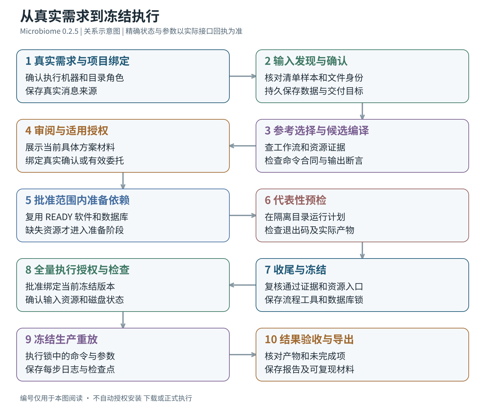

# Microbiome Agent 0.2.5 完整使用说明书

对应 **0.2.5 r10**，2026-10-19 文档更新。119 页、约 5 万汉字，含 8 张流程与思维导图。

- [完整在线阅读](Microbiome%20Agent%200.2.5%20完整说明书.md)
- [Word 下载](https://github.com/ylifc/microbiome-agent/releases/download/v0.2.5/microbiome-manual-0.2.5.docx)
- [手册资料 ZIP 下载](https://github.com/ylifc/microbiome-agent/releases/download/v0.2.5/microbiome-manual-0.2.5.zip)：解压后打开 index.html 离线阅读。
- [阅读说明](阅读说明.md) · [文件清单与摘要](reference/manual-manifest.json)

## 分章阅读

1. [架构、版本范围与八张流程图](chapters/01_overview.md)
2. [安装、升级、回退与宿主适配](chapters/02_install_adapt.md)
3. [具体操作、权限、后台任务与故障恢复](chapters/03_usage_operations.md)
4. [软件、数据库与分析方法](chapters/04_methods_resources.md) · [107 个软件与 33 个数据库完整附录](reference/catalog-appendix.md)
5. [维护开发、接口、验证与打包](chapters/05_developer_reference.md)

## 流程图

[全部 8 张图与 Mermaid 编辑源文件](diagrams/)。GitHub 在线阅读使用 Markdown；index.html 供下载后离线打开。

正文中的初始 ZIP 摘要是历史验收基线。当前安装包身份以 [现行发布清单](../release-manifest.json) 与 Release 的 .sha256 文件为准；此次仅补充文档，已验收的引擎 bundle 保持不变。
